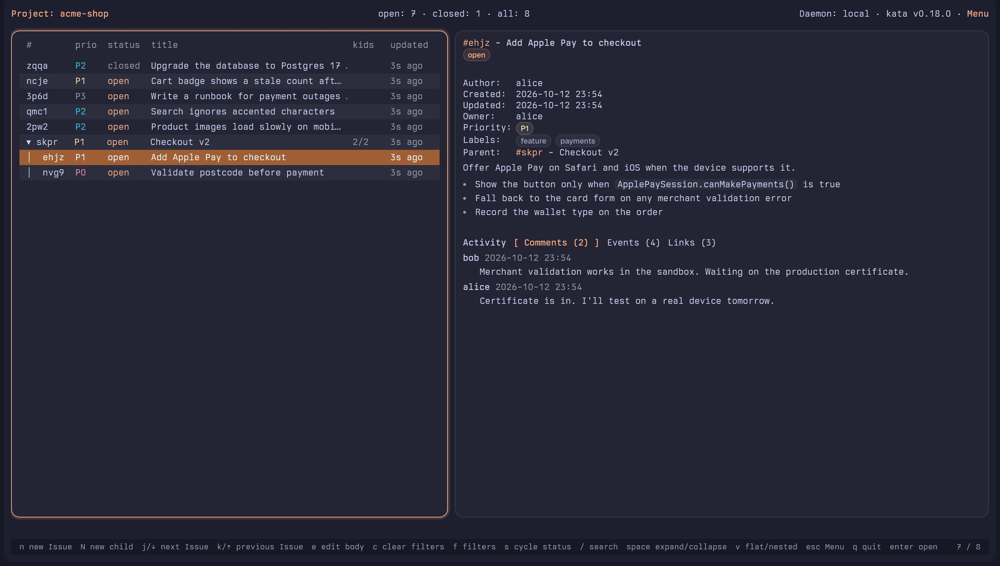
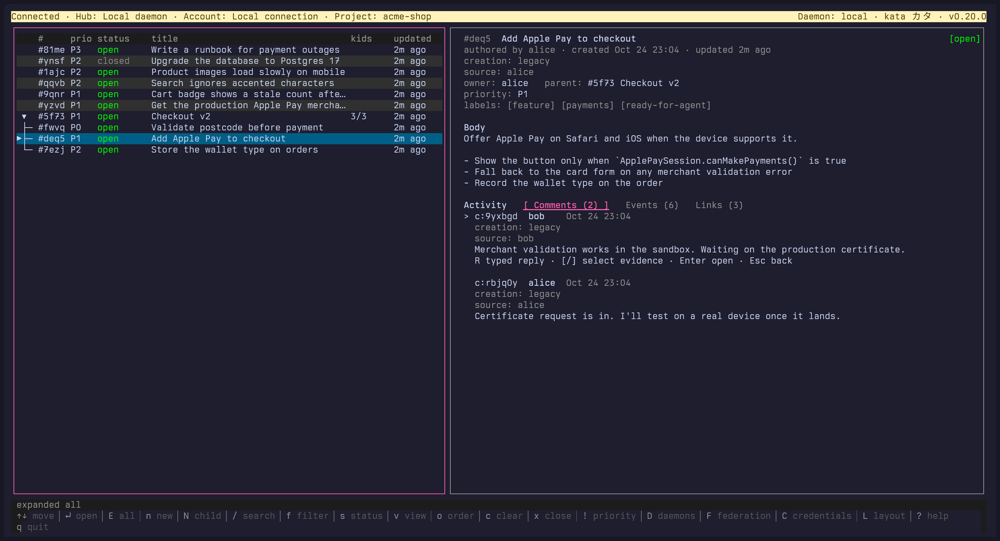
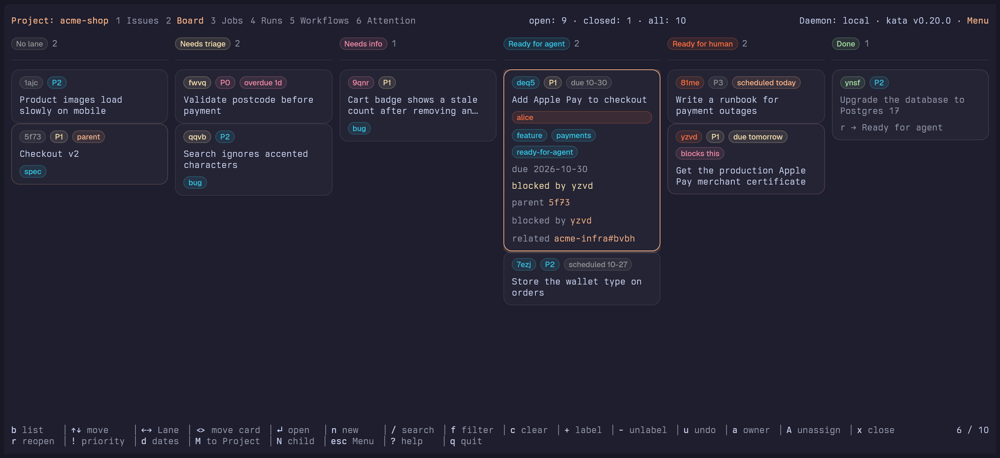
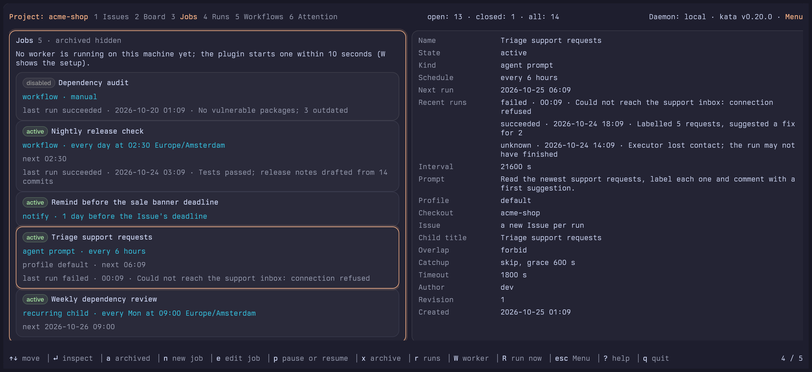
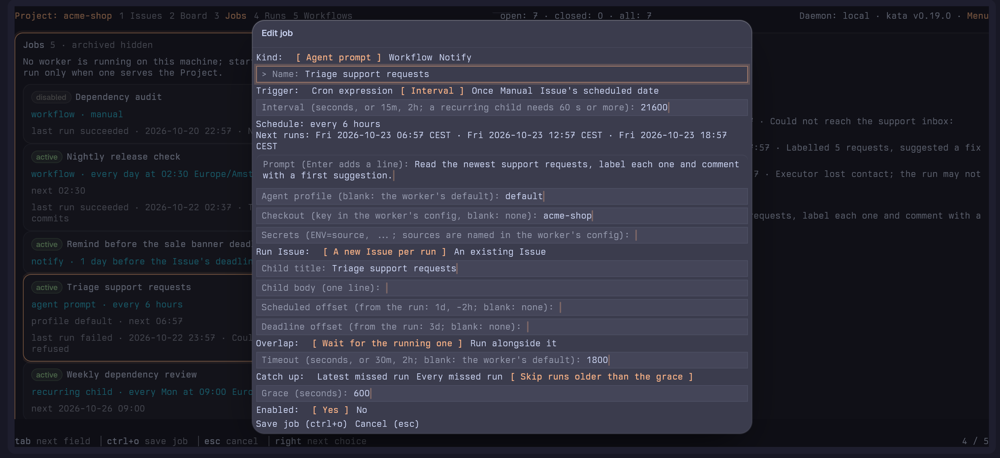
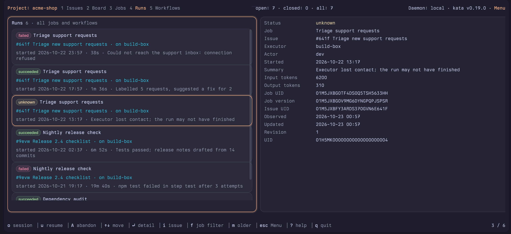
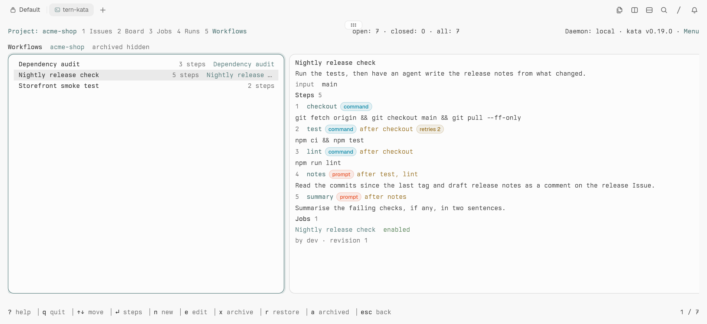
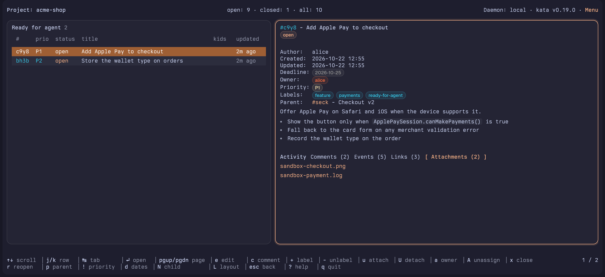
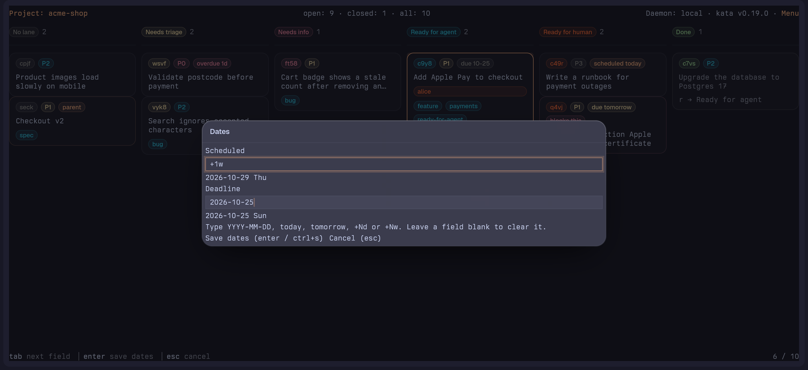

# tern-kata

Browse and edit [kata](https://katatracker.com/) Issues in a native [Tern](https://docs.stencil.so/tern/) Pane.

kata ([source](https://github.com/kenn-io/kata)) is an issue tracker built for coding agents and the people steering them. Agents create, claim, relate and close Issues from its CLI, and people follow the same work in its terminal UI, `kata tui`. By default Issues live in a local SQLite database rather than in your repo, and no hosted service is needed. tern-kata shows that work in a Tern Pane drawn with Tern's own widgets instead of terminal text.

The same example Project in tern-kata (top) and in `kata tui` (bottom), both running in Tern:





In tern-kata, Issue bodies render as Markdown, priorities and labels show as chips, and rows, tabs and links respond to mouse clicks.

## Features

**Issue list and detail.** A Project's Issues nested under their parents, with priority, status, child counts and age, beside the Issue detail with its Markdown body, properties and Activity tabs. Changes made anywhere, by you or an agent, show up live. Collections (Inbox, Today, Upcoming, Deadlines, All Open, Logbook and every Project), search and filters, and editing from the Pane are in [Pages and the Board](docs/guide/pages-and-board.md).

**Credentials.** `C` opens the Credentials Page, a Lettered Page (also in the Menu) that lists the daemon's API tokens read only, refreshes every 30 seconds and returns with esc or backspace; see [Pages and the Board](docs/guide/pages-and-board.md#lettered-pages).

**Board.** `2` or `b` shows a Project's Issues as cards in Lanes, one per triage label. `<` and `>` move a card by swapping its label in kata, and a selected card tags its related cards; following one of another Project switches the Pane to that Project and Esc comes back. See [Pages and the Board](docs/guide/pages-and-board.md).



**Jobs and the Job card.** `3` lists a Project's Cron jobs with their state, schedule in words and next run. The Job card makes and edits every kind of job. See [Jobs](docs/guide/jobs.md).





**Runs.** `4` lists a Project's runs newest first, with held runs, steps and output from this machine's worker. See [Runs](docs/guide/runs.md).



**Workflows.** `5` lists a Project's kata workflows, their steps and the jobs that run them, and edits them as JSON. See [Workflows](docs/guide/workflows.md).



**The worker.** `tern-kata worker` runs kata's agent prompt jobs and workflows through omp and your shell on your machine and records every run in kata. The plugin starts and supervises it once a `worker.toml` exists. Set it up from the Pane with `W` on the Jobs Page, which opens the Worker card (set up, serve the Project, edit `worker.toml`, restart or stop the worker, turn supervision off and on; the trust choice comes first), or from a shell with `tern-kata worker init` (optional `--executor`, `--actor`, `--command`, `--model`, `--thinking`), `worker add`, `worker edit` and `worker stop [--now]`. Read the trust note first. See [The worker](docs/guide/worker.md).

**Attachments.** `u` attaches a screenshot, log or any other file to an Issue; agents find it through the Issue's kata metadata. See [Attachments](docs/guide/attachments.md).



**Recurring Issues.** `O` opens the Recurrence card and `tern-kata recur` does the same from a shell. See [Recurring Issues](docs/guide/recur.md).

**Dates card.** `d` sets an Issue's scheduled date and deadline, typed as a date, `today`, `tomorrow`, `+3d` or `+1w`. See [Dates](docs/guide/dates.md).



**kata links.** Links from agents' chat replies open the Issue in tern-kata. See [Agents](docs/guide/agents.md).

## Requirements

- kata v0.19.0 or newer.
- A Tern that supports the Surface Protocol.
- For the worker: [omp](https://github.com/can1357/oh-my-pi) on `PATH`. On Windows also [Git for Windows](https://gitforwindows.org/), whose `sh` runs workflow command steps. The Pane itself needs no Git Bash.

## Install with an agent

In a Pane on the session host, give your coding agent this prompt:

```text
Install tern-kata by following the "Install with an agent" section of https://raw.githubusercontent.com/Dangerboi/tern-kata/main/README.md
```

Agents: follow these steps only when the user has asked you to install tern-kata.

1. Check that `kata` is on `PATH`. If it isn't, stop and tell the user that tern-kata requires kata, which they install themselves: https://katatracker.com/.
2. Run the install one-liner from [Install](#install) step 1 for this machine's OS.
3. Run `tern-kata --version`. If it isn't found, pass on the `PATH` instructions the install script printed.
4. If the script reported that `tern` is not on `PATH`, tell the user to run `tern plugin install github.com/Dangerboi/tern-kata` on the machine that shows the Tern window. Without it, the Open kata command, `F9` and kata links don't work.
5. Ask the user whether to add the rule below to your global rules file, the one you load in every repo. The links only work when your chat is shown in Tern with the window plugin installed. Copy the rule block exactly, and skip it if the file already contains it. For OMP the file is `~/.omp/agent/RULES.md`.

   ```markdown
   In a repo with a `.kata.toml`, write kata ticket references in chat replies as `[<id>](https://kata.invalid/<project>/<id>)`, with `<project>` the name in `.kata.toml`. The tern-kata window plugin opens them in tern-kata; Tern draws `kata://` links in chat as plain text. Everywhere else (files, commit messages, kata Issue text) write the bare id; those links only work inside Tern.
   ```

6. Ask the user whether to install the agent skills (`kata`, and `tern-kata` for attachments, recurrence and the worker). Run `npx skills add Dangerboi/tern-kata -g` only if they agree; it needs Node.js, and with only Bun installed `bunx` replaces `npx`.

## Install

1. On the **session host** (the machine whose shells run in your Panes), install kata, then tern-kata. On Linux or macOS:

   ```sh
   curl -fsSL https://raw.githubusercontent.com/Dangerboi/tern-kata/main/install.sh | sh
   ```

   On Windows, in PowerShell:

   ```powershell
   irm https://raw.githubusercontent.com/Dangerboi/tern-kata/main/install.ps1 | iex
   ```

   They install the latest release to `~/.local/bin` (`%LOCALAPPDATA%\Programs\tern-kata` on Windows, added to your user `PATH`), verify its checksum, and also install the window plugin when `tern` is on `PATH`. Run in a terminal with `npx` available, they then offer to install the [agent skills](docs/guide/agents.md#agent-skills). Once the plugin is installed, the **Install tern-kata** palette command runs the same one-liner in a new Pane. `tern-kata --help` lists the flags.

   Alternatively, with Go 1.27+:

   ```sh
   CGO_ENABLED=0 go install github.com/Dangerboi/tern-kata/cmd/tern-kata@latest
   ```

   Go puts the binary in `~/go/bin` (`%USERPROFILE%\go\bin` on Windows); it must be on your shell's `PATH`.

2. On the **machine showing the Tern window**, install the window plugin:

   ```sh
   tern plugin install github.com/Dangerboi/tern-kata
   ```

The window machine needs only the window plugin; kata and tern-kata run on the session host. For example, with a Tern window on Windows 11 and Panes on an Ubuntu host, install the window plugin on Windows and kata and tern-kata on Ubuntu. If the session host and the window are the same machine, do both steps on it.

In a directory bound to a kata Project, `tern-kata` opens that Project's Issues; anywhere else it opens Inbox. [How it works](docs/guide/pages-and-board.md#how-it-works) explains the three parts of the plugin.

## Guides

The [guide index](docs/guide/README.md) lists every page:

- [Pages and the Board](docs/guide/pages-and-board.md), [Jobs](docs/guide/jobs.md), [Runs](docs/guide/runs.md), [Workflows](docs/guide/workflows.md)
- [The worker](docs/guide/worker.md) and its [reference](docs/guide/worker-reference.md)
- [Attachments](docs/guide/attachments.md), [Recurring Issues](docs/guide/recur.md), [Dates](docs/guide/dates.md)
- [Agents](docs/guide/agents.md), [Compared with `kata tui`](docs/guide/kata-tui.md), [FAQ](docs/guide/faq.md), [Development](docs/guide/development.md)

## Credits

- [herdr-kata](https://github.com/salmonumbrella/herdr-kata) inspired the worker. [ADRs 0002 to 0012](docs/adr) record which of its adapter decisions tern-kata adopted, adapted or rejected.
- [kata](https://github.com/kenn-io/kata) is the issue tracker, [Tern](https://docs.stencil.so/tern/) hosts the Pane, and [omp](https://github.com/can1357/oh-my-pi) runs the agents.

## License

MIT. See [LICENSE](LICENSE).
