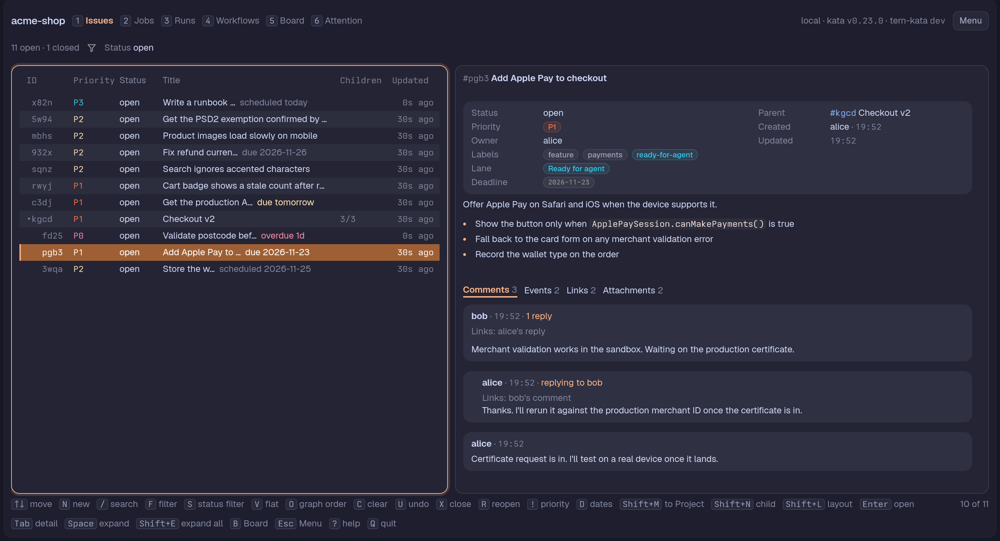
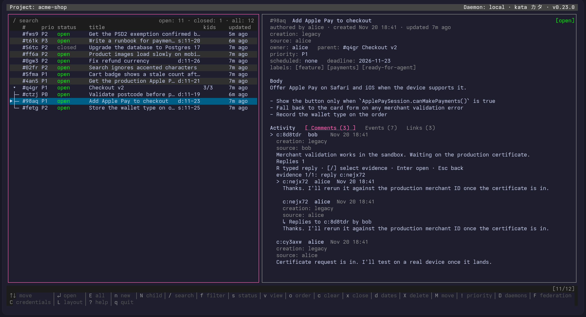
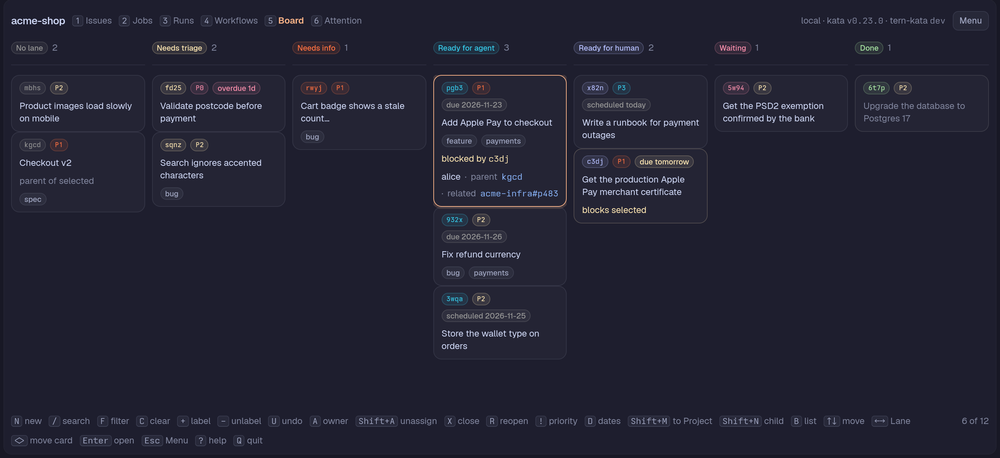
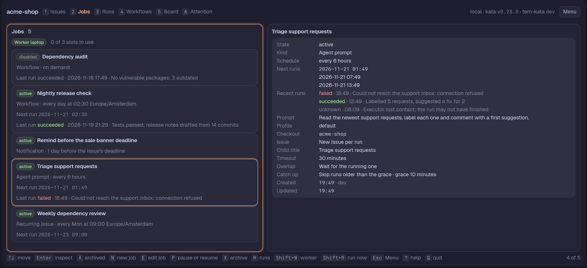
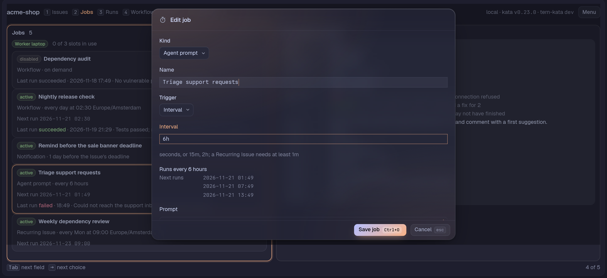
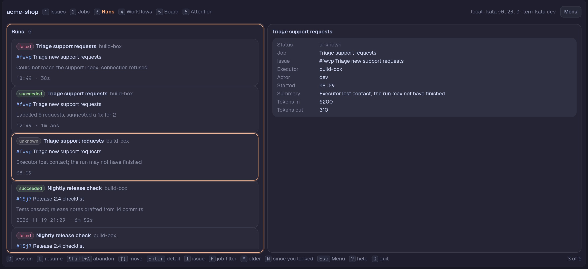
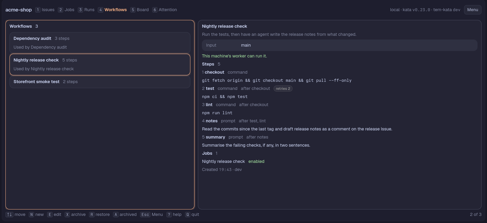
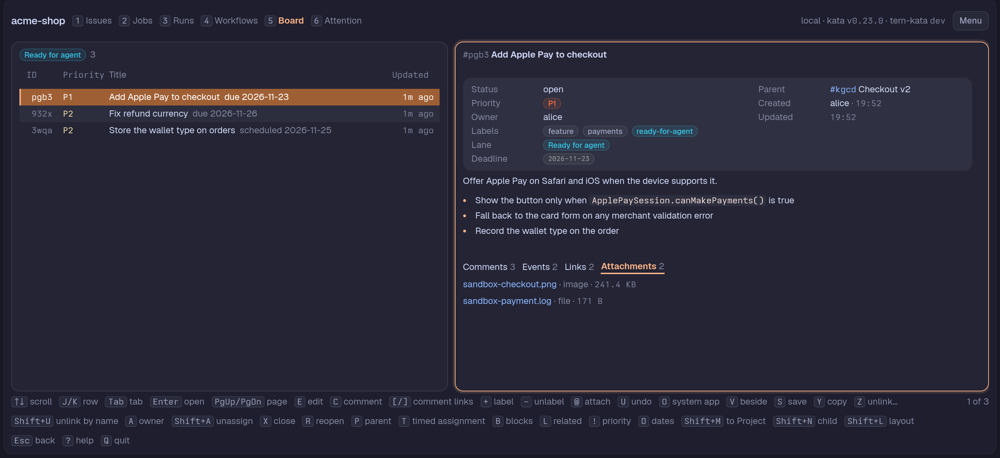
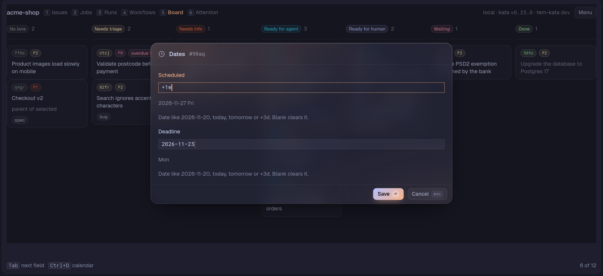

# tern-kata

Browse and edit [kata](https://katatracker.com/) Issues in a native [Tern](https://docs.stencil.so/tern/) Pane.

kata ([source](https://github.com/kenn-io/kata)) is an issue tracker built for coding agents and the people steering them. Agents create, claim, relate and close Issues from its CLI, and people follow the same work in its terminal UI, `kata tui`. By default Issues live in a local SQLite database rather than in your repo, and no hosted service is needed. tern-kata shows that work in a Tern Pane drawn with Tern's own widgets instead of terminal text.


https://github.com/user-attachments/assets/282d75ee-ccbd-495b-bb78-6eb0565aa3b4


The same example Project in tern-kata (top) and in `kata tui` (bottom), both running in Tern:





In tern-kata, Issue bodies render as Markdown, priorities and labels show as chips, and rows, tabs and links respond to mouse clicks.

## Features

**Issue list and detail.** A Project's Issues nested under their parents, with priority, status, child counts and age, beside the Issue detail with its Markdown body, properties and tabs (Comments, Events, Links, Attachments). Changes made anywhere, by you or an agent, show up live. Collections (Inbox, Today, Upcoming, Deadlines, All Open, Logbook and every Project), saved views (a Collection with filters, kept by name in the Menu's Views level), search and filters, and editing from the Pane are in [Pages and the Board](docs/guide/pages-and-board.md).

**Search by meaning.** In the search box, `Ctrl+T` switches from by words to by meaning: inside one Project, `Enter` runs kata's own ranked search with the Status and Label filters and lists the best 50 Issues best first. When kata has no embeddings, the search line says it searched by words, and where the connected daemon would take a turn-on it offers Turn on… (`Ctrl+O`), which opens the card below. The Config Page's Search by meaning row shows the setup for the kata daemon the Pane is connected to, and `S` or `Enter` on it opens a card that asks before anything starts (kata uses your Ollama, or downloads about N MB to the daemon's machine), turns it on through kata's API on `Y`, and follows the download and the indexing with their progress; search stays by words until the kata daemon restarts. See [Pages and the Board](docs/guide/pages-and-board.md#turning-search-by-meaning-on).

**Credentials.** `Shift+C` opens the Credentials Page, a Lettered Page (also in the Menu) that lists the daemon's API tokens, refreshes every 30 seconds and returns with `Esc` or `Backspace`; `N` creates a token into a new owner-only file and `X` revokes one after asking. See [Pages and the Board](docs/guide/pages-and-board.md#lettered-pages).

**Daemons.** `Shift+D` opens the Daemons Page, a Lettered Page (also in the Menu) that lists the daemons kata's `config.toml` names in a table (name, endpoint, auth, state); Enter switches this Pane to one, starting a stopped local daemon first as kata tui does, and nothing is written to disk. The top bar names the current daemon and the account the daemon says you are; see [Pages and the Board](docs/guide/pages-and-board.md#lettered-pages).

**Config.** `Shift+K` opens the Config Page, a Lettered Page (also in the Menu) that lists tern-kata's config files (`lanes.toml`, `filters.toml`, `views.toml`, `seen.toml`, `worker.toml`, `agent.toml`), the Docbank row (what kata's `[docbank]` section sets up; `S` switches tern-kata 0.10's pinned setup to kata's local Docbank), the Search by meaning row (the status for the kata daemon the Pane is connected to; `Enter` or `S` opens the card that turns it on, and `R` restarts the daemon when the setup waits for it) and kata's own `config.toml`, each as a card with a status word (`ok`, `broken` or `not created`; the loader's own error when it does not load) and a one-line summary, and a path only for a file outside the config folder (the Search by meaning row has no path: it shows only the daemon's answer); `Esc` or `Backspace` returns.

**Federation.** `Shift+F` opens the Federation Page, a Lettered Page (also in the Menu) that lists this daemon's spoke federations with hub, actor, push, pending pushes and last sync, and the words insecure connection, quarantined, reset blocked and claim violations when they apply, shows a Project's detail on Enter, reads again with `R` leaves a federation with `X` (preview, hub revoke, result), and names a spoke with `Shift+N`. `B` browses the Projects of the daemon catalog's hubs, and `N` enrolls a Project in a hub's federation (choose a local Project, a hub and a hub Project, preview, a typed confirmation for adopting, result; a failure after the hub granted it keeps a recovery whose `Shift+R` shows the `kata federation join …` command); see [Pages and the Board](docs/guide/pages-and-board.md#lettered-pages).

**Board.** `5` or `B` shows a Project's Issues as cards in Lanes, one per triage label. `<` and `>` move a card by swapping its label in kata, and a selected card tags its related cards; following one of another Project switches the Pane to that Project and Esc comes back. See [Pages and the Board](docs/guide/pages-and-board.md).



**Jobs and the Job card.** `2` lists a Project's Cron jobs with their state, schedule in words and next run. The Job card makes and edits every kind of job. See [Jobs](docs/guide/jobs.md).





**Runs.** `3` lists a Project's runs newest first, with held runs, steps and output from this machine's worker. See [Runs](docs/guide/runs.md).



**Workflows.** `4` lists a Project's kata workflows, their steps and the jobs that run them, and edits them in a form. See [Workflows](docs/guide/workflows.md).



**Attention.** `6`, or `Shift+T` from any Page and the Menu, lists the requests kata holds for you, in every Project on the daemon, newest first: who asked, the message, and the comment a request asks you to answer. Enter opens the request's Issue, on the comment it names so `Shift+R` answers it, `C` clears it, and `M` sends a message to the omp agent that raised it, which reaches the agent at once. It reads the Inbox address `KATA_INBOX_USER`, else the actor the Pane writes as. See [Pages and the Board](docs/guide/pages-and-board.md#attention-page).

**The worker.** `tern-kata worker` runs kata's agent prompt jobs and workflows through omp and your shell on your machine and records every run in kata. The plugin starts and supervises it once a `worker.toml` exists. Set it up from the Pane with `Shift+W` on the Jobs Page, which opens the Worker card (set up, serve the Project, edit `worker.toml`, restart or stop the worker, turn supervision off and on; the trust choice comes first), or from a shell with `tern-kata worker init` (optional `--executor`, `--actor`, `--command`, `--model`, `--thinking`), `worker add`, `worker edit`, `worker upgrade` (lists the secrets and command steps an older `worker.toml`'s jobs use) and `worker stop [--now]`. Read the trust note first. See [The worker](docs/guide/worker.md).

**Attachments.** `@` uploads a screenshot, log or any other file to an Issue through kata, which keeps the bytes in [Docbank](https://github.com/kenn-io/docbank); `Enter` on one in the Attachments tab downloads it and opens it when it is an image, video, audio, PDF or text file, and agents use `kata docbank attachments`. `kata docbank setup` sets Docbank up on this machine, or points kata at one someone else runs; kata starts a local Docbank itself when it is needed. See [Attachments](docs/guide/attachments.md).



**Recurring Issues.** `Shift+O` opens the Recurrence card and `tern-kata recur` does the same from a shell. See [Recurring Issues](docs/guide/recur.md).

**Dates card.** `D` sets an Issue's scheduled date and deadline, typed as a date, `today`, `tomorrow`, `+3d` or `+1w`, or with a time in kata's date-time forms. See [Dates](docs/guide/dates.md).



**Moving an Issue.** `Shift+M` opens the Move card on the selected Issue: pick a Project from a filtered list, preview the move (kata checks it and changes nothing), then move it, guarded on the revision the card opened with. The Issue moves with its open descendants; `O` (Only this Issue) moves it alone. A toast names the Issue in its new Project, and its Open button opens it there. See [Moving an Issue](docs/guide/pages-and-board.md#moving-an-issue).

**Deleting and restoring an Issue.** `Shift+X` opens the Delete card on the selected Issue: type its `project#id` (or `DELETE project#id`, as in kata tui) to confirm, add a reason if you like (kept as a `Deleted: <reason>` comment on the Issue), and kata deletes it (soft: it keeps the Issue and its history). `U` right after restores it, and the Menu's "Restore a deleted Issue" brings back an earlier one by short id, `project#id` or ULID. See [Deleting and restoring an Issue](docs/guide/pages-and-board.md#deleting-and-restoring-an-issue).

**Agents on an Issue.** `W` on the selected Issue opens the Agent card: it lists the Issue's agents, and `S`, `T` and `G` start an interactive `omp` agent in a split, a tab or the background, in the Issue's checkout. The **Agent badge** on an Issue's rows, cards and detail shows whether its agent is working, waiting for you, idle or exited. See [Agents](docs/guide/agents.md#agents-on-an-issue).

**kata links.** Links from agents' chat replies open the Issue in tern-kata. See [Agents](docs/guide/agents.md).

**kata tui's keys.** `U` undoes the last change the Pane made (up to 20), `Q` asks "Quit tern-kata? y/n" first (kata's `[tui] confirm_quit = false` turns that off), `B` and `L` add a Blocking or related link, `T` gives an Issue to you for a set time, `]` and `[` step through a comment's links, `O` switches the nested list's sibling order, `!` then `0`-`4` sets the priority at once, and `Ctrl+J`/`Ctrl+K`, `Backspace` and `Ctrl+Alt+<`/`Ctrl+Alt+>` work as in kata tui. See [Compared with `kata tui`](docs/guide/kata-tui.md).

## Requirements

- kata v0.21.0 or newer. kata v0.21 upgrades its database to schema 43 on first start, and older kata binaries cannot open it afterwards; kata keeps a backup from before the upgrade, and PostgreSQL stores need `kata storage postgres migrate` with the daemon stopped.
- For attachments: kata v0.23.0 or newer and Docbank 0.16.0 or newer to set them up with `kata docbank setup`.
- To turn search by meaning on from the Pane: a kata v0.23.0 daemon or newer.
- Tern 0.9.9 or newer.
- For the worker: [omp](https://github.com/can1357/oh-my-pi) on `PATH`. On Windows also [Git for Windows](https://gitforwindows.org/), whose `sh` runs workflow command steps. The Pane itself needs no Git Bash.

## Install with an agent

In a Pane on the session host, give your coding agent this prompt:

```text
Install tern-kata by following the "Install with an agent" section of https://raw.githubusercontent.com/Dangerboi/tern-kata/main/README.md
```

Agents: follow these steps only when the user has asked you to install tern-kata.

1. Check that `kata` is on `PATH`. If it isn't, stop and tell the user that tern-kata requires kata, which they install themselves: https://katatracker.com/.
2. Run the install one-liner from [Install](#install) step 1 for this machine's OS.
3. Run `tern-kata --version`. If it isn't found, pass on the `PATH` instructions the install script printed.
4. If the script reported that `tern` is not on `PATH`, tell the user to run the plugin-only one-liner from [Install](#install) step 2 for the OS of the machine that shows the Tern window. Without the plugin, the Open tern-kata command, `F9` and kata links don't work.
5. Ask the user whether to add the rule below to your global rules file, the one you load in every repo. The links only work when your chat is shown in Tern with the window plugin installed. Copy the rule block exactly, and skip it if the file already contains it. For OMP the file is `~/.omp/agent/RULES.md`.

   ```markdown
   In a repo with a `.kata.toml`, write kata ticket references in chat replies as `[<id>](https://kata.invalid/<project>/<id>)`, with `<project>` the name in `.kata.toml`. The tern-kata window plugin opens them in tern-kata; Tern draws `kata://` links in chat as plain text. Everywhere else (files, commit messages, kata Issue text) write the bare id; those links only work inside Tern.
   ```

6. Ask the user whether to install the agent skills (`kata`, and `tern-kata` for recurring Issues, saved views and the worker). Run `npx skills add Dangerboi/tern-kata -g` only if they agree; it needs Node.js, and with only Bun installed `bunx` replaces `npx`.

## Install

1. On the **session host** (the machine whose shells run in your Panes), install kata, then tern-kata. On Linux or macOS:

   ```sh
   curl -fsSL https://raw.githubusercontent.com/Dangerboi/tern-kata/main/install.sh | sh
   ```

   On Windows, in PowerShell:

   ```powershell
   irm https://raw.githubusercontent.com/Dangerboi/tern-kata/main/install.ps1 | iex
   ```

   They install the latest release to `~/.local/bin` (`%LOCALAPPDATA%\Programs\tern-kata` on Windows, added to your user `PATH`), verify its checksum, and also install the window plugin from the same release when `tern` is on `PATH` (a plugin you linked with `tern plugin link` is left as it is). The new binary then checks this machine as `tern-kata update` does and prints a warning when the kata daemon is older than tern-kata needs or can't be reached, or `worker.toml` won't load; the install goes ahead either way. Run in a terminal with `npx` (or `bunx`) available, they then offer to install the [agent skills](docs/guide/agents.md#agent-skills). Once the plugin is installed, the **Install tern-kata** palette command runs the same one-liner in a new Pane. `tern-kata --help` lists every subcommand and flag, and `tern-kata completion bash|zsh|fish` prints a completion script (`source <(tern-kata completion bash)`, or `tern-kata completion fish | source`).

   On Windows, the kata Pane, **Update tern-kata** and the palette's **Install tern-kata** Windows choice start PowerShell with `-NoProfile`, so a new kata Pane does not wait for your PowerShell profile. Your own shells and other Panes still load it.

   Alternatively, with Go 1.27+:

   ```sh
   CGO_ENABLED=0 go install github.com/Dangerboi/tern-kata/cmd/tern-kata@latest
   ```

   Go puts the binary in `~/go/bin` (`%USERPROFILE%\go\bin` on Windows); it must be on your shell's `PATH`.

2. On the **machine showing the Tern window**, install the window plugin from the release (needs `tern` on `PATH`; no binary, `PATH` or skills step). On Linux or macOS:

   ```sh
   curl -fsSL https://raw.githubusercontent.com/Dangerboi/tern-kata/main/install.sh | TERN_KATA_PLUGIN_ONLY=1 sh
   ```

   On Windows, in PowerShell:

   ```powershell
   $env:TERN_KATA_PLUGIN_ONLY = '1'; irm https://raw.githubusercontent.com/Dangerboi/tern-kata/main/install.ps1 | iex
   ```

   Run the same line again to update the plugin. It fails when `tern` is not on `PATH`, and leaves a plugin you linked with `tern plugin link` as it is, saying so.

The window machine needs only the window plugin; kata and tern-kata run on the session host. For example, with a Tern window on Windows 11 and Panes on an Ubuntu host, install the window plugin on Windows and kata and tern-kata on Ubuntu. If the session host and the window are the same machine, do both steps on it.

In a directory bound to a kata Project, `tern-kata` opens that Project's Issues; anywhere else it opens Inbox. [How it works](docs/guide/pages-and-board.md#how-it-works) explains the three parts of the plugin.

## Updating

Run `tern-kata update` on the session host to bring it to the latest release. It downloads the archive for this OS, checks its SHA-256 against the release's `checksums.txt`, and replaces the running binary; on Windows that works while Panes and the Worker run. Before the swap the new binary checks this machine: it refuses a kata daemon older than its minimum or a `worker.toml` it can't load (`--force` swaps anyway), and warns when the daemon can't be reached or is older than kata v0.23.0, which attachments and search by meaning need. It says "up to date" when you already have the latest release, and it never downgrades. After the swap it also brings this machine's installed copy of the window plugin to the same release (an up-to-date run still does that, leaving a linked copy as it is), and a Worker that the plugin restarts after a stop gets an idle stop, so it comes back as the new binary once its runs finish. Open Panes keep the old version until you reopen them, so it asks you to. `tern-kata update --pause` waits for Enter after a success, so a Pane shows the result before it closes. In a Tern Pane it shows Tern's progress bar from the start of the download to the end of the swap, filling with the downloaded bytes while the release's size is known.

Only a release build updates itself. A binary built with `go install` gets the command to run again (`go install github.com/Dangerboi/tern-kata/cmd/tern-kata@latest`), and one built from source says to rebuild. To bring the agent skills along, run `npx skills update -g` (or `bunx skills update -g`). Setting `TERN_KATA_BASE_URL` points update, and the install scripts, at another folder holding a release's files (for a rollback, a mirror or a test).

### Update tern-kata

The **Update tern-kata** palette command runs `tern-kata update --pause` in a new Pane on the focused Pane's machine, so the session host is updated first. Press Enter in the Pane to close it after a success; a failure leaves the Pane open so you can read why, and nothing more happens. When that machine is not the one showing the Tern window and the update succeeded, the command then reinstalls the window plugin on the window's machine without a terminal, from the same release's tag, and toasts "Updated the tern-kata plugin to vX." once the new plugin has loaded (or the install script's last error line if it failed). A window plugin already at that release is left alone, with the toast "The tern-kata plugin vX is up to date." When the session host is the window's own machine, `tern-kata update` already updated the plugin. On a device that can't run programs (iOS), the toast says the session host was updated but this device's plugin wasn't. `TERN_KATA_BASE_URL`, when set in the window's environment, is used for the plugin's files and for reading `version.txt`.

### Release check

The window plugin looks for a new release every hour. At window start, and every hour while the window stays open, it reads `version.txt` from the latest GitHub release, but only when the last check is an hour old (the time is kept in the plugin's store, so a second window or a restart doesn't ask again). When that release is newer than the plugin, a toast says "tern-kata vX is available (this window has vY). Run Update tern-kata." once per version on this machine, so a day with several releases may toast each. A failed request is silent and counts as a check. Nothing but that one small file is fetched, and nothing is installed by the check.

Turn it off with the **Toggle update checks** palette command, which toasts the new state, or by setting `TERN_KATA_NO_UPDATE_CHECK` to any non-empty value in the window's environment: the variable keeps checks off on that machine whatever the toggle says. A plugin linked with `tern plugin link` never checks, since that is a development machine; the toggle command says so. `TERN_KATA_BASE_URL` points the check at another folder holding `version.txt`, such as a local `dist/`.

### Version notices in the Pane

The Pane's top bar shows a muted facts line at the right: `local · kata v0.23.0 · tern-kata v0.15.0` (the Daemon's name first when it has one, `· as <account>` after the kata version; the versions are in the mono face, and a Pane narrower than 80 columns leaves the versions out and tells only a named or remote Daemon). Every minute the Pane also checks its own machine, the session host. While one of these holds, a warning chip sits after the title: "↑ kata v0.24.0" for one notice (the subject is `kata v0.24.0`, `tern-kata v0.16.0` or `kata daemon`), "↑ 2 updates" for several. There is no toast. The Menu lists each notice under Updates: "kata v0.24.0 is available" with `kata update`, "tern-kata v0.16.0 is available" with "Reopen this Pane", and the daemon's with "Restart the daemon…". Picking a row says "kata v0.24.0 is available. Run kata update to install it." (the daemon's asks to restart):

- **tern-kata vX is available**: the binary the Pane started from was replaced (`tern-kata update`, or a build copied over it). Reopen the Pane to run the new one. A build without a stamped version, such as one from `go install`, never claims this.
- **kata daemon vX is older than kata vY**: `kata update` installed a newer kata but the local daemon still runs the old one. The Menu entry restarts the daemon after asking, as setting up search by meaning does; a remote daemon is restarted on its own machine.
- **kata vX is available**: a newer kata release exists; run `kata update`. The Pane asks `kata update --check` at most once an hour per machine (the time is kept in `kata-release-check.json` in tern-kata's config folder, so other Panes and restarts don't ask again), and a failed check is silent and counts. `TERN_KATA_NO_UPDATE_CHECK` turns this check off too. The Pane never checks for tern-kata releases; that is the window plugin's release check above.

### What's new

The first tern-kata Pane of a new version on a machine opens that version's release notes in a split beside it, however the version got there (`tern-kata update`, the palette command, the install script or a copied binary), and the focus stays in the Pane. The notes cover every version since the one shown last, newest first, under "tern-kata vOLD → vNEW"; after a jump over several versions every **Breaking** change is listed first. Each version is shown once per machine: the last one shown is kept in `whats-new.json` in tern-kata's state folder, and other Panes of that version open nothing. A first install shows only its own version, and a development build, which has no release notes, shows nothing.

## Troubleshooting

If the Pane cannot find a local kata daemon whose storage is PostgreSQL, check the storage DSN: when it uses routing options (the `host`, `port`, `dbname`, `service` or `servicefile` query options, or `PG*` environment variables filling in missing parts), discovery fails because the lean kata client cannot resolve them. Set `KATA_SERVER` to the address `kata daemon locate` prints.

## Guides

The [guide index](docs/guide/README.md) lists every page:

- [Pages and the Board](docs/guide/pages-and-board.md), [Jobs](docs/guide/jobs.md), [Runs](docs/guide/runs.md), [Workflows](docs/guide/workflows.md)
- [The worker](docs/guide/worker.md) and its [reference](docs/guide/worker-reference.md)
- [Attachments](docs/guide/attachments.md), [Recurring Issues](docs/guide/recur.md), [Views from a shell](docs/guide/views.md), [Dates](docs/guide/dates.md)
- [Agents](docs/guide/agents.md), [Compared with `kata tui`](docs/guide/kata-tui.md), [FAQ](docs/guide/faq.md), [Development](docs/guide/development.md)

## Credits

- [herdr-kata](https://github.com/salmonumbrella/herdr-kata) inspired the worker. [ADRs 0002 to 0012](docs/adr) record which of its adapter decisions tern-kata adopted, adapted or rejected.
- [kata](https://github.com/kenn-io/kata) is the issue tracker, [Docbank](https://github.com/kenn-io/docbank) keeps its attachments, [Tern](https://docs.stencil.so/tern/) hosts the Pane, and [omp](https://github.com/can1357/oh-my-pi) runs the agents.

## License

MIT. See [LICENSE](LICENSE).
