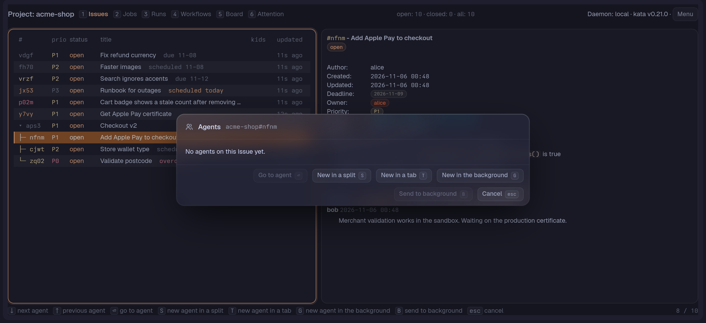

# Agents

Three things help coding agents work with tern-kata: the Agent card, which starts an agent on an Issue and keeps track of it (with the `agent.toml` that configures it, Background agents and Attention requests), a rule that makes ticket references clickable, and two agent skills.

## Agents on an Issue

### The Agent card and starting agents

`w` on the selected Issue (list, Board, Lane view or Issue detail) opens the Agent card, with or without agents. It lists the Issue's agents with state, start time and where each is (split, tab, background or open). Under the list it shows what the selected omp agent is doing: its model, the number of tool calls so far, the tool it is running now, its cost so far and the first line of its last message. The model, calls, tool and cost come from the end of the agent's omp session file (the last 1 MiB; on a longer session the count reads "at least" and the cost starts with `~`), read when the card opens and every 2 seconds while it stays open. An agent that is not omp, or whose session file is not there yet, shows the reason in muted words. `enter` goes to the selected one, `b` sends it to the background, `m` [messages](#messages-to-an-agent) it, `r` sends it a [quick reply](#quick-replies), `i` interrupts it, `x` stops it, `esc` cancels.



`s` starts a new interactive `omp` in a split right of the kata Pane, `t` in a new tab right of the kata Pane's tab (in that Pane's Tern session, with the plugin's window half loaded; otherwise the tab opens last), `g` in the background. Each starts in the Issue's checkout: the Binding's workspace, else the Project's `checkout` in `agent.toml`, else the first checkout `worker.toml` lists for it, else a Notice says to add one.

A closed Issue says "This Issue is closed; reopen it first (r)." and opens no card.

### Interrupting and stopping an agent

`i` interrupts the selected agent's current turn, as Escape does in its block (omp keeps a turn running on ctrl+c): the Pane types Escape into the block with `tern send`, the block and the conversation stay, and the badge reads idle once the turn ends. Use it when an agent is on the wrong path, then message the correction: the card stays open, so `m` or `x` can follow at once. It is off, with the reason in a tooltip and a Notice, for an agent that is not omp.

`x` asks "Stop <agent> on <ref>? Its block closes and any unsaved work in it is dropped." and `y` stops it: `tern close` on its block, then its entry and prompt file go. It works on an agent in a split, a tab or the background, and on one another kata Pane on this host started; the Pane reads `agents.json` again just before it closes. The Issue gets what an agent that exits gets, while it is open: when the Pane started the agent, the request "agent exited without closing <ref>"; and from the Pane that stopped it, `work.attention` set to `needs-human` with the reason in `work.attention_msg`, and `ready-for-agent` swapped for `ready-for-human` when the Issue has it. A write that fails shows a Notice. A close that fails shows Tern's words in a Notice and leaves the entry. Both actions are off for an agent that has exited.

The agent is told which Issue to work on and how to leave a record: claim it for 24 hours (renewing the claim when it already owns the Issue), comment what it did and how it checked, finish or drop its todo children before closing, close it with evidence only when done and verified, and ask you when it needs a decision. If it stops without closing, it comments why, sets `work.attention` to `needs-human` with the reason in `work.attention_msg`, and labels the Issue ready-for-human in place of ready-for-agent.

### agent.toml

`agent.toml` sets the actor, command and agent name, for every Project or for one. You write it by hand in tern-kata's config folder beside `lanes.toml`. It is read on every start.

```toml
actor = "me-agent"        # optional; without one the agent writes to kata as whoever kata resolves in its shell (KATA_AUTHOR as inherited)
name = "builder"          # optional; the teammate its Attention requests carry, default the command's program name
command = ["omp"]         # optional argv; the Pane appends @<prompt file>, so it must accept omp's @file message
forward_comments = true   # optional, default false; tell the agent of a person's comment on its Issue (see Comments from people)
[projects.tern-kata]      # optional, by Project name; overrides the values above
actor = "..."
name = "..."
command = ["omp", "--model", "opus"]
forward_comments = false   # a boolean; overrides the top-level value for this Project
checkout = "/home/me/Code/tern-kata"   # an absolute directory
```

An unknown key, a `forward_comments` that is not a boolean, a relative `checkout` or an empty `command` refuses the start and shows the error. The Pane remembers the agents it started in `agents.json` in its state folder and forgets the ones whose block has closed.

### How the agent runs

The agent always runs through `tern-kata agent [--as <actor>] [--address-prefix <actor>/<name> [--forward-comments]] --ref <qualified ref> --`. For a daemon other than the default one, the Pane also passes the route flags it needs to reach that daemon: `--home`, `--db`, `--schema`, `--dsn-file`, `--env-file`, `--daemon`, `--server`, `--token-file`, `--auth-file`, `--allow-insecure` and `--trust-private-network`, each only when it has a value. No flag holds a secret: a token or DSN goes through a private file the wrapper reads and deletes. The wrapper:

- sets `KATA_REF` to the Issue, so kata-plugin's todo plan hangs under it, and drops an inherited `KATA_REF`, `KATA_INBOX_USER` and `KATA_TEAMMATE` (your own inbox and teammate name are not the agent's);
- sets `KATA_AUTHOR` when there is an `actor`, and otherwise leaves `KATA_AUTHOR` as inherited;
- for an omp agent (the Pane passes `--address-prefix`), sets `TERN_KATA_FORWARD_COMMENTS=1` when the Pane passed `--forward-comments` and `KATA_TEAMMATE` is set, `KATA_INBOX_USER` to the agent's own address, `<your actor>/<agent.toml name>-<block id>` (the block id from `TERN_PANE`), `KATA_TEAMMATE` to `<agent.toml name>-<block id>` (so the agent's comments and requests carry its own teammate name; left unset when kata would refuse the name, for instance over 64 bytes), and `KATA_OMP_LIVE_INBOX=0`, and omp loads tern-kata's extension with `-e`, or with `--trusted-extension` when the agent's args hold one (see [Messages to an agent](#messages-to-an-agent)).

`tern-kata` must be on the `PATH` of Tern's shell on that machine, and must be this version: an older one refuses `--ref` or `--address-prefix` and the agent exits at once.

**The Pane's daemon.** A Pane on the default daemon starts agents as before. When the Pane's daemon is not what Tern's shell would pick (the Pane has `KATA_HOME` or `KATA_SERVER`, or you switched on the Daemons Page), the wrapper first drops the block's own `KATA_SERVER`, `KATA_AUTH_TOKEN`, `KATA_AUTH_TOKEN_FILE`, `KATA_ALLOW_INSECURE`, `KATA_TRUST_PRIVATE_NETWORK`, `KATA_DSN`, `KATA_DB` and `KATA_POSTGRES_SCHEMA`. It then sets `KATA_HOME` (made absolute), `KATA_SERVER`, `KATA_ALLOW_INSECURE`, `KATA_TRUST_PRIVATE_NETWORK`, `KATA_AUTH_TOKEN` and `KATA_AUTH_TOKEN_FILE` as the Pane has them. That is how the agent's `kata` commands reach the daemon `KATA_REF` names: its Issue is claimed, commented on and closed there, and kata-plugin registers nothing on Tern's default daemon.

- The Pane's `KATA_DB`, `KATA_POSTGRES_SCHEMA` and `KATA_DSN` are carried only when the route keeps the Pane's home and is not a `KATA_SERVER` or switched-remote route.
- The `token_env` values of `config.toml` are carried under their own names, never as one global token: every `[[daemon]]` and `[auth]` one for a home-only or plain local route, only `[auth]`'s for a `KATA_SERVER` route, none for a switched remote entry (it gets its own token) or a profile with its own home. Each reaches only the daemon kata scopes it to.
- Tokens, a DSN (it may hold a password) and these values travel in private files beside the prompt file, deleted once read, never on the command line.
- A remote daemon wins over the checkout's `.kata.local.toml` pin.
- A switch to a local daemon that the checkout's pin or `active_daemon` would override, or to a remote entry without a token while `[auth]` in `config.toml` holds a credential, is refused with the reason in the "Cannot start an agent" Notice.

### Agent badge

The Agent badge on an Issue's list row, Lane row, Board card and detail shows "agent working", "agent waiting for you", "agent idle" or "agent exited", with " · N" when the Issue has several agents. While an agent of the Issue has a message at its address that it has not cleared, the badge appends " · message unread" in the warning tone ("agent working · message unread") and the Agent card row ends with "message unread: " and the first line of the message. It goes on the next read after the slot clears (the agent, or `kata notify --clear`) and when the agent exits. On the Board card and in the detail, a click focuses the agent.

### Background agents

A Background agent's block goes in a tab of a hidden Tern session called "kata agents" (made when it does not exist), named after the Issue.

- It opens beside the Pane when you click its Agent badge in any kata Pane, or focus it in the hidden session, as Tern's notification for an agent waiting for you does (with the plugin's window half loaded). Nothing else brings it out.
- Once it is open and you answer it (it works again after waiting for you), the Pane that started it moves it back into the hidden session, wherever it was opened.
- One you have not opened ends by itself once its Issue is closed and it is idle or has exited: the Pane that started it closes its block with `tern close` and drops its entry and prompt file, unless you have it open in any kata Pane. A close that fails shows Tern's words in a Notice and leaves the entry.
- An agent that goes idle or exits while open stays open. An agent in a split or tab is closed this way only once a kata Pane has sent it to the background.
- Sending an agent back records it as a Background agent even when a later move step fails, and the Notice still shows Tern's error.

### Attention requests and Work attention

While an agent you started waits for you, the Issue holds an Attention request for your Inbox address with the agent's last message, also when the Pane finds the agent already waiting. It clears when no agent on the Issue waits and when the Pane quits; a newer request someone else wrote stays.

- For an omp agent, the message is the question of its pending ask call, else its last message. An omp agent with no text to show gets "agent waiting for you". An agent that is not omp keeps its last message.
- The request names the agent's `agent.toml` name (by default its program, such as `omp`) as its teammate, so the [Attention Page](pages-and-board.md#attention-page) shows `actor/<name>`. An Issue holds one request for you, so the agent that waited last is the one named.
- An agent that exits while its Issue is still open, also when you quit it with `/exit`, leaves the request "agent exited without closing <ref>" until the Issue closes, another agent on it waits or the Pane quits.

Work attention is the Issue's own `work.attention`. An open Issue whose `work.attention` is `needs-human` or `stuck`, written by an agent, kata-plugin or anyone else, shows `needs human` or `stuck` beside the Agent badge on list and Lane rows and as a badge on the Board card, and the word with its whole message as the Work attention property of the Issue detail. `ok`, no value and an unknown value show nothing.

### Messages to an agent

`m` on the [Attention Page](pages-and-board.md#attention-page) opens the Message card for the agent behind the selected request: the agent on that Issue this host's Panes started whose name the request carries, the newest that waits for you, else the newest. Type the message (at most 1024 bytes) and press `enter`; `esc` cancels.

`m` on the Agent card does the same for the selected agent, from any Pane on this host: a working, idle or waiting agent, wherever its block is. A Background agent gets the message in place; its block stays in the hidden session. The card closes and the Message card opens, with the same 1024-byte limit and the same question before replacing an unread message. The button and key are off, with the reason, for an exited agent, an agent that is not omp, one started before agents had an address, and one another actor started.

`m` on the Comments tab of the Issue detail, with a comment under the cursor, asks the Issue's agent to answer that comment. It opens the same Message card for the agent the Attention Page's `m` picks on a plain request (the newest that waits for you, else the newest, one your actor started), naming the comment's handle (`c:abc123`) on the card. The request carries the comment as `kata notify --re` stores it (its full ULID, which kata needs to settle the request), and the agent is told to answer with `kata comment <ref> --reply`, `--confirm`, `--refute` or `--supersede` on it. Its answer clears the request and leaves a reply notice for you on the Attention Page, so the exchange stays on the Issue. The key says why it is off in a Notice when no agent this host started is running on the Issue, or the agent cannot be messaged for one of the reasons above.

- **Where it goes**: the message is a kata Attention request from you on the agent's Issue, addressed to the agent's own address, `<actor>/<name>-<block id>` (for example `dana/omp-18494129176579`). No other agent reads that address, on the same Issue or another, and `kata inbox` output names the agent.
- **How it arrives**: tern-kata's omp extension, which every omp agent tern-kata starts loads, follows kata's event stream and hands the message to the agent at once: an agent waiting for you or idle starts a turn on it, a working one gets it at its next step between tool calls without its work being stopped. Text half typed in its prompt stays as it was. A question it waits on stays: a pending `ask` is neither answered nor lost, and a pending tool approval is neither approved nor denied; the message lands after you answer. Your own Attention request ("agent waiting for you") stays until you answer, as before.
- **What the agent sees**: who sent it, the Issue, the message, and the command that clears it, `kata notify <ref> --to <address> --clear`. The request stays until the agent clears it. The extension delivers only requests from the actor that started the agent, and the agent's first message tells it to act only on those; a request someone else writes to the address is never delivered.
- **An unread message**: kata keeps one request per Issue and address. When the agent has not cleared the last one, the card shows it and asks before replacing it (`enter` replaces it, `esc` goes back to your message).
- **When it is off**: `m` opens no card and says why for an agent that has exited, an agent whose command is not omp (only omp loads the extension), one started before agents had an address, one another actor started (the agent takes messages only from the actor in its address), and a request no agent raised.
- **After the agent**: when an agent exits or its block closes, the Pane that started it clears whatever is left at its address.
- **The extension**: it ships in the binary and is written to `omp/tern-kata.ts` in tern-kata's state folder on each start, replaced when its content changes; a running agent keeps the one it loaded. It needs `kata` on the agent's `PATH`, as the agent does. It loads even under `--no-extensions`.
- **With kata-omp installed**: kata-omp lists the message in its inbox section of the agent's system prompt too, until the agent clears it, so the agent sees it twice; that does no harm. The wrapper's `KATA_OMP_LIVE_INBOX=0` tells a kata-omp that delivers messages live itself to leave that to tern-kata's extension.

#### Messages to all the agents of an Issue

`S` on the selected Issue (list, Board, Lane view or Issue detail) opens the Message card for every running agent this Pane knows on that Issue and on its open children, for example "schema changed, re-check your branches". Type the message (at most 1024 bytes) and press `enter`; `esc` cancels. With no running agent on the Issue or its open children `S` opens no card and says so.

- **What it writes**: the same message as `m`, once to each agent's own address on that agent's own Issue, so each agent gets it as a message from you and clears it as usual. Agents on a closed child, and agents that have exited, get nothing and are not listed.
- **What it never replaces**: an agent that has not cleared its last message keeps it; the broadcast skips that agent instead of asking.
- **The outcome**: once every write has answered, the card shows how many agents got the message and each skipped agent with the reason: it holds an unread message, it is not omp, it was started before agents had an address, another actor started it, or kata refused the write (with kata's words). `enter` or `esc` closes it.

#### Wrap up every running agent

The **Wrap up every running agent** palette command ends the working day: it sends the quick reply "wrap up: commit what you have and comment your status" to every running agent this host's Panes started, on whatever Issue each runs, not only one Issue's. The kata Pane in the focused tab runs it (a new one is opened when there is none) and shows the **Wrap-up sweep** card.

- **What it writes**: the broadcast's write, once to each agent's own address on its own Issue. An agent holding an unread message is skipped and its message stays; an agent it cannot reach (not omp, so no address; started before agents had an address; started by another actor) is listed with the same reason `S` gives. With no running agent it opens no card and says so.
- **Who has finished**: the card lists each agent it wrote to as `finished: exited` (the agent exited or its block is gone), `finished: idle after the wrap-up` (the agent went idle after it was working on it, or was working when the wrap-up arrived), `not yet: waiting for you` (it asks something) or `not yet`, with the first line of its last message. It follows Tern's agent states, so it changes as agents go idle or exit; `enter` or `esc` closes it.
- **Not covered**: the card does not read a `RESULT:` line or time an agent out; an agent that ignores the wrap-up stays "not yet" until you stop it with `x` on the Agent card.

`kata notify --broadcast --teammates` reaches participants' teammate inboxes, not the running agents' addresses; `S` is the one that does.

#### Quick replies

`r` on the Attention Page (on a request an agent raised) and on the Agent card (on the selected agent) opens a picker with three canned replies: `1` "continue", `2` "wrap up: commit what you have and comment your status", `3` "commit and close if the acceptance criteria hold". The key sends at once; `esc` cancels. A quick reply is the typed message with that text: the same address, the same delivery, the same question before replacing an unread message, and `r` is off, with the same reason, wherever `m` is.

### Blocker closes

When an Issue that blocks an agent's Issue closes, the agent is told, with no one writing a message and with the Pane closed. The text is "<blocker ref> closed: <title>. <ref> may be unblocked."; when the agent's Issue still has other open blockers it adds how many ("1 other blocker is still open."). The message arrives the way a [message to an agent](#messages-to-an-agent) does, and nothing is left for the agent to clear.

- **Which links**: only blocking links (blocks and blocked by). A parent, a child or a related Issue closing sends nothing. A blocker added or removed while the agent runs is picked up.
- **Only the agent's own Project**: the extension follows the events of the Project its Issue is in, so a blocker in another Project sends nothing.
- **Only closes after the agent started**: a close that happened before is not sent, and a close the agent missed while its stream was down is sent once it is back. An Issue closed, reopened and closed again sends each close.
- **Which agents**: the omp agents the Pane starts, as for messages; worker runs receive none.

### Comments from people

With `forward_comments = true` in `agent.toml` for the agent's name (top level or in a `[projects.<name>]` table), a comment a person leaves on the agent's Issue is delivered to the running agent, with no one writing a message and with the Pane closed. The text is "New comment on <ref> from <author>: <first lines> (c:<comment UID>)": the first 3 lines of the comment, at most 400 characters, and the comment's UID, which the agent passes to `kata comment --reply`. The Pane starts the agent with `--forward-comments`, which sets `TERN_KATA_FORWARD_COMMENTS=1` for the extension; without the key the extension forwards nothing, and it needs an agent name short enough for a teammate (`<name>-<block id>` within 64 bytes).

- **Only people's comments**: a comment with a teammate is an agent's, since every agent the Pane starts writes with `KATA_TEAMMATE`, so the agent's own comments and other agents' are not delivered.
- **Only the agent's own Issue**: comments on other Issues send nothing.
- **Only comments after the agent started**: an older comment is not sent, and one the agent missed while its stream was down is sent once it is back.
- **Which agents**: the omp agents the Pane starts; an agent started before you set the key keeps its old setting.

### Agents messaging each other

An agent can find the other agents on this host and message one, for instance to tell the agent on a dependent Issue that it changed an API. Both commands run without Tern, and the agent prompt names them.

- `tern-kata agents [--issue <ref>]` lists the agents this host's Panes started that have not exited: the Issue, the agent's name, its state (`working`, `idle`, `waiting_input`; `-` before any relay has listed it) and its address (`-` when no message reaches it: a command that is not omp, or an agent started before agents had an address). `--issue` cuts the list to one Issue, named by its `<project>#<short id>`, `<project>/<short id>`, short id or uid. The states are the Pane's latest relay from Tern, which every open Pane saves in `agent-states.json` in tern-kata's state folder beside `agents.json`; with no Pane open they are the last ones saved.
- `tern-kata message <address|ref> -m <text>` writes the message to that address on the receiving agent's own Issue, as the Message card does, as the actor (`--as`, else `$KATA_AUTHOR`, which an agent has set). A ref writes to every running agent on that Issue that can receive one, except the sender's own address. Each agent is named in the output. An unknown address or ref, or an Issue with no agent that can receive the message, is refused before anything is written, as is an agent another actor started (it acts only on its own actor's messages).
- **An unread message is never replaced**: where the address holds a message its agent has not cleared, `tern-kata message` says so for that agent, writes nothing there and exits with status 1 once every target has been tried. The held message stays.
- **From a peer, not from you**: inside an agent, the message carries the sender's `KATA_TEAMMATE` (`<name>-<block id>`) as the slot's `teammate`. The receiving agent's extension words it "Message from agent <actor>/<teammate> on <ref>, sent to you through kata:" and adds that it is information from a peer agent, not the person's instruction. The agent's prompt tells it to act on such a message only within its own Issue's scope, and never to take on new work, close the Issue or change its scope because of it. A message from you has no teammate and arrives as before. On a daemon without identity tokens the teammate is advisory: any process that writes as the actor can leave it out.

### Transcript links on closes

kata can record which agent session closed an Issue, and link it to [AgentsView](https://agentsview.io), when `kata close` runs with `[close.transcript]` turned on in kata's `config.toml` (in `KATA_HOME`, `~/.kata` by default):

```toml
[close.transcript]
enabled = true
agentsview_url = "http://127.0.0.1:8080" # optional: also store a link to the session
```

- **What tern-kata does**: its omp extension sets `KATA_TRANSCRIPT_AGENT=omp` and `KATA_TRANSCRIPT_SESSION_ID` to the omp session's id when the session starts, and again when it switches or branches, so every `kata close` the agent runs names the session it ran in. kata stores the agent, the id and, with `agentsview_url`, the link `<agentsview_url>/sessions/omp/<id>` with the close. Without `[close.transcript]` kata ignores both variables. A subagent inside the agent leaves the agent's session named.
- **Which agents**: every omp agent the Pane starts (the same agents [messages](#messages-to-an-agent) reach), and every worker run whose profile `command` is omp. The extension is written as `tern-kata.ts`, into the state folder's `omp` folder for the Pane's agents and into the run folder for a worker run, and loaded with `-e`, or with `--trusted-extension` when the agent's `args` (or a profile's `extensions` list) trust a path, as omp refuses the two together. It loads under `--no-extensions` as well.
- **Worker runs in AgentsView**: a run keeps its omp session in its run folder (`--session-dir`), not in `~/.omp/agent/sessions`, where AgentsView looks for omp sessions, so the stored link may not open until AgentsView reads that folder too. The agent and session id are recorded either way.
- **Checked with**: omp 18.16, which reads the environment an extension sets at session start into the shell its agent's commands run in.

## Clickable ticket links from agents

Tern draws `kata://` links in chat as plain text, so agents should write ticket references as `https://kata.invalid/...` links, which the plugin intercepts. Clicking one focuses the kata Pane in the current tab (or opens one there) and selects that Issue; a kata Pane in another tab is left alone. When the Issue belongs to another Project than the one the Pane shows (a Project Collection), the Pane switches to that Project, on the same Page, and Esc goes back to where it was; in Inbox, All Open and the other Collections that span Projects it stays where it is.

To make your agent do that in every kata-tracked repo, add this to its global rules file (`~/.omp/agent/RULES.md` for OMP):

```markdown
In a repo with a `.kata.toml`, write kata ticket references in chat replies as `[<id>](https://kata.invalid/<project>/<id>)`, with `<project>` the name in `.kata.toml`. The tern-kata window plugin opens them in tern-kata; Tern draws `kata://` links in chat as plain text. Everywhere else (files, commit messages, kata Issue text) write the bare id; those links only work inside Tern.
```

The links only work when your chat is shown in Tern with the window plugin installed. The [README's agent install steps](../../README.md#install-with-an-agent) offer to add this rule for you.

## Agent skills

The repo ships two skills for coding agents:

- `kata`: the kata CLI, for finding, creating, claiming, commenting on, linking and closing Issues, reading and adding [Attachments](attachments.md) with `kata docbank attachments`, and coordinating subagents through them.
- `tern-kata`: making Issues recur with [`tern-kata recur`](recur.md), running an agent job now with `tern-kata run`, checking the [worker](worker.md) (`worker status`, `worker doctor`), and resuming or abandoning its held runs. Setting the worker up (`worker init`, `add`, `edit`) is left to when you ask; agents never stop or reconfigure it unasked.

Install them for the agents on this machine with the [skills](https://github.com/vercel-labs/skills) CLI, which asks which skills and which agents. It needs Node.js; with only Bun installed, use `bunx` in place of `npx`:

```sh
npx skills add Dangerboi/tern-kata -g
```

The install scripts offer the same step when run in a terminal with `npx` available.
