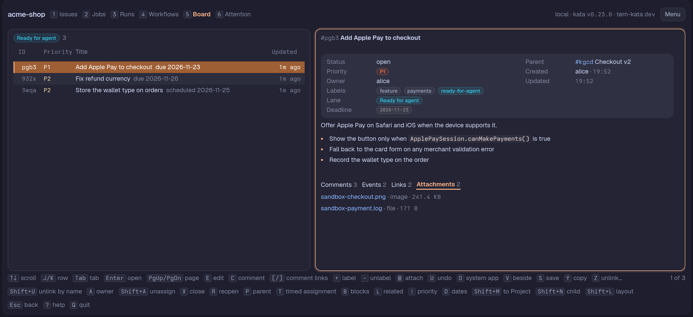

# Attachments

Attach a screenshot, log or any other file to an Issue so whoever picks it up sees what you saw. kata stores the file: its bytes go to [Docbank](https://github.com/kenn-io/docbank) and the Issue keeps a reference to them, so every agent and person who can read the Issue can download the file, from any machine.



This needs a kata daemon with Docbank configured (see [Setting Docbank up](#setting-docbank-up); that needs kata v0.23.0 and Docbank 0.16.0 or newer). Without it the Pane says so plainly and nothing can be attached.

## In a Pane

- `@` on the selected Issue (in the list, on the Board, in the Lane view or in the Issue detail) asks for a path, quoted, starting with `~` or relative to the directory, and uploads the file under its own name. A refusal or a failure shows in the form. A file may be up to 256 MiB.
- `U` lists the Issue's Attachments by name: `down` and `up` move and `enter` unlinks the one chosen, with no further confirmation. You can also type an attachment's name in full. Unlinking removes the Issue's reference only; the bytes stay in Docbank, because kata has no call that deletes them. Two Attachments with one name show with the last characters of their ids to tell them apart. `U` on an Issue with none says so.
- The Attachments tab of the Issue detail lists the Issue's Attachments, one row each as `name · kind · size`, for example `shot.png · image · 12 B` (the kind is image, text, audio, video, PDF or file; hover the row for the media type). A click or `enter` on one downloads it into a cache folder and opens it; opening it again reuses the download. A `.png`, `.jpg`, `.jpeg`, `.gif`, `.txt`, `.md`, `.json`, `.docx`, video (`.mp4`, `.mov`, `.m4v`, `.webm`), audio (`.mp3`, `.wav`, `.ogg`, `.flac`, `.m4a`) or `.pdf` file opens in Tern (a `.docx` needs Tern 0.9.21 or newer, and video, audio and PDFs need Tern 0.9.26 or newer; on an older Tern, or one whose version cannot be read, a `.docx` is saved and the message names the version or says Tern's version could not be told, while video, audio and PDFs go to the system app and the message adds the same; `.avi`, `.mkv` and the other types still go to the system app): on Tern 0.9.16 and later it shows in Tern's floating view over the tab, which a click outside or `esc` closes and dragging its header keeps. The palette command **Toggle Attachments panel** switches to the side panel, Tern's preview block beside the Pane, instead (and back), where the focus stays in the Pane and the next one you open replaces it, so you can go through several in turn; older Tern always uses the side panel. Opening the downloaded file another way (`tern open --tab`, Tern's Files explorer) opens it where you asked. This works when tern-kata runs in a Tern Pane and `tern` is on the PATH, and it opens in the window that shows the Pane even when the Pane runs on another machine. Every other file that tern-kata opens, and any file when it does not run in a Tern Pane, when `tern` is missing or when `tern open` fails, goes to the program the OS of the machine running tern-kata has for that type (`xdg-open`, `open`, `rundll32`), and the notice reads "Opened <name> outside Tern." instead of "Opened <name>." (a preview beside the Pane says "Opened <name> beside the Pane.", the system app "Opened <name> with the system app."; the path is only behind **Copy…**). When the OS opener cannot start or exits non-zero within 2 seconds, the notice reads "the file is at <path> but the system app could not open it: <why>" instead. tern-kata opens images (`.png`, `.jpg`, `.jpeg`, `.gif`, `.webp`, `.bmp`, `.heic`, `.tif`, `.tiff`), video (`.mp4`, `.mov`, `.webm`, `.mkv`, `.avi`, `.m4v`), audio (`.mp3`, `.wav`, `.ogg`, `.flac`, `.m4a`), `.pdf` and plain text (`.txt`, `.md`, `.log`, `.csv`, `.json`), in any letter case, judged by the name exactly as stored: `report.bat.` or `x.png ` do not count. A name containing `:` is never handed to the OS, by `enter`, a click or `o`; it is only saved. A `.docx` is drawn as a document by Tern 0.9.21 and later (older Tern draws it as hex) and is never handed to the OS: outside Tern, or when `tern open` fails, it is only saved. Any other file is only saved, never opened, because what the OS does with a file it knows (run it, follow a link inside it) cannot be told from its name and anyone who can write the Project can name an Attachment `report.bat`. The Pane then says where it is saved and that tern-kata opens only images, video, audio, PDFs and text: "Cannot open report.bat: saved at <path> and not opened: tern-kata opens only images, video, audio, PDFs and text". Open such a file yourself if you trust it. The download never gets an execute permission.
- A right-click on an Attachment row, or a long press on a phone or tablet, lists what you can do with it. Each item is also a key while the cursor is on the row, and the footer and the help sheet name them:
  - **Open** (`enter`) does what a click does. When Tern did not show the file and the OS opener got it, the message adds what `tern open --preview` said.
  - **Open beside** (`v`) opens a split beside the Pane whatever the floating or side panel setting says. It is for the kinds Tern draws (`.png`, `.jpg`, `.jpeg`, `.gif`, `.txt`, `.md`, `.json`, `.docx`, video, audio and `.pdf`, as above) and is greyed out, with the reason, for any other, `.avi` and `.mkv` included; it needs the Pane to run in Tern, a `.docx` needs Tern 0.9.21 or newer and video, audio and PDFs need Tern 0.9.26 or newer (the reason says so, or that Tern's version could not be told).
  - **Open with the system app** (`o`) hands the file to the OS opener, for the same types `enter` sends there (images, video, audio, PDFs and text). Any other type is refused, as is any name containing a `:` (on Windows `report.txt:x.png` is a hidden stream of `report.txt`), because the OS may run it and anyone who can write the Project, agents included, can name an Attachment: save it (`s`) and open it yourself. When the OS opener cannot start or exits non-zero within 2 seconds, the Pane says "the file is at <path> but the system app could not open it: <why>" instead of "Opened". On a Windows window with Tern-managed ABKit installed, Tern's preview cannot play video or audio and shows its own card saying the file plays in the default app; `tern open --preview` still succeeds there, so tern-kata cannot tell and does not fall back. Press `o` on the Attachment to open it with the system app.
  - **Save to Downloads** (`s`) in a Pane that runs in Tern runs `tern download`, which copies the file into the Downloads folder of the machine whose window shows the Pane: for a Pane on a remote host, the machine you sit at. The toast says it is on the computer showing the window. Without Tern, with a Tern that has no `tern download`, when Tern's version cannot be read (the toast then says why), when the window is on the Pane's own machine, or when `tern download` fails (the toast then adds what Tern said), it copies the file into the Downloads folder (`$XDG_DOWNLOAD_DIR` or `xdg-user-dir DOWNLOAD` on Linux, else `Downloads` in your home folder; `%USERPROFILE%\Downloads` on Windows) and says where in a toast. A file that is already there is never overwritten: the copy is `name (1).ext`, then `name (2).ext`.
  - **Copy…** (`y`) opens the **Copy attachment** card (the file's name in its meta) with the downloaded file's path (**Downloaded file**) and the command `kata docbank attachments get <Project>#<Issue id> <attachment id>` (**Command**), each in a read-only field with a copy button (the buttons take a click; Tern has no call for a key to copy text). **Close** (`esc`) closes the card. If a card, a question or the help sheet covers the Pane when the file arrives, the card does not open over it: a toast gives the path and the command instead.
  - **Unlink…** (`z`) asks "Unlink <name> from <Issue>? y/n", with **Unlink** and **Keep** buttons, and unlinks as `U` does when you answer `y`. The footer shows `z` as "unlink…" and `U` as "unlink by name".

  Open with the system app acts on the machine the Pane runs on, which for a remote window is the session host, not the machine you are sitting at. The copy buttons of the Copy card copy on the machine that shows the window.

## Citing an attachment when closing

`x` opens the Close card. For a close with the reason Done on an Issue that has Attachments, the card has an Attachments row after External account: the Issue's Attachments by name, with the last characters of the id after a repeated name. `tab` moves to it, `left` and `right` move the `▸` mark along the names, `space` (or a click on a name) cites the one under the mark and a second `space` takes it back; a cited name shows in brackets. Cite one or more. An Attachment counts as evidence like a commit, PR, test, reviewed paths or external account, so a done close needs no other evidence when it cites one.

The row is not offered for the reasons Won't fix, Duplicate, Superseded or No change, which kata does not accept an Attachment for, or for an Issue with no Attachments. Changing the reason away from Done hides the row and a close with another reason does not send the picks. **Close without evidence** sends no evidence, so it cites none. The Close card that completes an undone reopen offers the row too.

kata freezes the Attachment's name, media type, size and Docbank version into the close, so the Events tab still names the file after the Attachment is unlinked. A close line reads `closed as done`, then the message, then `Evidence: attachment report.pdf`; the name is followed by `(removed)` once the Issue no longer has the Attachment and by `(changed)` when the Issue now has another version of that file under the same id. A close recorded without that frozen copy reads the name from the Issue's current Attachment, and "Attachment removed" when it has none. This needs a kata daemon that speaks HTTP API 0.39.0 or newer (kata v0.21). `kata close <ref> --done --evidence attachment:<full-id>` records the same thing from a shell, and `--docbank <node-id|/path>` also links a Docbank file to the Issue first.

The cache folder is `tern-kata/attachments/<Issue UID>/<attachment id>/<version>/<name>` under your user cache directory (`$XDG_CACHE_HOME` or `~/.cache` on Linux, `~/Library/Caches` on macOS, `%LocalAppData%` on Windows). `<version>` is a short hash of the Attachment's Docbank version, so each version of an Attachment gets its own folder and a changed file is downloaded again instead of read from the old copy. It is yours to delete.

A daemon without Docbank is said so in the Attachments tab and as the error of `@`. Other failures are in words too: Docbank refusing kata's API key, Docbank not reachable, a file over the limit, a name kata refuses (empty, over 255 bytes, or holding `/`, `\` or a control character), content Docbank no longer has, and an Issue that is a read-only copy from another kata instance.

## From a shell or for an agent

kata has its own commands; tern-kata has none for attachments (`tern-kata attach` and `detach` no longer exist):

```sh
kata docbank attachments add <ref> <file>...   # upload; prints each attachment id
kata docbank attachments ls <ref>              # id, name, media type and size
kata docbank attachments get <ref> <id> -o <path> [--force]
kata docbank attachments rm <ref> <id>         # unlink; the bytes stay in Docbank
```

`<id>` may be a unique suffix of the id. See `kata docbank attachments --help` for the rest. Agents read the same commands from the `kata` skill.

An Attachment is one meta key on the Issue, `attachment.<id>`, holding exactly `{"name", "media_type", "size", "docbank_version"}` (the version a non-nil UUID), visible in `kata show --json`. A key whose value kata would not accept, such as one with another member or a version that is not a UUID, is not listed.

## Setting Docbank up

You do this once, for the kata daemon, with kata's own command: `kata docbank setup`. It needs kata v0.23.0 and Docbank 0.16.0 or newer. tern-kata has no setup command of its own.

Choose a vault that every reader of your Issues may open. kata puts files in a folder of that vault; the folder only organises them and is no access control, so whoever can read an Issue can download its attachments.

### Docbank on this machine

Install [Docbank](https://github.com/kenn-io/docbank), then run:

```sh
kata docbank setup
```

It checks Docbank's key, adds `[docbank]` with `local = true` to `<KATA_HOME>/config.toml` (`~/.kata/config.toml` unless you moved it) and restarts the kata daemon; `--yes` approves the change and the restarts without asking. kata then finds the Docbank on this machine through Docbank's own runtime record on every request, starts it when it is not running, and follows a new port or key after a restart, so a Docbank restart or a reboot never breaks attachments and nothing else needs to keep Docbank running. `--folder <path>` picks the vault folder (default `/kata`; kata adds one folder per Project below it).

### Docbank on another machine

Whoever runs that Docbank gives you its URL and an API key; keeping it running is theirs. Save the key in a file only you can read (`chmod 600`), then:

```sh
kata docbank setup --url https://docbank.example --key-file ~/docbank.key
```

The `url` must be HTTPS except for a Docbank on this machine, and `--folder` works as above. kata never starts a Docbank named by a url.

### Checking it

The Config Page (`K`) has a Docbank row after `agent.toml`. It reads the `[docbank]` section of the default kata daemon's `config.toml` (`~/.kata/config.toml`, or `KATA_HOME`'s), whichever daemon the Pane is switched to, and says one of:

- `Not set up: run kata docbank setup`;
- `On this machine: …` (`local = true`: kata starts Docbank when needed and follows its port and key);
- `At <url>`;
- `Pinned to <url> by tern-kata's old setup: …` (kata does not start it): see the next section;
- the error of the reader, when the file cannot be read.

**Telemetry.** Docbank reports usage unless its daemon's environment sets `DOCBANK_TELEMETRY_ENABLED=0`.

### Installs set up by tern-kata 0.10

tern-kata 0.10 had its own `tern-kata docbank setup`. It pinned Docbank on this machine to a fixed port and key (`[server]` in `<DOCBANK_HOME>/config.toml`, the key in `<KATA_HOME>/docbank.key`) and wrote a `[docbank]` section with a `url` on `127.0.0.1`, and the plugin kept that Docbank running. That is gone. kata never starts a Docbank named by `url`, so after the next reboot an install set up that way cannot reach Docbank until something starts it. The Config Page's Docbank row shows this form as `Pinned to <url> by tern-kata's old setup: …`; the row offers **Switch to local Docbank** (`s`) for it.

To switch from the Config Page, select the Docbank row and press `s` (or click **Switch to local Docbank**). It asks "Switch to kata's local Docbank? kata restarts its daemon." with **Switch** and **Keep** buttons; `n` or Keep changes nothing. On `y` the message line reads "Switching Docbank…" and tern-kata removes the `[docbank]` table from the default kata daemon's `<KATA_HOME>/config.toml` (every other line, comment and table stays; a `[docbank.<name>]` subtable is not part of it and stays) and runs `kata docbank setup --yes --folder <your old folder>` (`/kata` when the section had none) with that `KATA_HOME`, so kata restarts its daemon. While it runs the Pane does not quit (`q` and `ctrl+c` say "Cannot quit: the Docbank switch is still running."), and when Tern closes the Pane it waits for the switch before it exits, because a failed run is put back only after kata answers; kata gets at most 2 minutes. When it works, the rows are read again and the message line says "Switched to kata's local Docbank and restarted its daemon." and that `docbank.key` and `docbank.manual` are no longer used and can be deleted. When kata fails or does not answer in time, the message line shows "Cannot switch Docbank: <reason>." with kata's error line (or "kata did not answer within 2m0s") and the original file is put back; if the file changed after the switch wrote it, it is left as it is and the message line says it was not restored and why. If you leave the Config Page while the switch runs, its answer appears as a notice instead. Only this form has `s`.

To move over by hand:

1. Remove the whole `[docbank]` section from `<KATA_HOME>/config.toml`.
2. Run `kata docbank setup` (with `--folder <your old folder>` when it was not `/kata`).

Docbank keeps the port and key tern-kata gave it, and kata's local form reads them from Docbank's runtime record. `<KATA_HOME>/docbank.key` and `docbank.manual` in tern-kata's config folder are no longer used and can be deleted.

## Moving old attachments

Before kata stored attachments, tern-kata copied each file to `.kata-attachments/<Issue ULID>/<name>` at the root of the Project's primary checkout (the main worktree; outside git, the directory holding `.kata.toml`) and kept a pointer on the Issue: one `tern-kata.attachment.<name>` meta key holding `{"host", "path"}`, the host name of the machine with the copy and its absolute path. Version 0.3 wrote the same pointer under `attachment.<name>`; the migration reads those too. The Pane no longer lists these. Move them once per machine:

```sh
tern-kata migrate-attachments [--as <actor>]
```

Run it from a directory bound to the Project. For every Issue of the Project, open and closed, and every old key whose `host` is this machine (compared without regard to case) and whose file is in that Issue's `.kata-attachments` folder, it:

1. uploads the file under the name in the key,
2. clears the old key, and only then
3. deletes the local copy.

A failure before the key is cleared keeps the file and the key, so a run can be repeated. If the upload worked but the old key could not be cleared, the command reads the Issue again: while the old key is still there it unlinks the copy it just uploaded, so a repeat does not leave two; if the key is gone (the clear reached kata though the answer was lost) the move counts as done and the local copy is deleted. If that unlink fails, or the Issue cannot be read, the output says so and names the new attachment, because a duplicate may exist; remove it with `kata docbank attachments rm`. When the `.kata-attachments` folder ends up empty (or holding only its own `.gitignore`), the command removes it.

The command prints what moved, and lists what it left with the reason:

- a key whose `host` is another machine: run the command there;
- a file that is gone from this machine;
- a file outside the Issue's folder in `.kata-attachments`, which is never deleted: add it with `kata docbank attachments add` and clear the key yourself (`kata meta unset <ref> <key>`, with `<key>` the key the list names). A file, Issue folder or store folder that is a symlink counts as outside, so the link's target is never uploaded, with the reason "outside this Project's old attachment folder";
- a `tern-kata.attachment.*` key whose value is not a `{host, path}` pointer, so it is not an old attachment;
- a file refused before upload, for its size or type, with the reason shown. The command then exits non-zero;
- an upload or key change that failed, with kata's reason. The command then exits non-zero;
- a file moved whose local copy could not be deleted: the key is already cleared, so delete the file by hand. The command then exits non-zero.

A daemon without Docbank refuses before touching anything. The command is not needed on a machine with no old attachments, and tern-kata itself no longer reads or writes the old keys.
