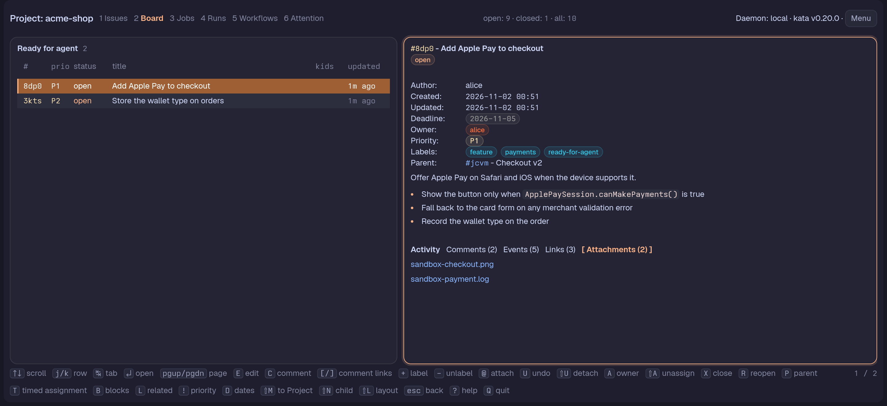

# Attachments

Attach a screenshot, log or any other file to an Issue so whoever picks it up sees what you saw. kata stores the file: its bytes go to [Docbank](https://github.com/kenn-io/docbank) and the Issue keeps a reference to them, so every agent and person who can read the Issue can download the file, from any machine.



This needs kata v0.21 and a daemon with Docbank configured (see [Setting Docbank up](#setting-docbank-up)). Without it the Pane says so plainly and nothing can be attached.

## In a Pane

- `@` on the selected Issue (in the list, on the Board, in the Lane view or in the Issue detail) asks for a path, quoted, starting with `~` or relative to the directory, and uploads the file under its own name. A refusal or a failure shows in the form. A file may be up to 256 MiB.
- `U` lists the Issue's Attachments by name: `down` and `up` move and `enter` unlinks the one chosen, with no further confirmation. You can also type an attachment's name in full. Unlinking removes the Issue's reference only; the bytes stay in Docbank, because kata has no call that deletes them. Two Attachments with one name show with the last characters of their ids to tell them apart. `U` on an Issue with none says so.
- The Attachments tab of the Issue detail lists the Issue's Attachments with their name, media type and size. `enter` on one downloads it into a cache folder and, if it is an image, video, audio, PDF or text file by its name, opens it with the program your OS has for that type; the next `enter` reuses the download. tern-kata opens images (`.png`, `.jpg`, `.jpeg`, `.gif`, `.webp`, `.bmp`, `.heic`, `.tif`, `.tiff`), video (`.mp4`, `.mov`, `.webm`, `.mkv`, `.avi`, `.m4v`), audio (`.mp3`, `.wav`, `.ogg`, `.flac`, `.m4a`), `.pdf` and plain text (`.txt`, `.md`, `.log`, `.csv`, `.json`), in any letter case, judged by the name exactly as stored: `report.bat.` or `x.png ` do not count. Any other file is only saved, never opened, because what the OS does with a file it knows (run it, follow a link inside it) cannot be told from its name and anyone who can write the Project can name an Attachment `report.bat`. The Pane then says where it is saved and that tern-kata opens only images, video, audio, PDFs and text: "Cannot open report.bat: saved at <path> and not opened: tern-kata opens only images, video, audio, PDFs and text". Open such a file yourself if you trust it. The download never gets an execute permission.

## Citing an attachment when closing

`x` opens the Close card. For a close with the reason `done` on an Issue that has Attachments, the card has an Attachments row after External account: the Issue's Attachments by name, with the last characters of the id after a repeated name. `tab` moves to it, `left` and `right` move the `▸` mark along the names, `space` (or a click on a name) cites the one under the mark and a second `space` takes it back; a cited name shows in brackets. Cite one or more. An Attachment counts as evidence like a commit, PR, test, reviewed paths or external account, so a done close needs no other evidence when it cites one.

The row is not offered for `wontfix`, `duplicate`, `superseded` or `audit-no-change`, which kata does not accept an Attachment for, or for an Issue with no Attachments. Changing the reason away from `done` hides the row and a close with another reason does not send the picks. Quick done sends no evidence, so it cites none. The Close card that completes an undone reopen offers the row too.

kata freezes the Attachment's name, media type, size and Docbank version into the close, so the Events tab still names the file after the Attachment is unlinked. A close line reads `closed: done`, the message, then `(attachment report.pdf)`; the name is followed by `[removed]` once the Issue no longer has the Attachment and by `[changed]` when the Issue now has another version of that file under the same id. A close recorded without that frozen copy reads the name from the Issue's current Attachment, and "Attachment removed" when it has none. This needs a kata daemon that speaks HTTP API 0.39.0 or newer (kata v0.21). `kata close <ref> --done --evidence attachment:<full-id>` records the same thing from a shell, and `--docbank <node-id|/path>` also links a Docbank file to the Issue first.

The cache folder is `tern-kata/attachments/<Issue UID>/<attachment id>/<version>/<name>` under your user cache directory (`$XDG_CACHE_HOME` or `~/.cache` on Linux, `~/Library/Caches` on macOS, `%LocalAppData%` on Windows). `<version>` is a short hash of the Attachment's Docbank version, so each version of an Attachment gets its own folder and a changed file is downloaded again instead of read from the old copy. It is yours to delete.

A daemon without Docbank is said so in the Attachments tab and as the error of `@`. Other failures are in words too: Docbank refusing kata's API key, Docbank not reachable, a file over the limit, a name kata refuses (empty, over 255 bytes, or holding `/`, `\` or a control character), content Docbank no longer has, and an Issue that is a read-only copy from another kata instance.

## From a shell or for an agent

kata has its own commands; tern-kata has none for attachments (`tern-kata attach` and `detach` no longer exist):

```sh
kata docbank attachments add <ref> <file>...   # upload; prints each attachment id
kata docbank attachments ls <ref>              # id, name, media type and size
kata docbank attachments get <ref> <id> -o <path> [--force]
kata docbank attachments rm <ref> <id>         # unlink; the bytes stay in Docbank
```

`<id>` may be a unique suffix of the id. See `kata docbank attachments --help` for the rest. Agents read the same commands from the `kata` skill.

An Attachment is one meta key on the Issue, `attachment.<id>`, holding `{"name", "media_type", "size", "docbank_version"}`, visible in `kata show --json`.

## Setting Docbank up

You do this once, for the kata daemon. tern-kata cannot do it for you.

1. Install [Docbank](https://github.com/kenn-io/docbank) and create a vault that every reader of your Issues may open. kata puts files in a folder of that vault; the folder only organises them and is no access control, so whoever can read an Issue can download its attachments.
2. Create an API key for it and save it in a file only you can read (`chmod 600`).
3. Add a `[docbank]` section to `<KATA_HOME>/config.toml` (`~/.kata/config.toml` unless you moved it):

   ```toml
   [docbank]
   url = "http://127.0.0.1:8080"
   api_key_file = "/home/me/.kata/docbank.key"
   folder = "/kata"
   ```

   - `url` must be HTTPS unless it points to this machine.
   - Give the key as one of `api_key_file`, `api_key_env` (the name of an environment variable) or `api_key`; a file is the safest. The key is read again for each request, so you can rotate it without a restart.
   - `folder` is an absolute path in the vault and defaults to `/kata`. kata adds one folder per Project below it.
   - `KATA_DOCBANK_URL`, `KATA_DOCBANK_API_KEY_FILE` and `KATA_DOCBANK_FOLDER` set the same three in the daemon's environment.
4. Restart the kata daemon. The Pane, `@` and the Attachments tab work from the next read.

Docbank has telemetry settings of its own; check [Docbank's documentation](https://github.com/kenn-io/docbank) for turning them off.

## Moving old attachments

Before kata stored attachments, tern-kata copied each file to `.kata-attachments/<Issue ULID>/<name>` at the root of the Project's primary checkout (the main worktree; outside git, the directory holding `.kata.toml`) and kept a pointer on the Issue: one `tern-kata.attachment.<name>` meta key holding `{"host", "path"}`, the host name of the machine with the copy and its absolute path. Version 0.3 wrote the same pointer under `attachment.<name>`; the migration reads those too. The Pane no longer lists these. Move them once per machine:

```sh
tern-kata migrate-attachments [--as <actor>]
```

Run it from a directory bound to the Project. For every Issue of the Project, open and closed, and every old key whose `host` is this machine (compared without regard to case) and whose file is in that Issue's `.kata-attachments` folder, it:

1. uploads the file under the name in the key,
2. clears the old key, and only then
3. deletes the local copy.

A failure before the key is cleared keeps the file and the key, so a run can be repeated. If the upload worked but the old key could not be cleared, the command reads the Issue again: while the old key is still there it unlinks the copy it just uploaded, so a repeat does not leave two; if the key is gone (the clear reached kata though the answer was lost) the move counts as done and the local copy is deleted. If that unlink fails, or the Issue cannot be read, the output says so and names the new attachment, because a duplicate may exist; remove it with `kata docbank attachments rm`. When the `.kata-attachments` folder ends up empty (or holding only its own `.gitignore`), the command removes it.

The command prints what moved, and lists what it left with the reason:

- a key whose `host` is another machine: run the command there;
- a file that is gone from this machine;
- a file outside the Issue's folder in `.kata-attachments`, which is never deleted: add it with `kata docbank attachments add` and clear the key yourself (`kata meta unset <ref> <key>`, with `<key>` the key the list names). A file, Issue folder or store folder that is a symlink counts as outside, so the link's target is never uploaded, with the reason "outside this Project's old attachment folder";
- a `tern-kata.attachment.*` key whose value is not a `{host, path}` pointer, so it is not an old attachment;
- a file refused before upload, for its size or type, with the reason shown. The command then exits non-zero;
- an upload or key change that failed, with kata's reason. The command then exits non-zero;
- a file moved whose local copy could not be deleted: the key is already cleared, so delete the file by hand. The command then exits non-zero.

A daemon without Docbank refuses before touching anything. The command is not needed on a machine with no old attachments, and tern-kata itself no longer reads or writes the old keys.
