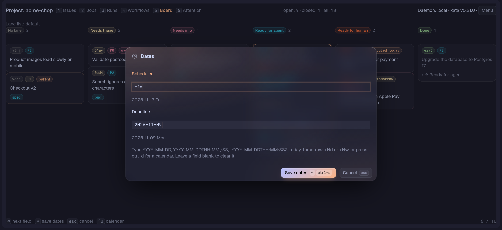

# Dates

`d` on the selected Issue (in the list, on the Board, in the Lane view and in the Issue detail) opens the **Dates card**: a Scheduled field and a Deadline field holding the Issue's current dates.

`tab` moves between the fields, `enter` saves and `esc` cancels. `ctrl+d` in a field opens a calendar beside it: the arrow keys move by a day or a week, `enter` or a click picks the date and `esc` closes the calendar. Typing a date works as before. A field takes:

| Input | Meaning |
|---|---|
| `YYYY-MM-DD` | that date |
| `YYYY-MM-DDTHH:MM` or `YYYY-MM-DDTHH:MM:SS` | that date and local time, sent to kata as typed |
| `YYYY-MM-DDTHH:MM:SSZ` | that UTC instant, sent to kata as typed |
| `today`, `tomorrow` | counted from the Pane calendar's date |
| `+Nd` | N days on |
| `+Nw` | N weeks on |
| blank | clears the date |

A muted line under the field shows the date it resolves to with its weekday (`2026-10-24 Sat`), followed by the time for a local time (`2026-10-24 Sat 09:00`); a UTC instant is shown as typed, since its calendar day depends on the time zone. The same forms kata's own `d` form takes are accepted, and the time forms need the `T` and, for UTC, a capital `Z`. Anything else is refused with a message naming the field. A date kata holds with a time (`2026-11-02T17:30:00`) is shown as it is and left alone unless you edit that field.

## In the Create card

The Create card (`n`, and `N` for a child Issue) has the same two fields after Priority, in tab order, with the same input forms, the same `ctrl+d` calendar, weekday preview and refusal naming the field (nothing is created). The dates go into the one create request as the new Issue's `scheduled_on` and `deadline_on` metadata; a field left blank sends none. Retrying a failed create reuses its idempotency key, and editing a date makes a new request.

## Saving

Saving writes the changed dates only, as the Issue's `scheduled_on` and `deadline_on` metadata, each guarded on the value the card opened with: a date changed elsewhere (the kata CLI, an agent, another Pane) since then is reported and not overwritten, and the card stays open with the reason. On that conflict the changed field is refilled with the value kata holds now and your other edits stay, so saving again writes only what you still change. The message reads "The Issue changed since the card opened; nothing was written for Deadline. The Deadline field now shows the current date." It is refused while the daemon is disconnected.

Dated cards on the Board and open Issue rows in the list show a badge such as "overdue 1d" or "due tomorrow"; the full list is in [the Board guide](pages-and-board.md#relationships-blockers-and-dates-on-cards). A list row shows the badge after its title, as `kata tui` shows its dates, and drops it when the list is too narrow to keep the title, as when it sits beside the detail; closed and undated rows show none.
