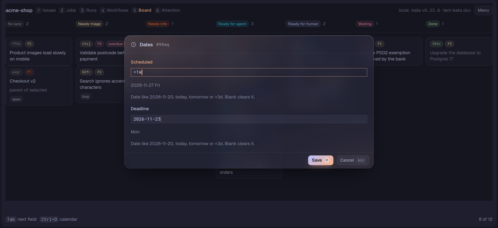

# Dates

`D` on the selected Issue (in the list, on the Board, in the Lane view and in the Issue detail) opens the **Dates card**: a Scheduled field and a Deadline field holding the Issue's current dates.

The card's head reads Dates, with the Issue's ref (`#tga6`, or `project#tga6` across Projects) as a muted line; its buttons are **Save** and **Cancel**, and each field's placeholder is `YYYY-MM-DD`. Under each field, focused or not, a muted line reads "Date like 2026-11-20, today, tomorrow or +3d. Blank clears it." `Tab` moves between the fields, `Enter` saves and `Esc` cancels. `Ctrl+D` in a field opens a calendar beside it (the footer shows `Ctrl+D calendar`) on the month of the field's date, else of the other date, else today: the arrow keys move by a day or a week, `Enter` or a click picks the date and `Esc` closes the calendar. Typing a date works as before. A field takes:

| Input | Meaning |
|---|---|
| `YYYY-MM-DD` | that date |
| `YYYY-MM-DDTHH:MM` or `YYYY-MM-DDTHH:MM:SS` | that date and local time, sent to kata as typed |
| `YYYY-MM-DDTHH:MM:SSZ` | that UTC instant, sent to kata as typed |
| `today`, `tomorrow` | counted from the Pane calendar's date |
| `+Nd` | N days on |
| `+Nw` | N weeks on |
| blank | clears the date |

A muted text beside the field shows the weekday of a typed date (`Sat`, with the time for a local time: `Sat 09:00`) and the day and weekday of a date that resolves from `today` or `+3d` (`2026-10-24 Sat`); a blank field, a UTC instant and text that is not a date show nothing, since a UTC instant's calendar day depends on the time zone. The same forms kata's own `D` form takes are accepted, and the time forms need the `T` and, for UTC, a capital `Z`; the forms with a time and `Shift+Z` are listed in the table above, not in the hint. Anything else is refused with a message naming the field: "Scheduled must be a date like 2026-11-20, today, tomorrow or +3d." A date kata holds with a time (`2026-11-02T17:30:00`) is shown as it is and left alone unless you edit that field.

## In the Create card

The Create card (`N`, and `Shift+N` for a child Issue) has the same two fields after Priority, in tab order, with the same input forms, the same `Ctrl+D` calendar, weekday hint and refusal naming the field (nothing is created). The dates go into the one create request as the new Issue's `scheduled_on` and `deadline_on` metadata; a field left blank sends none. Retrying a failed create reuses its idempotency key, and editing a date makes a new request.

## Saving

Saving writes the changed dates only, as the Issue's `scheduled_on` and `deadline_on` metadata, in one write guarded on the Issue's revision. First it checks the dates against the value the card opened with: a date changed elsewhere (the kata CLI, an agent, another Pane) since then is reported and not overwritten, and the card stays open with the reason. On that conflict the changed field is refilled with the value kata holds now and your other edits stay, so saving again writes only what you still change. The message reads "The Issue changed since the card opened; nothing was written. The <Field> field now shows the current date." If the Issue changes during the save for another reason, the save reads it again and goes on; if a date changed, it is refused the same way, so a refused save never keeps half of it. It is refused while the daemon is disconnected.

Dated cards on the Board and open Issue rows in the list show a badge such as "overdue 1d" or "due tomorrow"; the full list is in [the Board guide](pages-and-board.md#relationships-blockers-and-dates-on-cards). A list row shows the badge in a column of its own, as `kata tui` shows its dates, and never drops it for width (a long title is cut instead); closed and undated rows show none.

## How dates and ages read

- Absolute times read `2026-11-18 18:21` (the Pane's zone, no seconds, no `Z`), or `18:21` when the time is today. Date-only fields read `2026-11-18`. A missing time or date reads `—`, never `-`.
- Narrow list and table cells (Updated, children, related Issues) show a compact age with `ago`: `7s ago`, `4m ago`, `2h ago`, `3d ago`, `1w ago`; the hovercard carries the absolute time. Ages elsewhere are compact with no space: `7s`, `2h`.
- The date badge words are "due today", "due tomorrow", "due 2026-11-25", "overdue 3d" and "scheduled 2026-12-01". In a narrow row the badge shrinks to the ISO date alone (`2026-12-01`); its tone stays, and the row's tooltip carries the full badge (`due 2026-12-01`), so due and scheduled can still be told apart.
