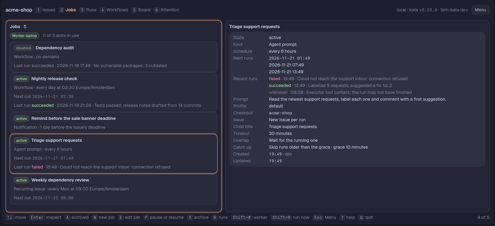
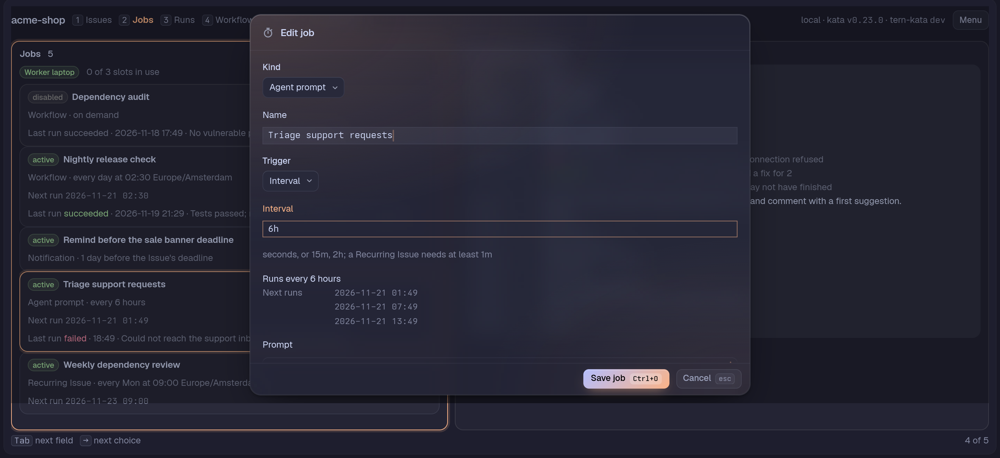

# Jobs

`2` in a Project opens the Jobs Page. It lists the Project's **Cron jobs**, the ones kata runs itself and the ones [a worker](worker.md) runs. The **Job card** makes and edits them.

## Jobs Page



One card per job. The heading reads `Jobs 4`, with `· 2 archived hidden` added only while archived jobs are hidden. With none, the Page reads "No jobs" / "A job makes an Issue or runs an agent on a schedule." with a **New job** button. A card shows:

- a state badge: `active`, `disabled`, `archived`, or `paused: parent closed`, `paused: parent deleted`, `paused: Project archived`;
- the name;
- the kind: Recurring Issue, Agent prompt, Workflow or Notification;
- the schedule in words: "every weekday at 09:00 Europe/Berlin", "every 15 minutes" (only for a step that divides the hour; `*/40` shows as `cron */40 * * * *`), "once at 2026-11-01 09:00 UTC", "on demand", "at the Issue's scheduled date", "2 days before the Issue's deadline". The time zone is appended only to a phrase that names a clock time or to a raw cron expression, never to "every 15 minutes", "every hour" or "every minute";
- the next run, `Next run 19:21` in the Pane calendar's zone (`2026-11-19 09:00` when it is not today);
- the last run or the last Issue: `Last run failed · 2026-11-16 13:00 · Quota reached · the provider answered 429` (the status word in its tone), or `Last Issue #ab12 Tick · open · 18:00` for a Recurring Issue job.

The agent profile is in the inspector, not on the card. A schedule that can't be read, or a next run that can't be worked out, is left off the card: a job that isn't running, a manual or Issue-date trigger, a once trigger in the past, or an interval of a Recurring Issue job whose parent has no delivery anchor yet. An interval of a job a worker runs does show, counted from the job's creation.

### Keys

| Key | Action |
|---|---|
| `↑`/`↓` or `j`/`k`, `g`, `G`, Page Up/Down | Move the selection |
| Enter or Tab | Show the inspector (narrow Panes) |
| Esc or Tab | Back to the list (on the list, Esc first ends a search) |
| `n` | New job (opens the [Job card](#job-card)) |
| `e` | Edit the selected job |
| `J` | On an Issue (list, Board, Lane view, Issue detail): new Recurring Issue job with that Issue as parent |
| `p` | Pause (writes the job disabled) or resume |
| `x` | Archive, or restore an archived job; the footer reads "archive" or "restore" |
| `a` | Show or hide archived jobs (hidden until then) |
| `/` | Search the jobs: type to keep the jobs whose name, state, kind, schedule, profile or last run holds the text (case-insensitive); Enter keeps the search and returns to the list, Esc ends it and brings every job back. An empty result says so under the search |
| `ctrl+r` | Read the jobs again; they also reload when the daemon reports a change |
| `r` | Open the Runs Page filtered to the selected job (see [Runs](runs.md)) |
| `R` | Ask the worker to run the selected adapter job now |
| `u` | Resume the selected job this machine's worker paused after repeated failed runs |
| `W` | Open the [Worker card](worker.md#from-the-pane-the-worker-card): this machine's worker; set it up, serve the Project, edit, restart or stop it |

### What a card tells you

- A kata-run job (a Recurring Issue) makes a child Issue under its parent each time it fires. It pauses by itself while its parent is closed or deleted or its Project is archived; reopening, restoring or re-enabling resumes it. The Pane works the reason out from the parent and the Project, since kata stores none: a disabled job reads `disabled` whatever its parent is doing, and an archived Project reads as paused for every job the Pane already holds, because kata then answers none of them.
- A card also names the job's latest run (an adapter job: the status word in its tone, when, the reason in words and the first line of its summary) or latest child Issue (a Recurring Issue job), and the inspector lists the five most recent.
- An enabled per-run Issue job of a worker that creates more than 24 Issues a day (`worker status` and `worker doctor` list it too) carries the line "creates about N Issues a day; consider an existing Issue"; the job keeps running. An interval of a worker's job counts from the job's creation, as the worker does.
- The Jobs Page keeps its selection while another Page is shown and reads the jobs again when you return.
- A job this machine's worker serves the Project for but sets aside (a profile, checkout or secret `worker.toml` does not map, a timeout over `max_timeout`, a workflow it does not run) shows "Set aside on this machine: <reason>" in the warning tone on its card and a **Set aside** fact in the inspector; the reason is the worker's, from `worker status`.

### Inspector

At 140 columns and wider an **inspector** beside the list shows the selected job's facts as label and value rows, in the same key column as the Issue properties, each row absent when it is empty: State, Worker (`Paused after 3 failed runs in a row`), Set aside, Kind, Schedule, Next runs, Warning, Recent runs (the status word in its tone, then the time and the run's reason in words), Recent children, Prompt, Workflow (the workflow's name), Recipient (`The Issue's owner or author` for the default), Message, Adapter, Profile, Checkout, Secrets, Issue (`New Issue per run` or `Existing Issue`), Child title, Child body, Scheduled offset, Deadline offset, Timeout (durations in words, such as `1 hour`), Overlap and Catch up (worded as the card words them: `Wait for the running one`, `Run alongside it`, `Latest missed run`, `Every missed run`, `Skip runs older than the grace`, with `· grace 2 hours` appended), Parent (with the delivery progress for a Recurring Issue job), Delivered through, Missed, Created (`2026-11-18 18:21 · author`) and Updated. Cron, Time zone, Interval and At rows appear only when the schedule cannot be read in words. Author, revision and UID are not rows: the ids sit in a hovercard on the job's name at the top of the inspector. Narrower, only the focused column shows: Enter or Tab on a card shows the inspector, Esc or Tab goes back.

The inspector lists the next three runs under **Next runs**, one per line as `2026-11-19 09:00` (`09:00` when it is today), with no zone abbreviation (a cron trigger in its own zone, an interval or once trigger in the Pane calendar's zone). An interval or `@every` trigger of a job a worker runs counts from the job's creation, as the list row's does. Where there are none it says why: "none while paused", "none while the parent is closed" (likewise for a deleted parent, an archived Project and an archived job), "unavailable: follows the Issue's date" for an Issue-date trigger, and "unavailable" where the runs can't be worked out (a schedule the Pane can't read, or a cron zone it doesn't know). A manual job has no Next runs row, since its Schedule row says "on demand".

With the inspector focused, Enter on a Recurring Issue job's parent opens that Issue on the Issues Page (a deleted parent leaves a Notice instead).

### Issues made by a job

An Issue a Recurring Issue job made is marked "◷" in the list and on its Board card, and its detail has a **Cron job** property: the job's name (its uid when the job is gone) and the run's scheduled time. Enter on it (it is the first row the detail's cursor stands on) or a click opens the Jobs Page with that job selected.

The parent's detail has a **Cron jobs** property listing its jobs with state, pause reason and schedule, each openable the same way; a closed parent says its Cron jobs are paused. The detail reads the Project's jobs for this, so it names them a moment after the Issue shows.

### Is the worker running?

The Jobs Page shows one line under its head about **this machine's worker**: a badge and a muted detail.

- `Worker smoke-box` (success) with `0 of 3 slots in use`;
- `Worker smoke-box` (warning) with `admits nothing: <why>` (the reason is the worker's, for instance another machine's lease), `does not serve smoke; restart it to pick up worker.toml` or `does not serve smoke; not listed in worker.toml`;
- `No worker` (warning) with `none set up for smoke`, `worker.toml does not load`, `worker.toml does not list smoke`, `supervision is off, so none starts by itself` or `none is running on this machine`;
- `Starting` (pending) with `the plugin starts one within 10 seconds`;
- with supervision off and a worker running, ` · supervision is off` ends the detail.

The banner names no key; the footer shows `W`. Adapter jobs run only when a worker serves the Project. The Pane asks the worker over its control socket when the page opens, on `ctrl+r` and after a run is requested.

### Run now

`R` asks the worker to run the selected **adapter** job now, under the same lease, overlap and capacity rules as a scheduled run. It is refused with the reason on a recurring-child job (kata runs those, not the worker), on an archived job, when no worker runs on this machine, when the worker does not serve the Project, and with the worker's own words when it declines (a full Project, a closed overlap gate). On success the Notice names the new run, which shows on the [Runs Page](runs.md).

The Jobs Page needs a Project like the Board Page and ends when you switch to a Collection that is not a Project.

### Paused after failed runs

After `pause_after_failures` runs of one adapter job in a row end `failed` (default 3; see the [worker reference](worker-reference.md#paused-jobs)) the worker stops admitting that job's runs. Its card reads "paused: failed runs" and says "This machine's worker: paused after 3 failed runs in a row", and the inspector adds a Worker line. This is the worker's own state, not kata's: the job stays enabled for every other executor and Pane, `p` neither shows nor lifts it, and `R` is refused with the same words. `u` asks the worker to resume the job; its failure count starts from none. It is refused with a Notice for a job the worker has not paused.

### Pause, archive and guarded writes

On the Jobs Page, `p` pauses a job that is running (it writes the job disabled) and resumes one that is not (enabled again); `x` archives the selected job and, on an archived one (press `a` to list them), restores it. All three are Guarded writes: a job changed meanwhile is left alone, the list shows the newer job and a Notice says nothing was written. A job's list and inspector update as soon as the write is answered.

## Job card



`n` on the Jobs Page opens the **Job card** for a new job; `J` on an Issue (list, Board, Lane view, Issue detail) opens it for a new Recurring Issue job with that Issue as its parent; `e` opens it on the selected job, prefilled. A refusal reads "Cannot create a job: disconnected from kata.", "Cannot create a job: this Project is archived." or "Cannot edit the job: it is archived; restore it first."

The **Kind** field offers:

| Kind | Run by |
|---|---|
| **Recurring Issue** | kata's own daemon |
| **Agent prompt** | an adapter ([the worker](worker.md)) |
| **Workflow** | an adapter |
| **Notification** | an adapter |

kata never runs the last three. The card makes and edits all of them and kata accepts them; the worker runs all three kinds and refuses a workflow it does not support with the reason. A job being edited offers only the kinds of its own side (a Recurring Issue stays one, and a worker's job stays a worker's).

Each field has a one- or two-word label (Cron expression, Time zone, Interval, Once at, Target Issue, Notify about, Lead, Parent Issue, Prompt, Workflow, Agent profile, Checkout, Secrets, Adapter, Run Issue, Child title, Child body, Scheduled offset, Deadline offset, Inbox recipient, Inbox message, Overlap, Timeout, Catch up, Grace, Enabled), and the format it reads is a muted hint under the focused field. Every text field, the Prompt included, is drawn under its label in every kind and trigger. The card marks no field as required; a refusal names the field.

The fields are reached with `tab` and `shift+tab`; a field that doesn't apply is hidden and skipped.

### Name and Trigger

**Name**, and the **Trigger**, whose choices depend on the kind.

- A Recurring Issue takes a **Cron expression** (five fields, or a descriptor like `@daily`; `@every` and a `TZ=` prefix are refused) with its **Time zone** (an IANA name, blank is UTC, the Pane's zone to start with), or an **Interval** in seconds or as a duration like `15m` or `2h`, at least 60 seconds.
- A worker's job also takes **Once at** (a full RFC 3339 instant with its offset, `2026-11-01T09:00:00+01:00` or `…Z`; a date or a time alone is refused), **manual** (it runs only on `tern-kata run` or a request), **Issue's scheduled date** and, for a Notification only, **Issue's deadline** with a **Lead** (seconds or `2h`, `1d`; blank fires at the deadline), because kata lets a deadline fire a notification and nothing else.
- An Issue-date trigger names its **Target Issue** by short id.
- A worker's interval has no 60-second floor.

Under the trigger a live preview reads the schedule in words ("Runs every day at 09:00 UTC") and a **Next runs** row lists the next runs, one per line as `2026-10-09 09:00` (`09:00` when it is today; no weekday, no zone letters): three for a cron or a Recurring Issue's interval; the instant of a once trigger; none for manual and Issue dates. An interval counts from the job's creation, so a new job's runs are "about" those times. A trigger that can't be read says "Not a valid schedule: <reason>."; an unknown start point says "Next runs are unknown until its start point is known."

### Recurring Issue fields

- **Parent Issue**: a short id, which a job made with `J` has filled in. The card resolves it to the Issue's full uid. A job keeps its parent, so when editing the card shows a Parent row (`#ab12 Title`) with the muted line "A job keeps its parent." instead of the field.
- **Child title** and **Child body**: the body is one line; a body with line breaks is shown on one line and saved that way.
- **Inbox recipient**: blank is the parent's current owner or author; otherwise an exact address like `alice` or `alice/reviewer`.
- **Inbox message**.

### Agent prompt and Workflow fields

- An **Agent prompt** has a multi-line **Prompt** (Enter adds a line, a pasted block keeps its lines).
- A **Workflow** job has a **Workflow** picker of the Project's live workflows (archived ones are not offered; with none, the card says to make one on the [Workflows Page](workflows.md)).
- Both have an **Agent profile** (stored in `options.profile`; the options the card doesn't edit are kept), a **Checkout** (stored as `checkout_key`), **Secrets** (`ENV=source` pairs, stored as `secret_refs`: the environment variable the run sees and the name of the source the worker's config defines; never a value), the **Run Issue** policy, **Overlap** and a **Timeout**.
- **Adapter** (stored in `options.adapter`): the adapter that runs the job. A new adapter job gets `tern-kata`. Another name leaves the job to that adapter: the worker neither schedules nor runs it, and the Jobs Page says "Set aside on this machine" with the reason. Blank takes the key out, and the job runs as before. Notify jobs have the field too.

### Conditions

An Agent prompt or Workflow job being edited shows its **conditions** (`options.conditions`, see [Conditions and skips](worker-reference.md#conditions-and-skips)) read-only under the fields, headed "Only runs when", with one line per condition: at most so many runs per day or week, at most so many dollars spent per day or week, and "New commits since the last succeeded run", with "in folders …" when it names folders. The card reads them with the same reader the worker admits runs with. A job without conditions shows nothing, and so does a new job. Conditions that do not parse show "Cannot read the conditions: <reason>. The worker holds every due run of this job until they are fixed."; the worker lists the job as blocked until it is fixed. The card does not edit conditions; write them into `options` with kata.
- **Run Issue** policy: **a new Issue per run**, with a title, a one-line body and optional **scheduled** and **deadline offsets** from the run such as `1d` or `-2h`, or **an existing Issue**, named by short id, which every run belongs to.
- **Overlap**: wait for the running one (the default) or run alongside it.
- **Timeout**: seconds or `30m`, `2h`; blank is the worker's default.
- **Profile and Checkout are pickers** when this machine has a `worker.toml` (tern-kata's config folder, read each time the card opens with the worker's own parser): the profiles and checkouts it names, plus "Worker default" and "None". Without one, or when it can't be read (the card says why), both take free text. A profile or checkout the job holds that the worker config doesn't name stays listed, marked "not available".

### Notify fields

A **Notification** job notifies an existing Issue: the **Target Issue**, or the trigger's Issue for an Issue-date trigger. For an Issue-date trigger an optional **Notify about** names a second Issue to notify instead of the trigger's. It also has an **Inbox recipient** (blank is the Issue's current owner or author; a named recipient needs a **message**) and an **Inbox message**.

kata's own date sweeper already notifies the owner or author of the trigger's Issue when a zero-lead job with a blank **Inbox recipient** watches an Issue date and notifies that same Issue, so the worker does not send it a second time. A job that notifies another Issue, has a lead, names a recipient or has a **Message** of its own is the worker's: the sweeper sends only its generic "Scheduled date reached" text, so the worker sends your message, and kata's own reminder still arrives too.

### Catch up and Enabled

**Catch up** is one of:

- **Latest missed run**;
- **Every missed run**;
- **Skip runs older than the grace**, with the **Grace** in seconds, which skip requires for a Recurring Issue and takes as optional for a worker's job.

On the day a cron trigger's zone falls back, a time inside the repeated hour runs twice (two runs); on the day it springs forward, a skipped time such as midnight can fail to run that day. It applies to cron, interval and once triggers. **Enabled** turns the job on or off. Turning a paused Recurring Issue job back on from the card, with catch-up on every missed run and runs missed, opens the [Backfill card](#backfill-card) first, as `p` does; it sends the card's draft with the answer, and Esc returns to the card.

### Conditions

An adapter `execute` job can start a scheduled run only when conditions in its `options` say yes: `options.conditions.runs_per_day` and `options.conditions.runs_per_week` cap how many runs of the job may start in a day or a week, and `spend_per_day` and `spend_per_week` cap what the runs may cost in US dollars (all counted in the zone of the job's trigger). A due occurrence that fails a condition is **skipped**: no kata Run, no per-run Issue and no slot. The worker records the skip with the reason in its own state, and `tern-kata worker status` shows each job's skips. A skipped occurrence is never caught up later, whatever the catch-up policy, and it does not close the job's overlap gate. The job runs again at its next occurrence, or with Run now.

```json
{ "options": { "conditions": { "runs_per_day": 3, "spend_per_day": 2.50 } } }
```

- **New commits** starts a scheduled run only when the job's checkout has commits since the last run of the job that succeeded. Write `"new_commits": true`, or `"new_commits": { "folders": ["docs", "src/api"] }` to count only commits that touch those folders (paths under the checkout). The job needs a checkout (`checkout_key`), and the worker runs git in it on the branch that is checked out. The first scheduled occurrence only notes the branch tip and is skipped ("first run: waiting for new commits"). After that an occurrence with no new commits is skipped, and one with new commits starts, with the commits (abbreviated id and subject, newest first, at most 30 and 8 KiB) added to the agent's prompt. A run that fails, is cancelled or is held does not use the commits up: the next occurrence sees them again. A run that succeeds moves the saved commit to the commit it started at, and so does a succeeded Run now or `tern-kata run`, though those runs are not checked against conditions.
- Write conditions into the job's `options` with kata. The Job card does not edit them yet, and keeps what it does not edit.
- Run now and `tern-kata run` are never checked, though a run they start counts toward a limit.
- A job whose agent commits to the branch it watches sees its own commits as new at the next occurrence, because the saved commit is where the last run started. Limit it with `folders`, or have the job commit elsewhere.
- Conditions that do not parse, a run count the worker cannot read, or new commits it cannot check (git fails, the checkout is gone, or the saved commit is no longer in the branch because history was rewritten) block the job's due run instead of starting it unchecked; the worker logs the reason once and `worker status` lists the job as blocked.
- Only the worker that holds the Project's lease checks them. A worker on another machine that does not know conditions ignores them and runs the job anyway.

See [Conditions and skips](worker-reference.md#conditions-and-skips) for the rules.

### Saving

`ctrl+o` saves (or the button).

<details>
<summary>What the card refuses, and what a save does</summary>

Invalid input is refused as "Cannot save the job: <Field>: <reason>.", with focus on the field, and nothing is sent:

- a bad cron expression;
- an unknown time zone;
- an interval under 60 seconds for a Recurring Issue, or one beyond kata's range;
- skip without a grace on a Recurring Issue;
- a blank name, child title or prompt;
- a workflow that isn't a live one of the Project;
- an Issue-date trigger or existing-Issue policy with no Issue;
- a once instant without its offset;
- a secret that isn't `ENV=source`;
- a checkout key that is not a portable name: 1 to 256 letters, digits, `-`, `_` or `.`, and not `.` or `..` (a space, a slash or any other character fails it);
- a span out of kata's range;
- a named recipient without a message.

An Issue that doesn't exist is refused by the write naming the field, and kata's own refusal of anything else is shown as it says it.

A new job is sent at a uid the card made when it opened, so sending the same card again is not a second job.

An edit is a Guarded write on the job's `definition_event_uid`: if the job changed meanwhile nothing is written. The card says "Changed since you opened it. Nothing was written; your Draft is kept.", shows the newer job (Name, State, Schedule, Child title, Catch up, Updated) and keeps your draft, and saving again needs an explicit choice:

| Key | Result |
|---|---|
| `u` | **Use theirs** (primary): replace the draft with the newer job |
| `o` | **Keep mine**: save the draft over the newer job |
| `d` | **Discard mine** |

</details>

## Backfill card

Before a Recurring Issue job whose catch-up is every missed run makes the runs it missed, the **Backfill card** asks. Reopening the parent with `r` on the Issues Page, resuming the job with `p`, restoring it with `x` on an archived one and saving it from the Job card each end a pause, after which kata's daemon creates one child Issue for every occurrence since the parent's progress stopped advancing, all at once.

When that count is above zero the card asks "Create 4 missed Issues?" ("Create 1 missed Issue?", "Create 10000 or more missed Issues?") and warns in one sentence: for a single job, "Minute tick missed 4 runs. Resuming creates all of them now, or only the latest." ("Restoring" and "Saving" in place of "Resuming" for those keys; "Reopening #12 creates the Issues its jobs missed, all of them or only the latest of each." for a reopen, which lists each job with its missed runs under the sentence). Choices, primary first and the safe exit last:

| Key | Choice |
|---|---|
| `l` | **Only the latest**: first replaces the job's catch-up with `latest` as a Guarded write, then goes on (resume, restore, save or reopen) |
| `c` | **Create all**: the daemon makes every missed child Issue |
| `esc` | **Cancel**: changes nothing |

While a write is under way the card shows `Resuming…`, `Restoring…`, `Saving…` or `Reopening…` in its foot and disables its buttons. After the last write a Notice says `Resumed "Minute tick" with only its latest missed run.` (or `Restored …`). A job that catches up with `latest` or `skip`, one with nothing missed and one that would stay paused for another reason (the parent is still closed, the job disabled) ask nothing. `r` reads the parent's jobs afresh first, since its progress stopped when it closed; a failed read says "Cannot read the Issue's jobs, so nothing was reopened: <reason>." A job changed meanwhile is not written; the list shows it and a Notice says so. Restoring a deleted parent from the Menu asks no Backfill; only reopening a closed parent does.
