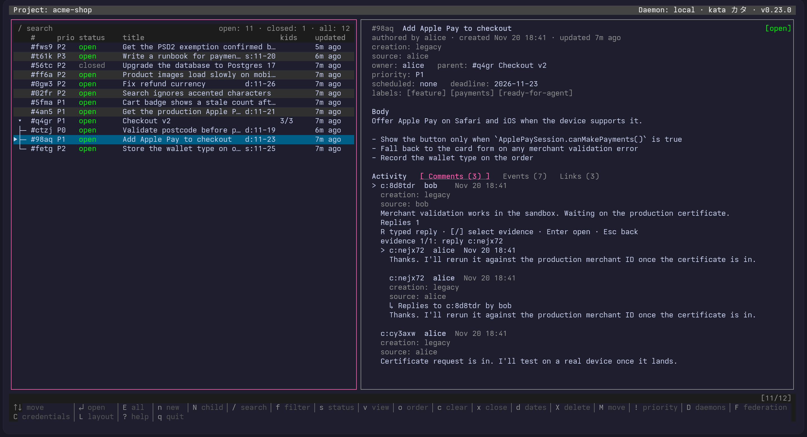

# Compared with `kata tui`

tern-kata takes kata tui's movement keys:

- `J`/`K` and the arrows;
- `Ctrl+N`/`Ctrl+P` to move a row;
- `PgUp`/`PgDn` and `Alt+V`/`Ctrl+V` to page;
- `G`/`Shift+G`;
- `Shift+I` to open the Inbox (from every Page, the Issue detail and the Menu sidebar; tern-kata opens it, where kata tui toggles it);
- `O` in the nested Issue list to switch siblings between creation order and blocking order (blockers first; creation order breaks ties and cycles), which it answers with "Graph order is topological." or "Graph order is temporal.". The choice lasts for the Pane and is not saved; `O` on the Runs Page still opens the session.

`?` opens the help sheet, headed "Keyboard shortcuts" with a Close button (`Esc`). It lists the global keys and the keys of the Page it is opened over, in the groups Everywhere, Issue list, Issue detail, Children, Cards, Filter and search, Menu, Board, Jobs, Workflows, Runs, Attention and More Pages. A row shows at most two keys (a run of digits reads `1-6`), with the verb first in sentence case and no card name ("Switch layout", "Move to Project", "Search jobs", "New job"). Quitting has two rows, "Quit, asking first" and "Quit now", and the search toggle's row reads "Search by words" or "Search by meaning", whichever `Ctrl+T` would switch to. The Emacs keys are named once under Everywhere, in no row of their own: "Emacs keys also work: `Ctrl+N`, `Ctrl+P`, `Ctrl+V`, `Alt+V`, `Ctrl+Alt+<` and `Ctrl+Alt+>`." They work wherever the arrows and the page keys do. The Emacs keys and `Shift+I` are plain text in search and in Popup cards.

## Activity tabs

The Issue detail has four tabs, Comments, Events, Links and Attachments, cycled with `Tab` and `Shift+Tab`. Each shows its row count in muted text after its name (`Events 13`; no count while it is empty), and the open tab is underlined in the accent colour. Events lists changes to the Issue only, each as its time, a thin rule, then who did what: a child linked to the Issue is named, and a metadata change says what it was set to: comments, the creation (the panel's Created row says who created it and when) and notification slot bookkeeping are not events. Links lists blocked by, blocks and related Issues under a heading per relation with its count, each with its title (read from kata for Issues of other Projects and for closed children, on every refresh, and cached); the parent and the children show in the properties and the Children table. Attachments lists the Issue's native attachments as `name · kind · size`, and `Enter` downloads and opens the one under the cursor (see [Attachments](attachments.md)).

The Comments tab shows a discussion as a reply tree, as kata's TUI does: a reply is indented under the comment it answers, down to four levels, after which deeper replies stay at the fourth. Replies to one comment are ordered by creation time, then UID, and a cycle of replies shows each comment once. A reply's head names what it answers: "replying to dana", "confirming dana", "refuting dana" or "superseding dana", with " in #bbbb" when the answered comment is in another Issue. A reply from another Issue has no row of its own: it is a muted "↳ <kind> <handle> in #<id> by <author> …" line under the comment it answers. A comment that confirms or refutes another carries a `confirm` or `refute` tag on the answered comment, reading "(before edit)" when all that evidence predates an edit of it, and a reply whose target changed after it reads "Target edited after this reply".

`Shift+R` on a comment in the Issue detail's Comments tab replies to it; `Ctrl+R` in the card cycles reply, confirm, refute and supersede.

`]` and `[` on a comment in the Comments tab step through its Comment links, wrapping around: the comment it answers (if any), then the Replies to it on any Issue, as kata returns them with the Issue detail. The comment under the cursor shows "link 2/3: fay refutes in #bbbb" for the chosen link (the first until you step), and `Enter` jumps to it, across Issues and Projects, landing on that comment. A comment without Comment links keeps `Enter` as it was.

## Credentials

`Shift+C` opens kata tui's Credentials view as a Lettered Page, and the Menu lists it. Its fields and 30-second refresh are kata tui's, drawn as cards of label and value rows with times in the Pane's zone; see [Pages and the Board](pages-and-board.md#lettered-pages). `N` creates an API token and `X` revokes the selected one after asking, as `kata tokens create` and `kata tokens revoke` do (kata tui itself only lists tokens); the secret goes to a new owner-only file you name and is never shown. The Token card and its rules are in [Pages and the Board](pages-and-board.md#lettered-pages).

## Federation

`Shift+F` opens kata tui's federation view as a Lettered Page, and the Menu lists it: the spoke federations as cards under a Page head (`Federation 2 · work · auth token`), a detail on Enter, `X` to leave one with the hub revoke, `B` to browse the hubs' Projects (read only), `N` to enroll a Project in a hub's federation and `Shift+N` to name the spoke. The order of the enrollment's steps is kata tui's; the hubs are the entries of kata's daemon catalog, each used with its own token. See [Pages and the Board](pages-and-board.md#lettered-pages).

## Daemons

`Shift+D` opens kata tui's daemons view as a Lettered Page, and the Menu lists it: the daemons kata's `config.toml` names, in a table of name, endpoint, auth and state, and `Enter` to switch this Pane to one. The switch lives in this Pane only and writes nothing to disk, as in kata tui; the top bar names the daemon by its catalog name and, when the daemon says who you are, the account ("work · remote · kata v0.21.0 · as alice"). See [Pages and the Board](pages-and-board.md#lettered-pages).

## Config

`Shift+K` opens the Config Page as a Lettered Page, and the Menu lists it. kata tui has no such view and no Search by meaning row: the Page lists tern-kata's own config files (`lanes.toml`, `filters.toml`, `views.toml`, `seen.toml`, `worker.toml`, `agent.toml`) with a status word (`ok`, `broken` or `not created`) and a one-line summary, a Docbank row that says what kata's `[docbank]` section sets up (with a **Switch to local Docbank** button, `S`, for tern-kata 0.10's pinned setup), a Search by meaning row that shows the status for the connected kata daemon (**Turn on**, `S`, turns it on, and `R` restarts the daemon when the setup waits for it), and shows kata's `config.toml` as `daemon entries edited on the Daemons Page · 2 daemons · asks before quitting` (its number of daemons and its `[tui] confirm_quit` setting); the Config Page changes nothing in it, and the Daemons Page edits its `[[daemon]]` entries. See [Pages and the Board](pages-and-board.md#lettered-pages).

## Jobs, Runs and Workflows

kata tui switches tabs with `1` to `4`: kata (the Issues), Jobs, Runs and Workflows. tern-kata numbers its Pages the same way for those four: `1` Issues, `2` Jobs, `3` Runs, `4` Workflows. The Board and Attention Pages come after them, as `5` and `6`.

kata tui's three tabs read the Project's Cron jobs, Runs and workflows, and open a record to follow its links (a run to its job and workflow, a workflow to the jobs that use it). Its writes are `N` and `E` on a job or a workflow (a workflow's JSON opens in `$EDITOR` with `Ctrl+E`; `Ctrl+O` saves). tern-kata's Pages show the same records and go further:

| | kata tui | tern-kata |
|---|---|---|
| Job card | New and edit for four kinds: Recurring Issue, Agent prompt, Workflow and Notification | The same four kinds, with the profile and checkout as pickers read from `worker.toml`, and a Backfill card before a catch-up of every missed run |
| Pausing and archiving | None; editing an archived job stops with "use the CLI to restore it before editing" | `P` pauses or resumes, `X` archives or restores, `A` shows archived jobs |
| Run now | None | `Shift+R` asks the worker to run the selected adapter job |
| Worker | None | `Shift+W` opens the Worker card for this machine's worker |
| Runs | The newest 100, read-only | `M` reads older runs, `F` narrows to a job, `I` opens the run's Issue, and `O`, `U` and `Shift+A` open the session of, resume or abandon a run of this machine's worker, held runs included |
| Workflows | `N` and `E` create and edit a workflow as JSON (`Ctrl+E` for the editor, `Ctrl+O` to save); an archived workflow stops with "use the CLI to restore it before editing" | The Workflow card makes and edits workflows as a form (steps one at a time; `Ctrl+E` opens the JSON), and adds `X` to archive, `R` to restore and `A` to show archived ones |

kata tui's `R` refreshes the tab; tern-kata reads again with `Ctrl+R`, and `R` on the Jobs Page opens the Runs Page filtered to the selected job.

## Links

In the Issue detail, `B` adds a Blocking link and `L` a related link to the Issue you name: a short id, `#id` or `project#id`. The field is kata tui's add-link request. kata records a Blocking link from the Issue you add it on, so the field reads "This Issue blocks (Issue id)"; kata tui words the same key "add blocker". When kata refuses the link (an Issue to itself, an archived Project, a Project outside your scope) its reason shows under the field. On the Board and in the Lane view `B` still toggles the Board.

## Timed assignment

`T` in the Issue detail gives the Issue to you for a set time. The field reads "Assignment duration (1m..24h, e.g. 1h)" and takes a Go duration of whole seconds from 1m to 24h (`90m`, `1h`, `24h`); anything else is refused with kata tui's wording, "duration must be a whole number of seconds from 1m through 24h". kata records the claim for your actor, and the Issue detail shows the owner and "until" the claim ends.

## Moving an Issue

kata tui's `Shift+M` previews the Issue and the descendants that move to another Project, then asks before it moves them. `Shift+M` in tern-kata is the same key and opens the Move card, which sends kata's move; like the CLI and web it moves the Issue with its descendants unless the card's "Only this Issue" switch is on (see [Moving an Issue](pages-and-board.md#moving-an-issue)).

## Deleting and restoring an Issue

kata tui's `Shift+X` (in the list, the detail, the Inbox and a detail opened from Attention) asks you to type `DELETE <project>#<id>`, and its `U` restores the Issue. tern-kata's `Shift+X` opens the Delete card, headed Delete Issue, which accepts the Issue's ref, `<project>#<id>` or `DELETE <project>#<id>`, has an optional reason field, and also works on the Board and in the Lane view. It sends kata's delete with `DELETE <project>#<id>` in the confirmation header. The Menu's **Restore a deleted Issue** brings back an Issue deleted earlier or elsewhere. See [Deleting and restoring an Issue](pages-and-board.md#deleting-and-restoring-an-issue). An account whose credential is limited to one Issue is offered neither, as in kata tui, which hides delete from it. Purge stays in the CLI.

## Closing with an attachment

The Close card for a `done` close can cite one or more of the Issue's Attachments as evidence, and the Events tab names a cited one; kata tui has no such choice. See [Attachments](attachments.md#citing-an-attachment-when-closing).

## Undo

`U` in the list, on the Board, in the Lane view and in the Issue detail takes back the newest change this Pane made, as in kata tui. The Pane remembers the last 20 completed changes, across Issues, and undoes the newest first. It undoes a close (reopens), a reopen (closes as done, opening the Close card first when kata requires evidence), an owner or priority change, a label added or removed, a body edit, a link added (the link is removed, found by type and its two ends), a Lane Move (its label changes reversed), a Dates card change (both dates put back in one write, guarded on the dates the change wrote) and a delete (the Issue is restored; "#12 is already restored." when kata no longer holds it as deleted). The Notice names what it undid: "Undid the close on #12." (the kinds are close, reopen, owner change, priority change, body edit, label addition, label removal, link addition, Lane move, dates change and delete). On the Attention Page `U` works as in kata tui only while the newest entry is a delete: it restores that Issue the same way and the Page reads its requests again; with any other newest entry, or none, the Page neither lists `U` nor reacts to it.

Before it writes, `U` checks, with kata tui's words, that it is still the same daemon and account ("daemon instance changed", "daemon principal changed"), the same Issue ("issue identity changed") and that nobody changed the Issue since: the revision the change produced for owner, priority and link ("issue owner changed since the action" and the like), the body text the change wrote for a body edit ("issue body changed since the action"; kata v0.21 takes no revision precondition on an edit, so a body edit landing in the instant between this check and the write is overwritten), the label state for a label added or removed (a label someone else changed reads "#12 is already restored."), the dates the change wrote for a Dates card change ("issue dates changed since the action"). A refusal drops that change and says "Cannot undo #12: <reason>."; the one after it can still be undone. An Issue already as the undo would leave it reads "#12 is already restored." A second `U` while one is out says "Cannot undo: another undo is in progress.", and with kata unreachable `U` says "Cannot undo: disconnected from kata."

Every other change to an Issue clears the history, and the next `U` says "Nothing to undo: <reason>.": creating an Issue, a comment or Reply, a timed assignment, a Recurrence change or stop, attaching or unlinking a file, and every Cron job or Workflow change. A change whose outcome is unknown (a timeout) clears it too. `U` never undoes an older change across one of these.

## Quitting

`Q` outside text fields asks "Quit tern-kata? y/n": `Y` or the **Quit** button quits, `N`, `Esc` or the **Stay** button stays, and every other key is ignored while the question shows. `Ctrl+C` quits at once, asked or not. `Q` typed into search or a Popup card stays text. kata's own `[tui] confirm_quit = false` in `<KATA_HOME>/config.toml` (`~/.kata/config.toml` unless `KATA_HOME` is set) makes `Q` quit at once in tern-kata too; a config file kata would refuse leaves the question on. Closing a tern-kata Pane (its tab, or Tern's close) follows the same setting as it stands when the Pane starts: Tern closes it without asking only when `confirm_quit = false`, and asks otherwise. While the Config Page's Docbank switch runs, `Q` and `Ctrl+C` are refused and a closing Pane waits for it (see [Attachments](attachments.md)).

## Key aliases

kata tui's alternative keys work where kata has them:

| Key | Same as |
|---|---|
| `Ctrl+J`, `Ctrl+K` | `Tab`, `Shift+Tab`: the next and previous tab of the Issue detail |
| `Backspace` | `Esc` where it goes back outside text fields: the Issue detail, the Lane view, the Menu's Views and Projects levels, the Jobs and Runs inspectors and the Lettered Pages |
| `Ctrl+Alt+<`, `Ctrl+Alt+>` | `G`, `Shift+G`: the first and last row of every list, the Issue detail and the Menu |
| `!` then `0`-`4` or `-` | set or clear the priority at once; any other key closes the field and is handled as usual |
| `Shift+T` | open the Attention Page, from any Page and the Menu |
