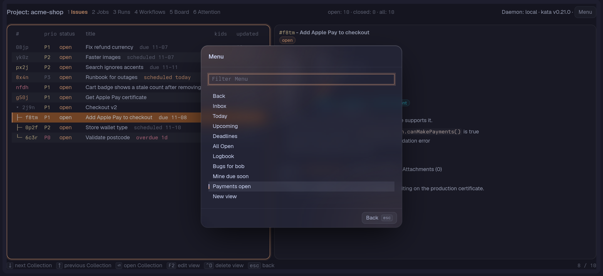
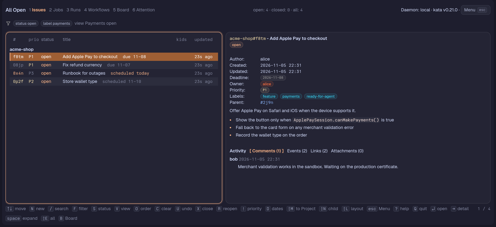
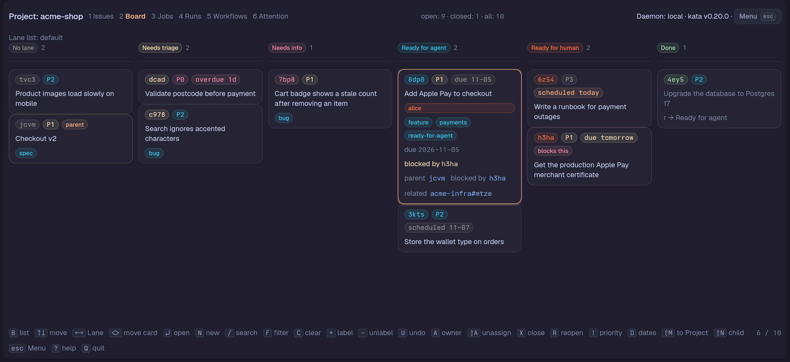
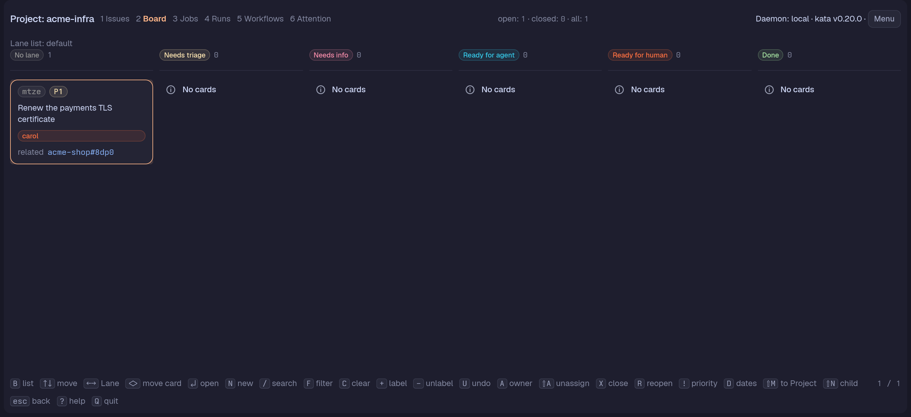

# Pages and the Board

tern-kata shows a Project through six Pages. This guide covers how the plugin is put together, the Page bar, the Issues Page, the Board Page and the Attention Page. The [Jobs](jobs.md), [Runs](runs.md) and [Workflows](workflows.md) Pages have their own guides.

## How it works

The plugin has three parts:

- **`tern-kata`**: a Go program that runs in a Pane. It talks to kata's daemon and draws the Issue list and detail with Tern's own widgets, using the Tern Surface Protocol. Run outside Tern, it falls back to `kata tui`.
- **Window plugin** (`window.luau`): adds **Open kata** to the palette and binds `F9`. Both open `tern-kata` in a split on the right, in the focused Pane's directory. It also opens kata links: `kata://<project>/<id>` or `https://kata.invalid/<project>/<id>` focuses the kata Pane in the current tab (or opens one there) and selects that Issue. A kata Pane in another tab is left alone.
  - **Go to the agent waiting for you**: a palette command, bound to `shift+F9`. It goes to the agent kata started that most recently began waiting for you, from any tab, and focuses its block. A Background agent opens beside its kata Pane, as a click on its Agent badge does. With none waiting it shows a toast and changes nothing. Agents kata didn't start are neither counted nor targeted. After a plugin reload, agents already waiting rank after those seen starting to wait.
  - **Status line**: "N waiting" in the warning tone, shown only while N > 0. A click runs the command above.
- **Host half** (`host.luau`): runs in Tern's session daemon, with or without a window, and keeps [the worker](worker.md) running. It does nothing until you create `worker.toml`.

In a directory bound to a kata Project, `tern-kata` opens that Project's Issues. A directory is bound when it, or a parent up to the enclosing git root, contains a `.kata.toml`, which `kata init` creates. Anywhere else it opens Inbox beside the Menu sidebar, where you can switch to another view (Today, All Open, Logbook and others), browse your kata Projects or create a new one. In a bound directory the same Menu opens as a popup with `esc`, and `P` opens it straight at the list of Projects. Press `?` for the keybindings.

## The Page bar

The top bar holds the **Page bar**, "[1] Issues  [2] Jobs  [3] Runs  [4] Workflows  [5] Board  [6] Attention", each Page's key drawn as a keycap like the footer's key hints. `1` to `6`, or a click on a Page, switch Pages; `b` toggles between Issues and Board. Each Page keeps its selection while another is shown. The top bar's Project heading is only a heading: the Menu button, or `esc` from the list, opens the Menu.

The Board, Jobs, Runs and Workflows Pages act on the Pane's Project: the current Project Collection, else the workspace's Binding (from Inbox or another fixed Collection in a bound workspace it switches to the Binding's Project). With neither it says so and opens the Menu's Projects list. The Attention Page acts on no Project: it reads every Project on the daemon, and neither a Project nor a Collection change touches it.

## Cards, menus and hovercards

Every Popup card draws its buttons in the card's footer bar, each with its key as a keycap. A choice field is a select, a switch or segmented tabs: `left`/`right` and `space` step through them, `down` opens a select, typing searches a long one, `enter` picks and `esc` closes it, and a click picks.

An Issue row, a Lane row and a Board card open a menu on a right click: Open, Agent…, Close, Priority…, Dates… and Move to Project, plus Reopen on a closed Issue, each with its key. Picking an entry selects that Issue first, then does what the key does on it. On a closed Issue, Agent… and Close are disabled and say why. Hovering an Issue reference, such as an id on a Relationships line or a Comment link, shows a card with the Issue's id, title, status, owner and update time.

Pages and lists with nothing to show draw an empty state saying so.

## Attention Page

`6`, or `T` from any Page and the Menu, opens the Attention Page: every **Attention request** kata holds for your **Inbox address**, in every Project on the daemon, newest Issue update first, as one full-width list. A request is a `notify.<address>` slot on an open Issue. It comes from a Worker run that is held and needs the Issue's owner or author, a notify Cron job, kata's date sweeper, a typed Reply to one of your comments, `kata notify --re` (asking you to answer a comment) or `kata notify --broadcast`. Only open Issues are listed.

- **Address**: `KATA_INBOX_USER` when it is set and not blank, otherwise the actor the Pane writes as (`--as`, `$KATA_AUTHOR`, `$USER`, git `user.name`). It is read once, when the Pane starts, and trimmed. kata's recipient rules apply: not blank, at most 128 bytes, valid UTF-8, no control or format characters. An address kata would refuse is shown with the reason, and nothing is read.
- **Page bar**: the entry draws a badge with the count after its name while requests wait ("[6] Attention 3" with three), and no badge at zero, on every Page; the compact Page bar keeps the badge. The Pane asks for the requests again after it connects, on every Issue or Project event of the daemon and after a stream reset, whether or not the Page is shown; a burst of events costs one read in flight and one after it. The count is the last read that succeeded, so a failed read keeps it. The bar's width rules count the badge.
- **Header**: "for dangerboi · 3 requests", plus "· 1 skipped" when a stored request could not be read the way kata reads it. Such a request is left out and counted, never shown as garbage.
- **Rows**: `project#id` and the title, then who asked (`actor`, or `actor/teammate`), a tag (`request`, the reply kind `reply`, `confirm`, `refute` or `supersede` for the notice a Reply left, or `broadcast`), the comment handle (`c:abc123`) when the request names a comment, and the first line of the message. The selected row shows the whole message, wrapped.
- **States**: "No requests" with "Nothing is waiting on dangerboi; a request shows here when someone asks it." when nothing waits; kata's error line over the rows already read when a read fails; the reason when the address is refused.
- **Keys**: `↑`/`↓` (or `j`/`k`) move, `Enter` opens the request's Issue on the Issues Page with its detail focused, in whichever Project it lives; when the request names a comment, the detail opens on its Comments tab with that comment under the cursor, so `R` answers it (and kata clears the request once the Reply is saved), and a notice left by a Reply opens on that Reply. A comment that is gone leaves the cursor on the first comment, `c` clears the selected request, `m` messages the agent that raised it ([Messages to an agent](agents.md#messages-to-an-agent)), `r` sends it a [quick reply](agents.md#quick-replies), and `ctrl+r` reads again. `c` clears only if the request still reads as the Page showed it: when it was rewritten meanwhile, "The request changed meanwhile; nothing was cleared" shows and the Page reads again, so the new request is on screen before you decide. While a clear is out, `c` and `Enter` on that row wait. `6` brings the Page back as you left it, with the same request selected. `u` restores the Issue just deleted, only while the newest entry of the undo history is a delete (as in kata tui): the Page then reads its requests again. With any other newest entry, or none, `u` is neither listed in the footer or help sheet nor does anything here.

## Lettered Pages

A **Lettered Page** has a letter for its key instead of a number. It opens from any Page and from the Menu, where it is listed, and the Page bar draws it only while it is shown ("[1] Issues ... [6] Attention  [C] Credentials"). Esc or backspace returns to the Page shown before. A Lettered Page does not act on the Pane's Project, and choosing a Collection from the Menu leaves it.

`C` opens the **Credentials Page**: the daemon's API tokens, newest first, one card each with kata tui's fields (state, id, name or "—", actor, scope or "global" with the Project and root Issue uid, created, expires, last observed use, revoked; times in UTC as `2006-01-02 15:04:05Z`) under "N credentials · observed at <time>". It reads the connection's auth capabilities first; an account without token audit read sees "credential audit unavailable for this connection" and why. It refreshes every 30 seconds, `r` refreshes at once (or retries a failed check), and `j`/`k` move the cursor. It shows "loading credential inventory...", "no credentials" and kata's errors in kata tui's words.

`n` on the Credentials Page opens the **Token card**, which makes an API token as `kata tokens create` does. Its fields, with `tab` between them:

- **Actor**: required, prefilled with the Pane's actor.
- **Name**: optional.
- **Expires in**: a positive whole-second duration (`720h`, `90m`); optional for an account token, required for an Issue-subtree token.
- **Scope**: `account` (the default) or `issue`.
- **Issue**: for scope `issue`, the root Issue as a short id, `#id` or `project#id`. The Pane resolves it to its Project and root Issue; an account token takes none.
- **Teams**: optional, comma-separated team names or uids, at most 256.
- **Token file**: the path of a new file for the secret.

The secret goes from kata's answer into the token file, which is created new and readable only by you (mode `600`; on Windows access for your account alone). An existing path, link included, is refused before anything is sent, and a failure after the token exists revokes it and removes the file. The secret is never drawn, logged or kept in the Pane: when the token is made, the card says "Created token <id>" and names the file, and `enter` or `esc` closes it. kata's refusals show on the card with your text kept: identity mode off (`auth.require_token_identity`), `issue_subtree_tokens_unsupported`, `scoped_token_spoke_forbidden`, no permission, an unknown team.

`x` on a token opens "Revoke token <id> (<name>, <actor>)? This cannot be undone."; `y` revokes it and `n` or `esc` keeps it. A token already revoked is not asked about. After a create or a revoke the list is read again.

`K` opens the **Config Page**: tern-kata's config files on this machine, under "N files in <config folder>", one card each in three lines: the file and whether it is missing, loads or does not load, its absolute path on this OS, and a one-line summary. The rows are `lanes.toml` (how many Projects have a Lane list), `filters.toml` (how many have a default filter), `views.toml` (the saved views, and how many were skipped as invalid), `seen.toml` (how many Projects have a seen mark from the Runs Page and how many have since you last looked on; a missing file reads "not created: no Runs marked seen"), `worker.toml` (how many Projects it serves, and whether the plugin supervises the worker or `worker.manual` turned that off), `agent.toml` (the top-level actor, host, name, command and message_from actors, and the Projects that have their own table; a missing file reads "agents start with the defaults") the Docbank row (the `[docbank]` section of the default kata daemon's `config.toml`, whichever daemon the Pane is switched to, with that file as its path: `not set up: kata docbank setup sets Docbank up`, `the Docbank on this machine: kata starts it when needed and follows its port and key` for `local = true`, `Docbank at <url>`, `pinned to <url> by tern-kata's old setup: kata does not start it` for the loopback url tern-kata 0.10 wrote, or the reader's error; `s` on the old pinned form asks "Switch to kata's local Docbank? kata restarts its daemon. y/n" and switches it, the other forms have no key) and kata's own `config.toml` (marked read-only: the number of daemons in the Daemon catalog and whether `q` asks before quitting). A missing `lanes.toml`, `filters.toml` or `views.toml` reads "not created" with the default it implies, a missing `worker.toml` "no worker set up" and a missing kata `config.toml` an empty catalog. Each file is read by the same reader its feature uses, so a file that does not load shows that reader's own error: the selected card's full error is drawn, wrapped, under the list, and every other row still shows. `j`/`k` and clicks move the cursor. The Page is read again each time it opens, and says so when tern-kata's config folder cannot be found, listing no rows. `enter` opens what already edits the selected file, and the footer names it: `lanes.toml` opens the Board Page and then the Lanes card (once the Lane list has been read, so the card starts on the source in use); `filters.toml` the Issues Page and then the Filter card; `views.toml` the Menu at its Views level (its back returns to the Menu's top level), opened in the sidebar when one is shown, as `P` does for Projects; `seen.toml` the Runs Page; `worker.toml` the Jobs Page and then the Worker card; kata's `config.toml` the Daemons Page, whose back key returns to the Page shown before the Config Page. A Page that needs a Project and finds none shows its usual "needs a Project" notice and opens no card. `agent.toml` has no card and `enter` does nothing on it. After a jump the Config Page is closed, and `K` reads the files again, so a change made in the card shows. A click on a row's button does what `enter` does. `e` on the `agent.toml` row opens the file in `$VISUAL` or `$EDITOR` (from a commented starter that shows every key when there is no file), checks the result with the rules an agent start uses and writes it only if it loads and the file did not change while you edited; see [agent.toml](agents.md#agenttoml). An unchanged or blank result changes nothing. Apart from that save the Page writes nothing.

`D` opens the **Daemons Page**: the daemons named in kata's `config.toml` (`[[daemon]]` entries, read from `$KATA_HOME`, else `~/.kata`), under "N daemons", one row each with kata tui's columns: the daemon, its endpoint ("local" for a local entry, else the url's host), "token" or "no token", and "current" on the daemon this Pane talks to. Under the list the selected daemon's `name · endpoint`, with `· allow_insecure` when the entry sets it. `j`/`k` move the cursor, and it starts on the current daemon. Enter switches this Pane to the selected daemon and leaves the Page: the Pane starts over on it with an empty Collection, no Page, cache, filter or undo history of the old daemon ("nothing to undo: connected to a different daemon"), and follows the new daemon's events. Your workspace's Project is bound again when the new daemon has one by that name, else the Pane starts on the Inbox. A switch changes this Pane only and writes nothing to disk, so other Panes and the CLI stay where they were. A local entry whose daemon is stopped is started first, as in kata tui: kata's client runs `kata --daemon <name> daemon recover` for an entry with a `home` (a profile; it never creates storage), and `kata daemon start` for any other local entry, with the Pane's own environment, so a `KATA_DSN`, `KATA_DB` or `KATA_SERVER` set for the Pane reaches the started daemon; with no `kata` on `PATH` the stopped daemon is reported, not started, and a remote entry is never started; this is the one case in which tern-kata starts a daemon. A switch that fails shows `daemon "<name>": <reason>` and keeps the current connection. With no `[[daemon]]` entry the Page says "no named daemons" and names the file to add one to. The top bar names the current daemon by its catalog name and, when the daemon says who you are, the account: "Daemon: work · remote · kata v0.21.0 · as alice".

`F` opens the **Federation Page**: this daemon's spoke federations, the Projects that replicate a Project on a hub. A header reads "Federation for active daemon: <name> <endpoint> instance <uid> auth <auth>", then "N spoke federations" and one card per Project in two lines: the Project (with "Name <spoke name>" after it when the hub gives this daemon a name), its hub host and actor, then push ("push" or "off"), pending pushes, last sync ("never", "error", or "5m ago") and badges (`insecure`, `quarantine`, `reset`, `violations`, or "-"). Under the list the selected Project's `hub <URL>/project <id> · actor <actor> · credential <status>`. `j`/`k` move the cursor and Enter shows the Project's detail: the spoke name ("-" when there is none), hub URL, hub Project id and uid, actor, capabilities (`pull`, `push`, `lease`), push enabled, credential, `allow_insecure`, the pull and push cursors, pending push and its high water, pending and live claims, each quarantine, the reset blocker, claim violations, and the last pull, push and sync success and last error in UTC. Esc or backspace leaves the detail, then the Page; `r` reads the status again from the list or a detail. It shows "loading federation status...", "no spoke federation enrollments" and "failed to load federation: <error>" in kata tui's words, a failed read replacing the list until the next read.

`x` on a Project, in the list or its detail, opens the leave preview: the local Project, the hub, the hub Project id, what becomes of the local Project and whether the leave is local-only. `d` switches between detaching ("keep (detach) — standalone with all issues") and archiving ("reversible via kata projects restore"), `l` makes the leave local-only (the preview warns that the enrollment token stays valid until manually revoked), Enter runs it and esc or backspace goes back to the list. Running it asks the spoke to check the leave first, then, unless local-only, lists the hub's enrollments and revokes those for this spoke's instance and the hub Project, then leaves. A grant for another instance blocks the leave when none matches ("revoke the right one with `kata federation revoke <id>` on the hub, or retry with local-only"), a grant for this spoke that is not limited to a Project is left active and named on the result, and a hub that cannot be reached or refuses stops the leave with "hub revoke failed: …; retry with local-only to tear down locally, then revoke on the hub later". The hub is the daemon catalog entry whose URL is the Project's hub, with its token; with none the hub is asked without a token. A failure stays under the preview and Enter tries again; a success shows status (detached or archived), Project, hub and what was revoked, and Enter or esc returns to the list, read again.

`N` on a Project, in the list or its detail, opens "Rename Spoke": the name the Project's hub keeps for this daemon, so hub event history and the hub's enrollment list say which spoke is meant (kata v0.21's spoke names). The card starts on the current name; Enter sets it on the hub, with the hub's own `token_env` token, and an empty name clears it. A name is a letter, then up to 31 lowercase letters, digits or hyphens: the card refuses another itself, before anything is sent, with kata's reason ("invalid federation spoke name: … must match [a-z][a-z0-9-]{0,31}") and your text kept, and enrolling checks the name again before it touches the hub. A name the hub holds for another spoke is refused by the hub and shows the same way. The name belongs to the daemon, not the Project, so every spoke of that hub shows it once it is set. The Page reads each hub's names with the catalog token for that hub's URL; a hub it cannot read leaves its spokes unnamed.

`b` browses the hubs of kata's daemon catalog (`<KATA_HOME>/config.toml`), read only: the Projects of every entry that is neither the active daemon nor local, each read with that entry's own `token_env` token and never the global one, shown as "<hub> <id> <name>" under a line per hub ("catalog hub: <name> <URL> · auth <auth> · allow_insecure: <bool>"). A hub that cannot be read says "failed to load hub projects: <error>" without hiding the others, and with no such entry the Page says "failed to load hub projects: no catalog hub daemons configured". `j`/`k` move, and esc or backspace goes back to the list.

`n` enrolls a Project in a hub's federation, in kata tui's steps, each with `j`/`k` to move, Enter to choose and esc or backspace to go back one step:

1. **Local Project**: "create new local replica from hub project", or one of this daemon's Projects by name (the archived ones are not listed) to adopt. The cursor starts on the Pane's own Project, so adopting is never armed without a choice.
2. **Hub**: every daemon of the catalog, "<name> <URL> auth <auth>" with " allow_insecure" and " (active spoke)". The active daemon is refused ("active daemon cannot be selected as hub"), and so is a local entry ("local hub targets cannot be used for federation enrollment; …"), as is a hub whose `token_env` variable is unset.
3. **Hub Project**: the hub's Projects. Adopting lists first a row that uses the hub Project of the local Project's name ("use existing hub project "x"; enable federation if needed") or creates it ("create hub project "x" and enable federation"), then every other hub Project; creating a replica lists every hub Project. The requested actor is the account the hub says the read acted as, else the Pane's actor.
4. **Preview**: the operation (adopt, adopt into the selected hub Project, new replica or rejoin), the local Project, the hub and its auth, what happens to the hub Project, the actor, `pull,push,lease`, push and `allow_insecure` and the spoke name ("-" when none), with the adoption warning ("pre-adoption event history is replaced by snapshot events for federation") when it adopts. It says "Blocked: …" and Enter does nothing when a local Project of that name exists, the Project already has a federation binding (as spoke or hub), or an identity is unknown. A local Project that already shares the hub Project's identity (it left the federation earlier) rejoins instead and needs no adoption. `N` names the spoke before it runs ("Name Spoke", empty for none; the rules are those of renaming); the hub records the name with the enrollment, and a name it refuses fails the run before anything is granted, with its reason under the preview.
5. **Adopting** asks you to type the local Project's exact name; any other text answers `type "x" to confirm adoption`, and esc goes back to the preview.
6. Enter then runs it: on the hub, ensure the Project (same-name adoption only; an idempotent init), enable federation and create the enrollment; read the hub Project's federation metadata with the enrollment's token; create the replica on the spoke. The result shows status (joined or adopted), actor, spoke name, snapshot count, hub URL and the hub Project's id and uid, and Enter or esc returns to the list, read again. Esc does nothing while a run is out.

A failure before the hub granted the enrollment stays under the preview, and Enter tries again. A failure after it (reading the metadata, or the spoke refusing the replica) keeps a **recovery**: "hub: enrollment created / spoke: join failed / token: hidden", with the failure. `R` reveals the single-use, secret-bearing `kata federation join …` command, with the enrollment's token and, for a remote active daemon, its `KATA_SERVER` settings; it is drawn only on request, and esc goes back to the preview.

## Issues Page

The Issues Page is the list and the Issue detail.

- **List**: a Project's Issues nested under their parents, with priority, status, child counts and age.
- **Detail**: the Issue's Markdown body, its properties, its Children as a table (a click on a row jumps to that child; hovering a row's ticket shows the child's id, title, status, owner and update time) and the Activity tabs (Comments, Events, Links, Attachments). Changes made anywhere, by you or an agent, show up live.
- **Collections and the Menu**: the Menu (the top bar's Menu button, or `esc` from the list) opens on the bound Project, **Views**, **Projects**, the Lettered Pages (Credentials, Federation, Daemons, Config), Restore a deleted Issue and New Project. **Views** opens a level of Back, Inbox, Today, Upcoming, Deadlines, All Open, Logbook, your [saved views](#saved-views) by name and New view; **Projects** (or `P`) opens a level of Back and every kata Project, and `I` opens the Inbox from anywhere. `esc`, `backspace` or Back leave a level for the top, with the cursor on the row that led there; while a fixed Collection is current, the top level's Views row names it on the right (or the saved view, while one is current) and the Menu opens with the cursor on Views. Typing in the Menu filters every level at once: "tod" finds Today, "alp" finds the Project alpha. In a directory bound to no Project the Menu sidebar shows the Views level. Beside the Collections, `/` searches and `f`, `s`, `c` filter any of them.

### Saved views

A saved view is a base Collection (a fixed one or a Project) with the Filter card's fields and a search text, saved under a name. They live in `views.toml` in tern-kata's config folder beside `filters.toml`, on this machine for every Project, and [`tern-kata views`](views.md) works on the same file.



- **New view**, the last row of the Menu's Views level, opens the View card: **Name** (required, at most 64 characters, unique ignoring case, and not a fixed Collection's title or key), **Base** (a fixed Collection or a Project, prefilled with the current Collection), the Filter card's fields and **Search**, prefilled with the current filters. `tab` and `shift+tab` move between fields, `←`/`→` change a choice, `ctrl+o` or `ctrl+s` saves and opens the new view, `esc` cancels. A refusal names the field and keeps what you typed; so does a `views.toml` that changed since the Pane read it.
- Saved views are listed by name after the fixed Collections. Opening one makes its base current with its filters applied, and the filter line under the top bar ends with "view <name>" while the filters equal it. `c` clears the filters for this Pane only. An owner of `@me` means this Pane's actor when the view opens.

  

- On a saved view's row `f2` edits it in the View card (a rename keeps its place in the file) and `ctrl+d` asks "Delete view <name>? y/n"; both are in the footer and on the help sheet (`?`). Letters and `ctrl+a`/`ctrl+e` stay with the Menu's filter box.
- A view whose base Project is gone or archived stays listed with "(Project gone)" or "(archived)"; opening it says so and changes nothing.
- The Pane reads `views.toml` when it starts and each time the Menu opens, so a view saved by another Pane or by `tern-kata views add` appears without a restart. A file that cannot be read is reported and left untouched, and the fixed Collections still work.

### Filters

- `s` cycles the status filter (on the Issues Page; the Board ignores status, see [the Board](#lanes-and-cards)), `f` opens the Filter card (project, status, owner, label, relationship; the Board's card has no Status row, and Apply and `ctrl+d` there keep the status filter as it was), `/` searches text and `c` clears every filter for this Pane.
- The filter line under the top bar shows each active filter as a chip after a funnel: "status open", "owner me", "label bug,ux", "relationship has parent", "search text". It is gone while no filter is on.
- Field filters narrow a Collection but keep its grouping and headings: Today with status open still shows Overdue and Today. Only a text search or a search by meaning shows the flat **Results** list. Where a view groups by Project (All Open), the headings are ordered by Project name, as in kata's web UI, so `app` comes before `app 2` and `tern` before `tern-kata`.
- `ctrl+t` in the search box switches it between by words (the text filter above) and **search by meaning**; the footer and the help sheet (`?`) offer it. Search by meaning works inside one Project: a Project Collection, or a saved view scoped to one Project. In the Inbox, Today and the other Collections the key says "search by meaning works inside one Project" and the search stays by words.
  - Typing only edits the query. `enter` runs kata's search of the Project with the Status and Label filters and lists the best 50 Issues in kata's order as flat Results; the list keeps the last results until the next `enter`, and a live refresh does not run the search again, because each run embeds the query. A second `enter` commits the search as it does for words, and the ranked list stays until the search is cleared. `ctrl+t` on the results switches them to by meaning and runs the search at once.
  - Changing the Status or Label filter after a search by meaning ends the ranked list: the list goes back to the words filter on the same text. Switching to another Collection ends it too and turns by meaning off.
  - The search line under the box says what kata said: "kata searched by words: <reason>" when kata's embeddings are off or failing (without a reason it says to turn search by meaning on with `kata daemon local-embeddings`), "showing the best 50" when more Issues match, and that the Owner and Relationship filters don't apply while one is set. A failed search shows kata's error and keeps the rows.
  - A short id typed in the box still jumps to its Issue. `esc` out of the query puts back the search you had before you opened the box (a ranked list stays ranked, a words search stays by words) unless you switched Collection meanwhile. `/` on ranked Results continues by meaning; any other new search starts by words. A saved view and the default filter keep only the text.
- `ctrl+d` in the Filter card saves the card's values as the **default filter** of the Project the Pane's folder is bound to, and applies them. The card stays open, saving, until the save answers; a failure keeps the card and its values with the error. An empty card removes the default. Search text is never saved, and a folder bound to no Project has no default.
- A Pane starts with its Project's default already applied, and the filter line under the top bar ends with "default" while the active filters equal it. `c` clears the filters for this Pane only; the default returns the next time a Pane starts.
- Defaults live in `filters.toml`, beside `lanes.toml` (the paths are in [the Lane list file](#the-lane-list-file)), one table per Project UID with only the filters that are set; other tables and keys you add are kept on save:

```toml
["01JABC..."]
name = "work"
status = "open"
owner = "me"
```

  A file that cannot be read starts the Pane unfiltered with a Notice naming the file and its error, and a save is refused rather than overwriting it.

Editing from the Pane:

| Key | Action |
|---|---|
| `n`, `N` | Create an Issue; `N` makes a child |
| `x`, `r` | Close; reopen |
| `c`, `R` | Comment (in the detail); reply to a comment |
| `m` | Ask the Issue's agent to answer the comment under the cursor (Comments tab; [Messages to an agent](agents.md#messages-to-an-agent)) |
| `]`, `[` | Next, previous Comment link (Comments tab); `enter` follows the chosen one |
| `+`, `-` | Add or remove a label |
| `a`, `A` | Owner |
| `!` | Priority: `!` then `0`-`4` or `-` sets or clears it at once; any other key closes the field and does what it usually does |
| `p` | Parent |
| `b`, `l` | In the Issue detail: add a Blocking link (this Issue blocks the one you name) or a related link; `b` still toggles the Board elsewhere |
| `t` | In the Issue detail: timed assignment to you, 1m to 24h (see [Compared with `kata tui`](kata-tui.md#timed-assignment)) |
| `O` | Recurrence (see [Recurring Issues](recur.md)) |
| `d` | Dates (see [Dates](dates.md)) |
| `S` | Message every running agent on the Issue and its open children (see [Messages to an agent](agents.md#messages-to-an-agent)) |
| `M` | Move the Issue to another Project (see [Moving an Issue](#moving-an-issue)) |
| `X` | Delete the Issue after typing its id (`project#id` or `DELETE project#id`); restore it with `u` or from the Menu (see [Deleting and restoring an Issue](#deleting-and-restoring-an-issue)) |
| `@`, `U` | Attach a file; list and unlink Attachments (see [Attachments](attachments.md)) |
| `u` | Undo the last change this Pane made (see [Compared with `kata tui`](kata-tui.md#undo)) |
| `o` | In the nested Issue list: switch siblings between creation and blocking order (see [Compared with `kata tui`](kata-tui.md)) |
| `q` | Quit, after "Quit tern-kata? y/n" (see [Compared with `kata tui`](kata-tui.md#quitting)) |
| `e` | Edit the Issue body in Tern's editor |
| `?` | The global keys and the current Page's keys |

The Issue detail's Activity tabs are described in [Compared with `kata tui`](kata-tui.md).

## Moving an Issue

`M` on the selected Issue (in the list, on the Board, in the Lane view and in the Issue detail) opens the **Move card**, as kata web's move does. kata tui's `M` is the same key: it previews the Issue and the descendants that move, then asks. tern-kata sends kata's move action.

1. The card lists the Projects of the Collection snapshot, without the Issue's own Project and without archived ones. Type to filter the list by name (any case); `↓`/`↑` move, and `esc` closes the card.
2. `enter` on a Project sends the move as a dry run: kata checks it and changes nothing. The card then reads "#id moves to <project> and gets its new id there" (see below for an Issue with descendants): kata assigns the new short id only when it moves the Issue, so a preview cannot name it. When kata refuses (for example "cross-project moves involving a federated project are unsupported", a recurring Issue, or an import mapping that already exists in the target), its reason shows on the card and the list stays for another choice.
3. `enter` again moves the Issue. `esc` goes back to the list.

kata moves an Issue **with its descendants**, as its CLI and web do. The preview then reads "#id and 2 descendants move to <project> and get new ids there: #b, #c", naming each descendant by short id (qualified with its Project when it lives in another one; past eight it counts the rest). The card's **Only this Issue** switch, which `o` and a click toggle, moves the Issue alone and leaves its descendants where they are; flipping it asks kata for a new preview. kata refuses a subtree move when a descendant is in an archived Project (the card names the descendant and keeps the chosen Project, so you can switch on Only this Issue) and when the descendants changed while it checked the move (`enter` previews again). After a subtree move the Notice says how many Issues moved.

The move is a Guarded write: it carries `If-Match` with the revision the card opened with (the preview carries it too). kata moves its revision on owner and status changes only, so a move after such a change is refused; the card stays open, says the Issue changed since it opened and nothing was moved, and `enter` asks for a fresh preview (read at the revision as it stands now) before `enter` moves.

After the move a Notice names the new `project#id` as a link: click it to open the Issue in its new Project. The selection goes to the neighbouring row when the Collection no longer lists the Issue, and an open Issue detail closes to the list. A move cannot be undone: it clears the undo history.

## Deleting and restoring an Issue

`X` on the selected Issue (in the list, on the Board, in the Lane view and in the Issue detail) opens the **Delete card**, which soft-deletes the Issue through kata's delete action, as the CLI's `kata delete` does. kata keeps a deleted Issue and its history, so it can be restored. An account whose credential is limited to one Issue is offered neither `X` nor **Restore a deleted Issue**, because kata refuses both to it: the Pane reads the daemon's auth capabilities when it connects and again after a daemon switch, and until the answer arrives (or when it fails) both are offered as for any account.

1. The card names the Issue's qualified id (`project#id`) and title, says a deleted Issue can be restored, and asks you to type the qualified id, or `DELETE` and the qualified id as kata tui asks. An optional reason goes in the second field (`tab` moves between the two).
2. `enter` with `<project>#<id>` or `DELETE <project>#<id>` typed (surrounding spaces ignored) sends the delete with kata's confirmation, `DELETE <project>#<id>`, and the actor. kata's delete records no reason, so a reason is first added to the Issue as a comment, `Deleted: <reason>`, by you; it shows in kata too. If that comment fails nothing is deleted and the card shows the error; if the delete fails after the comment, the comment stays. With anything else typed, the card refuses, names both forms and sends nothing. kata's own refusals (a federated replica, a changed Issue) show on the card, which stays open. `esc` closes it.
3. After the delete the Issue leaves the list, the selection goes to the neighbouring row, an open Issue detail closes to the list, and a Notice says "Deleted project#id. Press u to restore it."

`u` right after a delete restores the Issue (also on the Attention Page, where it is offered only for a delete): the delete enters the undo history like any change, and the restore is refused as "already restored" when kata no longer holds the Issue as deleted. To bring back an Issue deleted earlier or elsewhere, open the Menu and choose **Restore a deleted Issue**. Its one field takes a short id (in the Pane's Project), `project#id` or an Issue's ULID. `enter` reads that Issue with deleted Issues included and shows its title and that it is deleted; `enter` again restores it. A delete's reason stays on the Issue as its `Deleted: <reason>` comment, visible in kata, through `u` and any restore. An Issue kata holds as not deleted is shown as such, and restoring it reports kata's answer that nothing changed. A restore from the Menu clears the undo history. Purging an Issue, which cannot be undone, stays in the CLI.

## Board Page

`b` in a Project Collection shows the Project's Issues as a **Board**; `b` or `1` again returns to the list with the same Issue selected. `5` also opens it.



Columns, left to right: **No lane** (open Issues with none of the Lane labels, always shown), one **Lane** per label of the Lane list, and **Done** (Issues closed today or in the 14 days before, at most 20 of them, newest closed first; the header says "Done 20 of 192" when more qualify; both numbers are per Project, see [the Lanes card](#the-lanes-card)).

Enter opens the card's Lane beside the Issue detail. Clicking an id on the Relationships line selects that card; an Issue the Board doesn't draw (closed beyond Done, filtered out) opens in the detail beside the Lane view, and Esc goes back. An id of another Project switches the Pane to that Project, on the same Page: below, the id of "Renew the payments TLS certificate" was clicked on the acme-shop Board, and the Pane shows the acme-infra Board with that card selected and the top bar reading "Project: acme-infra". On the Issues Page the Project's list opens with the Issue selected and its detail focused, the heading the bare `#id`; the same goes for the detail's Links and children rows, `^` and a kata link. Esc goes back to the Collection, Page, Lane view, selection and focus you came from, one step per hop. Collections that span Projects (Inbox, Today, All Open and the others) stay as they are, and their detail heading names the Project, `acme-infra#59yd`.



### Lanes and cards

- The Lane list is `needs-triage`, `needs-info`, `ready-for-agent`, `ready-for-human` unless the Project has its own (see [the Lane list file](#the-lane-list-file)). A Lane is one kata label: an Issue sits in the first of its Lane labels in Lane order, and an Issue with none (an unlabelled one, or one labelled only `bug`) sits in No lane. An Issue with several Lane labels shows once, with "also: …" naming the rest. A closed Issue keeps its Lane label, and its Done card says "r → <Lane>", the Lane `r` reopens it into.
- A card shows its short id, its priority as a badge beside it (`P0` error, `P1` warning, `P2` info, other priorities muted; none without a priority, and Done cards keep it), its title over at most two lines (a recurring Issue's starts with "↻ ", as in the list, and Done cards keep it) and its labels that aren't Lane labels. The selected card shows its full title, owner and every label.
- The Board and its Lane view ignore the status filter: Lanes hold open Issues and Done the recently closed ones whatever `status` says, the filter line leaves it out, and `s` is not bound there. The status filter stays set and applies again on the Issues Page. The other filters (`/`, `f`, `c`: project, owner, label, relationship, search) narrow the Board as they do the list, `c` clears status too, and a live refresh moves cards.

### Moving around and moving cards

- `↑`/`↓`/`j`/`k` move within a Lane and `←`/`→` to the neighbouring Lane that has cards. A click selects a card. `x` opens the Close card (on a closed Issue it says the Issue is already closed), `r` reopens a closed Issue into its Lane, and `+`, `-`, `a`, `A`, `!`, `p`, `u` (undo), `@`, `U`, `e` and `n` act on the selected card as in the list. `esc` opens the Menu.
- `>` moves the selected card one Lane right and `<` one Lane left, among No lane and the Lanes; a Move never enters or leaves Done (`x` closes, `r` reopens). Leaving No lane adds the first Lane's label; moving into No lane removes the Lane labels and keeps every other label.
- A Move adds the target label first, then removes the other Lane labels, so a failure halfway leaves the Issue in two Lanes, never none, and a Move of an Issue with two Lane labels leaves it with one. The card shows in its new Lane at once; a failure leaves a Notice with the daemon's reason. Moves are refused while the daemon is disconnected.

### The Lanes card

`B` (on the Board or in the Lane view) opens the **Lanes card**: a field holding the Lane list as comma-separated names, in order (`needs-triage, in review, ready-for-agent`), then **Days back**, **Most cards** and **Save to** (`tab`/`shift+tab` move between the fields). Its first line names the list in use: shared with the Project, this machine or default.

- A blank Done field restores its default (14 days, 20 cards); anything but a positive whole number is refused with a message naming the field.
- **Save to** is **This machine** (the [Lane list file](#the-lane-list-file)) or **The Project** (its shared list, for everyone on the daemon); `←`/`→` or `space` change it. It starts on the source in use.
- An archived Project keeps its shared list on the Board, but kata refuses any change to it: **The Project** and `ctrl+x` are refused on the card with that reason, without asking kata. Restore the Project first, or save to **This machine**.
- `enter` saves to the chosen place and `esc` cancels. `ctrl+x` (or the **Stop sharing** button) removes the Project's shared list, and the Board goes back to this machine's list.
- Each name is tidied to a label (`In review` reads `in-review`); an empty name, a name over 64 characters and a duplicate are refused with a message naming the entry.
- Saving an empty field removes the list, which restores the default list.
- `B` waits, with a Notice, until the saved list has loaded.
- A muted line lists the labels on loaded Issues that aren't Lanes yet.
- Saving never changes a label in kata, so renaming a Lane just changes which label it shows.
- Sharing is guarded on the Project's revision when the card opened. When the Project changed meanwhile, nothing is written: the card keeps your text and names the list the Project shares now, and `enter` again replaces it. A refusal (a read-only token, a federated spoke) shows kata's reason on the card; **This machine** still saves.
- Saving to this machine while the Project shares a list writes `lanes.toml` but keeps showing the shared list, with a Notice, until sharing stops.

### Relationships, blockers and dates on cards

- An open card that an open Issue blocks shows a **Blocked marker** in the warning tone, "blocked by e5f6": every open blocker, as a short id inside the Project and `project#id` outside it, cut to three and "+N". It shows on every card, selected or not, but never on Done cards, and a card whose blockers are all closed shows none. Blockers count even when the Board doesn't draw them (filtered out, closed beyond Done, in another Project), and a live refresh that closes the last one removes the marker.
- While a card is selected on the Board (not in the Lane view), every other drawn card related to it gets a **Relationship highlight**: a badge beside its short id naming the Relationship as seen from the selected card (`parent`, `child`, `blocks this`, `blocked by this`, `related`) and a ring in its tone:

  | Relationship | Ring |
  |---|---|
  | parent | accent |
  | child | info |
  | blocks this | error |
  | blocked by this | warning |
  | related | neutral |

  A card with several Relationships shows every tag and takes the ring of the first of blocks this, blocked by this, parent, child, related. The selected card keeps its own ring and Done cards keep their muted ring. The highlight follows the selection and shows nothing without one.
- The selected card also shows a **Relationships line**: `parent a1b2`, `6 children, 2 open` (counted from each child's status), `blocks c3d4` (open Issues only), `blocked by e5f6` (open blockers only) and `related g7h8`. A part with nothing in it is left out, and a card with no Relationships has no line. Ids are short inside the Project and `project#id` outside it, cut to three and "+N", and Issues the Board doesn't draw count.
- Click an id to select that card and scroll it into view in its Lane (in the Lane view, the Pane switches to that Lane). If the Board doesn't draw it (filtered out, closed beyond Done) the click opens its detail beside the Lane view, and Esc goes back to the card you came from, then to the Lane view and the Board. An id of another Project switches the Pane to that Project's Board (or, when that Board doesn't draw the Issue, its Lane view with the detail), and Esc returns to where you came from. `^` selects the parent's card the same way, or leaves "<id> has no parent." when there is none.
- An open card with a deadline or a scheduled date shows one **Date badge** in its id row, after the priority badge and before the Relationship tags, for the most pressing date, read in the Pane calendar's zone on every Collection and compared as days in the Pane calendar. In order:

  | Date | Badge | Tone |
  |---|---|---|
  | deadline before today | "overdue 2d" | error |
  | deadline of today | "due today" | warning |
  | scheduled date before today | "scheduled 3d ago" | warning |
  | scheduled date of today | "scheduled today" | accent |
  | deadline tomorrow | "due tomorrow" | warning |
  | deadline after tomorrow | "due 10-24" | muted |
  | scheduled date after today | "scheduled tomorrow" or "scheduled 10-28" | muted |

  A date in another year than today reads YYYY-MM-DD. Done cards and cards without dates have no badge. Before the Pane knows today's date the badge shows the earlier date plainly, muted ("due 2026-10-24"). The wording moves on at local midnight (the first instant of the next local date) without a key. An open Issue row in the list shows the same badge, in the same tone, after its title; a row whose whole title, Agent badge and badge do not fit the list drops the badge (beside the detail only short titles keep it), and closed and undated rows have none.
- The selected card also shows a **Dates line**, "scheduled 2026-10-28 · due 2026-11-02", with an absent date left out and no line without dates. See [Dates](dates.md) for setting them.

### Lane view

Enter on a card, or a double-click, opens the **Lane view**: that Lane's Issues as a flat, full-width list under a Lane header line, with the Issue detail beside it at 140 columns and wider. It works like the list (tab moves to the detail, the same keys apply, including `L`), except `←`/`→` switch to the neighbouring Lane that has cards, and `<`/`>` Move the selected card with the selection going to the next card in the Lane. Esc returns to the Board with the same card selected.

The Board Page needs a Project and ends when you switch to a Collection that is not a Project. A Pane under 140 columns opens it straight in the Lane view, on the selected Issue's Lane, and narrowing the Pane switches the Board to the Lane view; only the focused column shows, so Enter shows the detail, Esc returns to the Lane view, and Esc from the Lane view opens the Menu.

### The Lane list file

The Board's Lane list comes from the first of these that holds one, and the line over the Lanes ("Lane list: shared with the Project", "this machine" or "default") names which:

1. The Project's **shared list**: the `tern.lanes` key of the Project's metadata in kata, `{"labels": [...], "done_days": N, "done_cards": N}`, the fields of a `lanes.toml` table. Every tern-kata on the same daemon shows it, with nothing to copy between machines. The Lanes card writes it with **Save to: The Project**; kata stores the key without reading it.
2. This machine's `lanes.toml`, below.
3. The default Lanes.

A shared value that is not a Lane list (a label kata would refuse or one given twice, a limit that isn't a whole number from 1 to 3650 days or 500 cards) is reported once in a Notice and `lanes.toml` is used; **Stop sharing** clears it. When the daemon can't be read, `lanes.toml` is used too. A change to any Project's metadata, from this Pane or another client, reads the list again, so a shared list another machine saves shows at once.

`lanes.toml` lives in `tern-kata` under your user config directory:

| OS | Path |
|---|---|
| Linux | `~/.config/tern-kata/lanes.toml` (`$XDG_CONFIG_HOME` if set) |
| macOS | `~/Library/Application Support/tern-kata/lanes.toml` |
| Windows | `%AppData%\tern-kata\lanes.toml` |

It has one table per Project UID, with the Project's name (for readers), its ordered labels and, optionally, Done's limits:

```toml
["01JABC..."]
name = "work"
labels = ["needs-triage", "in-review", "ready-for-agent"]
done_days = 14
done_cards = 20
```

- `done_days` and `done_cards` are how many days before today Done reaches (Issues closed today always count) and how many cards it shows at most; a missing or zero value means the default (14 and 20). A table with only `done_days`/`done_cards` and no `labels` keeps the default Lanes.
- tern-kata reads it each time the Board turns on and when the Project changes while it is on, so an edit shows the next time you press `b`; the Lanes card (`B`) writes it for you with **Save to: This machine**.
- Saving rewrites only the Project's `name`, `labels`, `done_days` and `done_cards`; other tables and any other keys you add are kept, but comments are lost.
- Labels are tidied like kata's (`In review` reads `in-review`).
- A missing file, or no table for the Project, gives the default Lanes. A file that can't be read or parsed gives the default Lanes and a Notice, and tern-kata won't overwrite it; a shared list still shows over it.
- Removing a label sends its Issues to No lane, or to their next Lane label; kata isn't touched.
