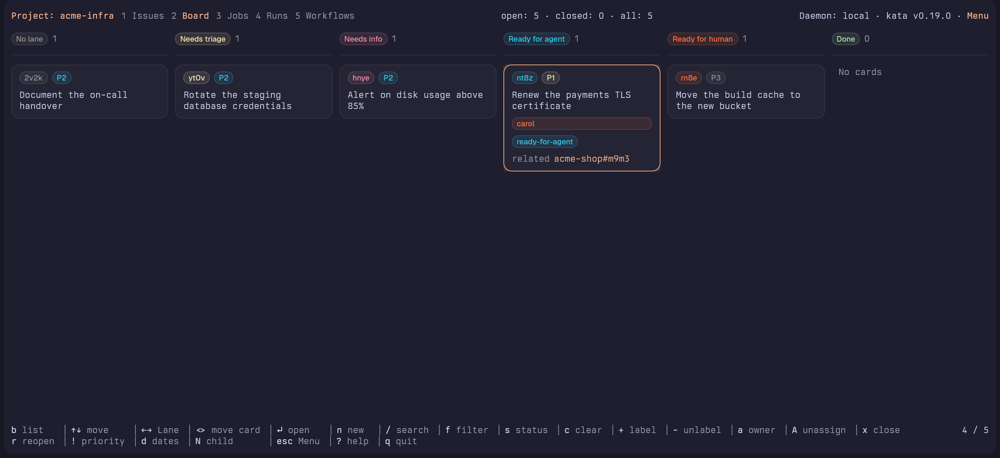

# Pages and the Board

tern-kata shows a Project through six Pages. This guide covers how the plugin is put together, the Page bar, the Issues Page, the Board Page and the Attention Page. The [Jobs](jobs.md), [Runs](runs.md) and [Workflows](workflows.md) Pages have their own guides.

## How it works

The plugin has three parts:

- **`tern-kata`**: a Go program that runs in a Pane. It talks to kata's daemon and draws the Issue list and detail with Tern's own widgets, using the Tern Surface Protocol. Run outside Tern, it falls back to `kata tui`.
- **Window plugin** (`window.luau`): adds **Open kata** to the palette and binds `F9`. Both open `tern-kata` in a split on the right, in the focused Pane's directory. It also opens kata links: `kata://<project>/<id>` or `https://kata.invalid/<project>/<id>` focuses the kata Pane in the current tab (or opens one there) and selects that Issue. A kata Pane in another tab is left alone.
- **Host half** (`host.luau`): runs in Tern's session daemon, with or without a window, and keeps [the worker](worker.md) running. It does nothing until you create `worker.toml`.

In a directory bound to a kata Project, `tern-kata` opens that Project's Issues. A directory is bound when it, or a parent up to the enclosing git root, contains a `.kata.toml`, which `kata init` creates. Anywhere else it opens Inbox beside the Menu sidebar, where you can switch to another view (Today, All Open, Logbook and others), browse your kata Projects or create a new one. In a bound directory the same Menu opens as a popup with `esc`, and `P` opens it straight at the list of Projects. Press `?` for the keybindings.

## The Page bar

The top bar holds the **Page bar**, "1 Issues  2 Board  3 Jobs  4 Runs  5 Workflows  6 Attention". `1` to `6`, or a click on a Page, switch Pages; `b` toggles between Issues and Board. Each Page keeps its selection while another is shown.

The Board, Jobs, Runs and Workflows Pages act on the Pane's Project: the current Project Collection, else the workspace's Binding (from Inbox or another fixed Collection in a bound workspace it switches to the Binding's Project). With neither it says so and opens the Menu's Projects list. The Attention Page acts on no Project: it reads every Project on the daemon, and neither a Project nor a Collection change touches it.

## Attention Page

`6` opens the Attention Page: every **Attention request** kata holds for your **Inbox address**, in every Project on the daemon, newest Issue update first, as one full-width list. A request is a `notify.<address>` slot on an open Issue. It comes from a Worker run that is held and needs the Issue's owner or author, a notify Cron job, kata's date sweeper, a typed Reply to one of your comments, `kata notify --re` (asking you to answer a comment) or `kata notify --broadcast`. Only open Issues are listed.

- **Address**: `KATA_INBOX_USER` when it is set and not blank, otherwise the actor the Pane writes as (`--as`, `$KATA_AUTHOR`, `$USER`, git `user.name`). It is read once, when the Pane starts, and trimmed. kata's recipient rules apply: not blank, at most 128 bytes, valid UTF-8, no control or format characters. An address kata would refuse is shown with the reason, and nothing is read.
- **Page bar**: the entry reads "Attention 3" while three requests wait, and plain "Attention" at zero, on every Page. The Pane asks for the requests again after it connects, on every Issue or Project event of the daemon and after a stream reset, whether or not the Page is shown; a burst of events costs one read in flight and one after it. The count is the last read that succeeded, so a failed read keeps it. The bar's width rules apply to the longer label.
- **Header**: "for dangerboi · 3 requests", plus "· 1 skipped" when a stored request could not be read the way kata reads it. Such a request is left out and counted, never shown as garbage.
- **Rows**: `project#id` and the title, then who asked (`actor`, or `actor/teammate`), a tag (`request`, the reply kind `reply`, `confirm`, `refute` or `supersede` for the notice a Reply left, or `broadcast`), the comment handle (`c:abc123`) when the request names a comment, and the first line of the message. The selected row shows the whole message, wrapped.
- **States**: "No requests for dangerboi" when nothing waits; kata's error line over the rows already read when a read fails; the reason when the address is refused.
- **Keys**: `↑`/`↓` (or `j`/`k`) move, `Enter` opens the request's Issue on the Issues Page with its detail focused, in whichever Project it lives; when the request names a comment, the detail opens on its Comments tab with that comment under the cursor, so `R` answers it (and kata clears the request once the Reply is saved), and a notice left by a Reply opens on that Reply. A comment that is gone leaves the cursor on the first comment, `c` clears the selected request, and `ctrl+r` reads again. `c` clears only if the request still reads as the Page showed it: when it was rewritten meanwhile, "The request changed meanwhile; nothing was cleared" shows and the Page reads again, so the new request is on screen before you decide. While a clear is out, `c` and `Enter` on that row wait. `6` brings the Page back as you left it, with the same request selected.

## Lettered Pages

A **Lettered Page** has a letter for its key instead of a number. It opens from any Page and from the Menu, where it is listed, and the Page bar draws it only while it is shown ("1 Issues ... 6 Attention  C Credentials"). Esc or backspace returns to the Page shown before. A Lettered Page does not act on the Pane's Project, and choosing a Collection from the Menu leaves it.

`C` opens the **Credentials Page**: the daemon's API tokens, newest first, one card each with kata tui's fields (state, id, name or "—", actor, scope or "global" with the Project and root Issue uid, created, expires, last observed use, revoked; times in UTC as `2006-01-02 15:04:05Z`) under "N credentials · observed at <time>". It reads the connection's auth capabilities first; an account without token audit read sees "credential audit unavailable for this connection" and why. It refreshes every 30 seconds, `r` refreshes at once (or retries a failed check), and `j`/`k` move the cursor. It shows "loading credential inventory...", "no credentials" and kata's errors in kata tui's words, and it is read only.

`F` opens the **Federation Page**: this daemon's spoke federations, the Projects that replicate a Project on a hub. A header reads "Federation for active daemon: <name> <endpoint> instance <uid> auth <auth>", then "N spoke federations" and one card per Project in two lines: the Project, its hub host and actor, then push ("push" or "off"), pending pushes, last sync ("never", "error", or "5m ago") and badges (`insecure`, `quarantine`, `reset`, `violations`, or "-"). Under the list the selected Project's `hub <URL>/project <id> · actor <actor> · credential <status>`. `j`/`k` move the cursor and Enter shows the Project's detail: hub URL, hub Project id and uid, actor, capabilities (`pull`, `push`, `lease`), push enabled, credential, `allow_insecure`, the pull and push cursors, pending push and its high water, pending and live claims, each quarantine, the reset blocker, claim violations, and the last pull, push and sync success and last error in UTC. Esc or backspace leaves the detail, then the Page; `r` reads the status again from the list or a detail. It shows "loading federation status...", "no spoke federation enrollments" and "failed to load federation: <error>" in kata tui's words, a failed read replacing the list until the next read, and it is read only.

## Issues Page

The Issues Page is the list and the Issue detail.

- **List**: a Project's Issues nested under their parents, with priority, status, child counts and age.
- **Detail**: the Issue's Markdown body, its properties and the Activity tabs (Comments, Events, Links, Attachments). Changes made anywhere, by you or an agent, show up live.
- **Collections and the Menu**: Inbox, Today, Upcoming, Deadlines, All Open, Logbook and every kata Project, plus a search (`/`) and filters (`f`, `s`, `c`) over any of them.

### Filters

- `s` cycles the status filter (on the Issues Page; the Board ignores status, see [the Board](#lanes-and-cards)), `f` opens the Filter card (project, status, owner, label, relationship; the Board's card has no Status row, and Apply and `ctrl+d` there keep the status filter as it was), `/` searches text and `c` clears every filter for this Pane.
- Field filters narrow a Collection but keep its grouping and headings: Today with `status=open` still shows Overdue and Today. Only a text search shows the flat **Results** list.
- `ctrl+d` in the Filter card saves the card's values as the **default filter** of the Project the Pane's folder is bound to, and applies them. The card stays open, saving, until the save answers; a failure keeps the card and its values with the error. An empty card removes the default. Search text is never saved, and a folder bound to no Project has no default.
- A Pane starts with its Project's default already applied, and the filter line under the top bar ends with "(default)" while the active filters equal it. `c` clears the filters for this Pane only; the default returns the next time a Pane starts.
- Defaults live in `filters.toml`, beside `lanes.toml` (the paths are in [the Lane list file](#the-lane-list-file)), one table per Project UID with only the filters that are set; other tables and keys you add are kept on save:

```toml
["01JABC..."]
name = "work"
status = "open"
owner = "me"
```

  A file that cannot be read starts the Pane unfiltered with a Notice naming the file and its error, and a save is refused rather than overwriting it.

Editing from the Pane:

| Key | Action |
|---|---|
| `n`, `N` | Create an Issue; `N` makes a child |
| `x`, `r` | Close; reopen |
| `c`, `R` | Comment (in the detail); reply to a comment |
| `]`, `[` | Next, previous Comment link (Comments tab); `enter` follows the chosen one |
| `+`, `-` | Add or remove a label |
| `a`, `A` | Owner |
| `!` | Priority |
| `p` | Parent |
| `b`, `l` | In the Issue detail: add a Blocking link (this Issue blocks the one you name) or a related link; `b` still toggles the Board elsewhere |
| `t` | In the Issue detail: timed assignment to you, 1m to 24h (see [Compared with `kata tui`](kata-tui.md#timed-assignment)) |
| `O` | Recurrence (see [Recurring Issues](recur.md)) |
| `d` | Dates (see [Dates](dates.md)) |
| `u`, `U` | Attach a file; list and remove Attachments (see [Attachments](attachments.md)) |
| `e` | Edit the Issue body in Tern's editor |
| `?` | Every key |

The Issue detail's Activity tabs are described in [Compared with `kata tui`](kata-tui.md).

## Board Page

`b` in a Project Collection shows the Project's Issues as a **Board**; `b` or `1` again returns to the list with the same Issue selected. `2` also opens it.


Columns, left to right: **No lane** (open Issues with none of the Lane labels, always shown), one **Lane** per label of the Lane list, and **Done** (Issues closed in the last 14 days, at most 20 of them, newest closed first; the header says "Done 20 of 192" when more qualify; both numbers are per Project, see [the Lanes card](#the-lanes-card)).

Enter opens the card's Lane beside the Issue detail. Clicking an id on the Relationships line selects that card; an Issue the Board doesn't draw (closed beyond Done, filtered out) opens in the detail beside the Lane view, and Esc goes back. An id of another Project switches the Pane to that Project, on the same Page: below, the id of "Renew the payments TLS certificate" was clicked on the acme-shop Board, and the Pane shows the acme-infra Board with that card selected and the top bar reading "Project: acme-infra". On the Issues Page the Project's list opens with the Issue selected and its detail focused, the heading the bare `#id`; the same goes for the detail's Links and children rows, `^` and a kata link. Esc goes back to the Collection, Page, Lane view, selection and focus you came from, one step per hop. Collections that span Projects (Inbox, Today, All Open and the others) stay as they are, and their detail heading names the Project, `acme-infra#59yd`.



### Lanes and cards

- The Lane list is `needs-triage`, `needs-info`, `ready-for-agent`, `ready-for-human` unless the Project has its own (see [the Lane list file](#the-lane-list-file)). A Lane is one kata label: an Issue sits in the first of its Lane labels in Lane order, and an Issue with none (an unlabelled one, or one labelled only `bug`) sits in No lane. An Issue with several Lane labels shows once, with "also: …" naming the rest. A closed Issue keeps its Lane label, and its Done card says "r → <Lane>", the Lane `r` reopens it into.
- A card shows its short id, its priority as a badge beside it (`P0` error, `P1` warning, `P2` info, other priorities muted; none without a priority, and Done cards keep it), its title over at most two lines (a recurring Issue's starts with "↻ ", as in the list, and Done cards keep it) and its labels that aren't Lane labels. The selected card shows its full title, owner and every label.
- The Board and its Lane view ignore the status filter: Lanes hold open Issues and Done the recently closed ones whatever `status` says, the filter line leaves it out, and `s` is not bound there. The status filter stays set and applies again on the Issues Page. The other filters (`/`, `f`, `c`: project, owner, label, relationship, search) narrow the Board as they do the list, `c` clears status too, and a live refresh moves cards.

### Moving around and moving cards

- `↑`/`↓`/`j`/`k` move within a Lane and `←`/`→` to the neighbouring Lane that has cards. A click selects a card. `x` opens the Close card, `r` reopens a closed Issue into its Lane, and `+`, `-`, `a`, `A`, `!`, `p`, `u`, `U`, `e` and `n` act on the selected card as in the list. `esc` opens the Menu.
- `>` moves the selected card one Lane right and `<` one Lane left, among No lane and the Lanes; a Move never enters or leaves Done (`x` closes, `r` reopens). Leaving No lane adds the first Lane's label; moving into No lane removes the Lane labels and keeps every other label.
- A Move adds the target label first, then removes the other Lane labels, so a failure halfway leaves the Issue in two Lanes, never none, and a Move of an Issue with two Lane labels leaves it with one. The card shows in its new Lane at once; a failure leaves a Notice with the daemon's reason. Moves are refused while the daemon is disconnected.

### The Lanes card

`B` (on the Board or in the Lane view) opens the **Lanes card**: a field holding the Lane list as comma-separated names, in order (`needs-triage, in review, ready-for-agent`), then **Done days** and **Done cards** (`tab`/`shift+tab` move between the fields).

- A blank Done field restores its default (14 days, 20 cards); anything but a positive whole number is refused with a message naming the field.
- `enter` saves and `esc` cancels.
- Each name is tidied to a label (`In review` reads `in-review`); an empty name, a name over 64 characters and a duplicate are refused with a message naming the entry.
- Saving an empty field removes the Project's list, which restores the default list.
- `B` waits, with a Notice, until the saved list has loaded.
- A muted line lists the labels on loaded Issues that aren't Lanes yet.
- Saving writes the Lane list file only and never changes a label in kata, so renaming a Lane just changes which label it shows.

### Relationships, blockers and dates on cards

- An open card that an open Issue blocks shows a **Blocked marker** in the warning tone, "blocked by e5f6": every open blocker, as a short id inside the Project and `project#id` outside it, cut to three and "+N". It shows on every card, selected or not, but never on Done cards, and a card whose blockers are all closed shows none. Blockers count even when the Board doesn't draw them (filtered out, closed beyond Done, in another Project), and a live refresh that closes the last one removes the marker.
- While a card is selected on the Board (not in the Lane view), every other drawn card related to it gets a **Relationship highlight**: a badge beside its short id naming the Relationship as seen from the selected card (`parent`, `child`, `blocks this`, `blocked by this`, `related`) and a ring in its tone:

  | Relationship | Ring |
  |---|---|
  | parent | accent |
  | child | info |
  | blocks this | error |
  | blocked by this | warning |
  | related | neutral |

  A card with several Relationships shows every tag and takes the ring of the first of blocks this, blocked by this, parent, child, related. The selected card keeps its own ring and Done cards keep their muted ring. The highlight follows the selection and shows nothing without one.
- The selected card also shows a **Relationships line**: `parent a1b2`, `6 children, 2 open` (counted from each child's status), `blocks c3d4` (open Issues only), `blocked by e5f6` (open blockers only) and `related g7h8`. A part with nothing in it is left out, and a card with no Relationships has no line. Ids are short inside the Project and `project#id` outside it, cut to three and "+N", and Issues the Board doesn't draw count.
- Click an id to select that card and scroll it into view in its Lane (in the Lane view, the Pane switches to that Lane). If the Board doesn't draw it (filtered out, closed beyond Done) the click opens its detail beside the Lane view, and Esc goes back to the card you came from, then to the Lane view and the Board. An id of another Project switches the Pane to that Project's Board (or, when that Board doesn't draw the Issue, its Lane view with the detail), and Esc returns to where you came from. `^` selects the parent's card the same way, or leaves "<id> has no parent." when there is none.
- An open card with a deadline or a scheduled date shows one **Date badge** in its id row, after the priority badge and before the Relationship tags, for the most pressing date, read as the Today, Upcoming and Deadlines Collections read it and compared as days in the Pane calendar. In order:

  | Date | Badge | Tone |
  |---|---|---|
  | deadline before today | "overdue 2d" | error |
  | deadline of today | "due today" | warning |
  | scheduled date before today | "scheduled 3d ago" | warning |
  | scheduled date of today | "scheduled today" | accent |
  | deadline tomorrow | "due tomorrow" | warning |
  | deadline after tomorrow | "due 10-24" | muted |
  | scheduled date after today | "scheduled tomorrow" or "scheduled 10-28" | muted |

  A date in another year than today reads YYYY-MM-DD. Done cards and cards without dates have no badge. Before the Pane knows today's date the badge shows the earlier date plainly, muted ("due 2026-10-24"). The wording moves on at local midnight without a key.
- The selected card also shows a **Dates line**, "scheduled 2026-10-28 · due 2026-11-02", with an absent date left out and no line without dates. See [Dates](dates.md) for setting them.

### Lane view

Enter on a card, or a double-click, opens the **Lane view**: that Lane's Issues as a flat, full-width list under a Lane header line, with the Issue detail beside it at 140 columns and wider. It works like the list (tab moves to the detail, the same keys apply, including `L`), except `←`/`→` switch to the neighbouring Lane that has cards, and `<`/`>` Move the selected card with the selection going to the next card in the Lane. Esc returns to the Board with the same card selected.

The Board Page needs a Project and ends when you switch to a Collection that is not a Project. A Pane under 140 columns opens it straight in the Lane view, on the selected Issue's Lane, and narrowing the Pane switches the Board to the Lane view; only the focused column shows, so Enter shows the detail, Esc returns to the Lane view, and Esc from the Lane view opens the Menu.

### The Lane list file

A Project's own Lane list lives in `lanes.toml` in `tern-kata` under your user config directory:

| OS | Path |
|---|---|
| Linux | `~/.config/tern-kata/lanes.toml` (`$XDG_CONFIG_HOME` if set) |
| macOS | `~/Library/Application Support/tern-kata/lanes.toml` |
| Windows | `%AppData%\tern-kata\lanes.toml` |

It has one table per Project UID, with the Project's name (for readers), its ordered labels and, optionally, Done's limits:

```toml
["01JABC..."]
name = "work"
labels = ["needs-triage", "in-review", "ready-for-agent"]
done_days = 14
done_cards = 20
```

- `done_days` and `done_cards` are how many days back Done reaches and how many cards it shows at most; a missing or zero value means the default (14 and 20). A table with only `done_days`/`done_cards` and no `labels` keeps the default Lanes.
- tern-kata reads it each time the Board turns on and when the Project changes while it is on, so an edit shows the next time you press `b`; the Lanes card (`B`) writes it for you.
- Saving rewrites only the Project's `name`, `labels`, `done_days` and `done_cards`; other tables and any other keys you add are kept, but comments are lost.
- Labels are tidied like kata's (`In review` reads `in-review`).
- A missing file, or no table for the Project, gives the default Lanes. A file that can't be read or parsed gives the default Lanes and a Notice, and tern-kata won't overwrite it.
- Removing a label sends its Issues to No lane, or to their next Lane label; kata isn't touched.
