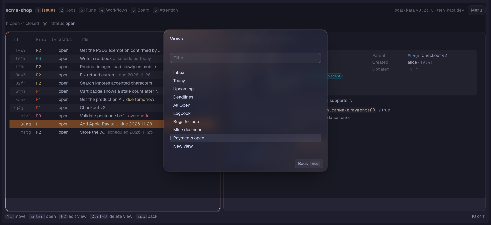
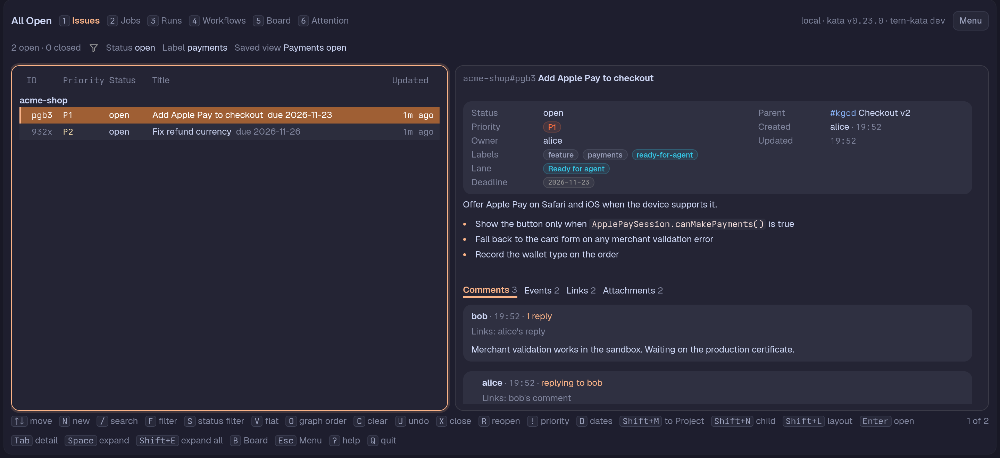
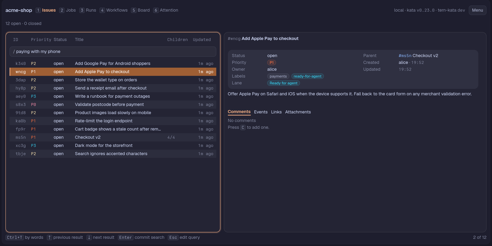
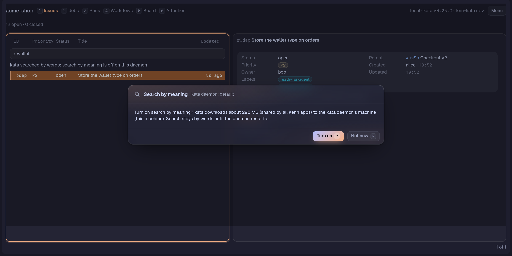
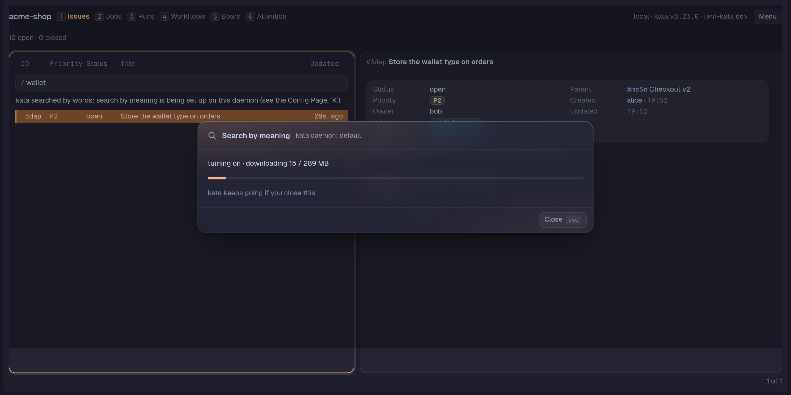
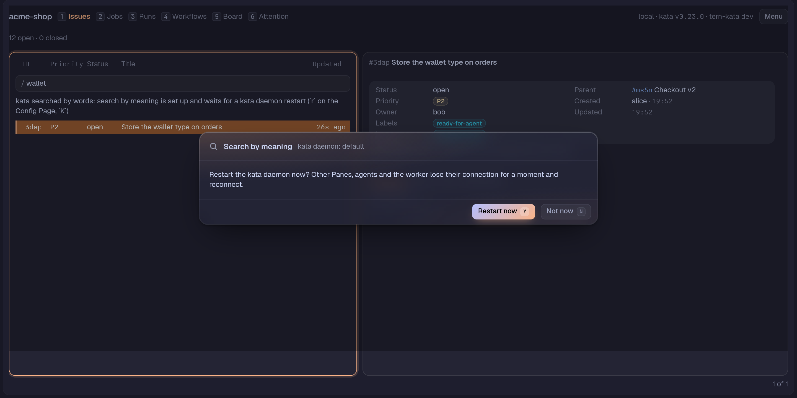
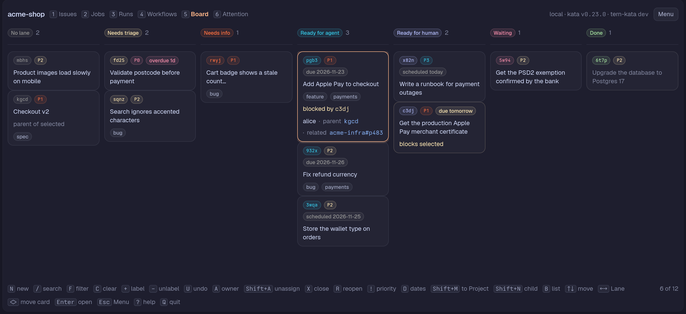
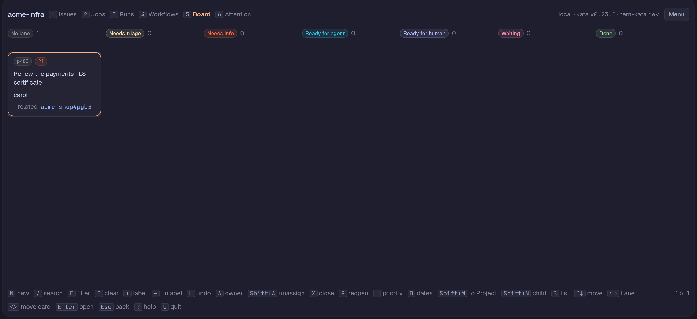

# Pages and the Board

tern-kata shows a Project through six Pages. This guide covers how the plugin is put together, the Page bar, the Issues Page, the Board Page and the Attention Page. The [Jobs](jobs.md), [Runs](runs.md) and [Workflows](workflows.md) Pages have their own guides.

## How it works

The plugin has three parts:

- **`tern-kata`**: a Go program that runs in a Pane. It talks to kata's daemon and draws the Issue list and detail with Tern's own widgets, using the Tern Surface Protocol. Run outside Tern, it falls back to `kata tui`.
- **Window plugin** (`window.luau`): adds **Open tern-kata** to the palette and binds `F9`. Both open `tern-kata` in a split on the right, in the focused Pane's directory. It also opens kata links: `kata://<project>/<id>` or `https://kata.invalid/<project>/<id>` focuses the kata Pane in the current tab (or opens one there) and selects that Issue. A kata Pane in another tab is left alone. A tab where kata quit back to the shell, or where a `tern-kata` command other than the Pane runs (such as `tern-kata worker` typed by hand), gets a new kata Pane, even if another kata Pane in that tab still runs. A link waiting for a Pane where kata never started shows an error toast, and an action that fails to send toasts while the queued ones still go.
  - **Go to waiting agent**: a palette command, bound to `shift+F9`. It goes to the agent kata started that most recently began waiting for you, from any tab, and focuses its block. A Background agent opens beside its kata Pane, as a click on its Agent badge does. With none waiting it shows a toast and changes nothing. Agents kata didn't start are not targeted. After a plugin reload, agents already waiting rank after those seen starting to wait. On Tern 0.9.23, Tern's own Agents widget lists the waiting agents in the widget bar.
  - **kata worker widget**: on Tern 0.9.17 and later, what the [worker](worker.md) runs; on Tern 0.9.21 and later it is the session host's worker, so a remote window shows it too (see [the worker guide](worker.md#worker-widget) for older Terns): "N running" or "idle", or "N held" in the warning tone while a run waits for you (the running count then moves to its hover card). On Tern 0.9.27 and later its hover card lists each held run under its Issue's id and title, which a click opens, then its job and how long it has been held (`review · 2h`) with a **Resume** button when the worker would resume it (an **Abandon** button when only abandoning can settle it), then the hold reason in words ("Quota reached: …"), and ends with the worker's executor ("this machine" on the widget a window draws for its own machine's worker) and what it runs and how many of its slots are in use ("1 running · 2 of 4 slots"). On an older Tern a tooltip says the same in short: where the worker runs, up to five held runs with the hold reason before the Issue, then "and N more", and the running count, process and executor, each line cut to Tern's tooltip width. A click on a held count runs **Show held runs** (below); otherwise it opens kata. Place it with the palette command **Add worker widget**, which appends it when the bar lacks it and changes nothing else, or from the palette's Edit widgets....
  - **Show held runs**: a palette command on every Tern version. It opens or focuses a kata Pane on its Attention Page. While a card, a question, the help sheet or a search is open in the Pane, it shows a toast asking you to close it instead; on the Pane's daemon error screen, or with the Attention Page already shown, it changes nothing.
- **Host half** (`host.luau`): runs in Tern's session daemon, with or without a window, and keeps [the worker](worker.md) running. It does nothing until you create `worker.toml`.

In a directory bound to a kata Project, `tern-kata` opens that Project's Issues. A directory is bound when it, or a parent up to the enclosing git root, contains a `.kata.toml`, which `kata init` creates. Anywhere else it opens Inbox beside the Menu sidebar, where you can switch to another view (Today, All Open, Logbook and others), browse your kata Projects or create a new one. In a bound directory the same Menu opens as a popup with `esc`, and `P` opens it straight at the list of Projects. Press `?` for the keybindings.

## The Page bar

The top bar holds the **Page bar**, "[1] Issues  [2] Jobs  [3] Runs  [4] Workflows  [5] Board  [6] Attention", each Page's key drawn as a keycap like the footer's key hints. `1` to `6`, or a click on a Page, switch Pages; `b` toggles between Issues and Board. Each Page keeps its selection while another is shown. Where the full bar does not fit, the bar turns compact: an icon for each Page, the label only on the current Page, no keycaps; a Page's tooltip reads "Jobs · 2" with its count. A Lettered Page shows its keycap and label only while it is current. The top bar reads the Project's name, then a muted facts line (`local · kata v0.23.0 · tern-kata dev`, with no prefixes and no trailing separator). The Project's name is only a heading: the Menu button, or `esc` from the list, opens the Menu.

The Board, Jobs, Runs and Workflows Pages act on the Pane's Project: the current Project Collection, else the workspace's Binding (from Inbox or another fixed Collection in a bound workspace it switches to the Binding's Project). With neither it says so and opens the Menu's Projects list. The Attention Page acts on no Project: it reads every Project on the daemon, and neither a Project nor a Collection change touches it.

## Cards, menus and hovercards

Every Popup card draws its buttons in the card's footer bar. A button shows one keycap, the main key of its action; the Menu button shows none, and a card's footer does not repeat the keys of its buttons. A card's status lines (an error, a pending request) sit above the buttons, which stay and are disabled while a request is out. A choice field is a select, a switch or segmented tabs: `left`/`right` and `space` step through them, `down` opens a select, typing searches a long one, `enter` picks and `esc` closes it, and a click picks.

An Issue row, a Lane row and a Board card open a menu on a right click, in groups: Open; Close… (Reopen on a closed Issue); Priority…, Dates…, Owner… and Labels…; Move to Project… and Agents…; New child…. Each row shows its key. Delete stays a key (`X`) only. Picking an entry selects that Issue first, then does what the key does on it. On a closed Issue, Agents… is disabled and says why. Hovering an Issue reference, such as an id in the facts row or a Comment link, shows a card headed by the Issue's id as the Pane reads it (`#61r6` in the Project on screen, `project#61r6` otherwise) and `open` or `closed` (closed muted), then its title and one muted line with the owner (when there is one) and the time of the last update (`2026-11-18 18:21`).

Pages and lists with nothing to show draw an empty state saying so. A Notice draws a failure ("Cannot …") in the error tone and everything else in the default text; a toast is drawn in the success tone and shows its button's key after its label ("Undo u"). While kata is unreachable the Pane says "Disconnected from kata. Showing Issues as of 18:23; changes are off until it reconnects."; the raw error is in the line's hovercard.

Keys are written one way: named keys as lowercase words (`esc`, `enter`, `tab`, `space`, `ctrl+o`), letters as typed (`W`, and `A` for shift+a), arrows as glyphs. On every Page the footer ends with `esc` (Back or Menu), `?` (help) and `q` (quit); the Page's own keys come first. A footer key that toggles shows the state it switches to: `v` reads "nested" or "flat", `o` "graph order", `s` "status filter", `E` "expand all". The selected row is filled with the theme's accent colour. Its text is white, and in a theme with a light accent colour (a Tern that supports relative colours) it turns black so it stays readable. Accent colour marks the selected row or tab and links, never a state.

## Attention Page

`6`, or `T` from any Page and the Menu, opens the Attention Page: every **Attention request** kata holds for your **Inbox address**, in every Project on the daemon, newest Issue update first, as one full-width list. A request is a `notify.<address>` slot on an open Issue. It comes from a Worker run that is held and needs the Issue's owner or author, a notify Cron job, kata's date sweeper, a typed Reply to one of your comments, `kata notify --re` (asking you to answer a comment) or `kata notify --broadcast`. Only open Issues are listed.

- **Address**: `KATA_INBOX_USER` when it is set and not blank, otherwise the actor the Pane writes as (`--as`, `$KATA_AUTHOR`, `$USER`, git `user.name`). It is read once, when the Pane starts, and trimmed. kata's recipient rules apply: not blank, at most 128 bytes, valid UTF-8, no control or format characters. An address kata would refuse shows as "Cannot read your inbox: <reason>.", and nothing is read.
- **Page bar**: the entry draws a badge with the count after its name while requests wait ("[6] Attention 3" with three), and no badge at zero, on every Page; the compact Page bar keeps the badge. The Pane asks for the requests again after it connects, on every Issue or Project event of the daemon and after a stream reset, whether or not the Page is shown; a burst of events costs one read in flight and one after it. The count is the last read that succeeded, so a failed read keeps it. The bar's width rules count the badge.
- **Heading**: `Attention 3 · for dangerboi` (a muted count, then whose requests these are), with `· 2 unreadable` added while slots could not be read the way kata reads them; the count waits for the first answer. An unreadable request is left out and counted, never shown as garbage.
- **Cards**: each card shows the Issue's title and its ref (`project#id`, a link), the sender and the age on the right (`smoke-asker · 2h ago`, the exact time in a hovercard), and the message: all of it on the selected card, its first line on the others. A reply notice or a broadcast carries a muted badge with the reply kind (`reply`, `confirm`, `refute` or `supersede`) or `broadcast`; a request that answers a comment says `on a comment`. A plain request has no tag.
- **States**: the empty state "No requests" with "Requests addressed to dangerboi appear here."; "Cannot read the requests: <reason>." above the rows already read when a read fails; "Cannot read your inbox: <reason>." when the address is refused.
- **Keys**: `↑`/`↓` (or `j`/`k`) move, `Enter` opens the request's Issue on the Issues Page with its detail focused, in whichever Project it lives; when the request names a comment, the detail opens on its Comments tab with that comment under the cursor, so `R` answers it (and kata clears the request once the Reply is saved), and a notice left by a Reply opens on that Reply. A comment that is gone leaves the cursor on the first comment, `c` clears the selected request, `m` messages the agent that raised it ([Messages to an agent](agents.md#messages-to-an-agent)), `r` sends it a [quick reply](agents.md#quick-replies), and `ctrl+r` reads again. `c` clears only if the request still reads as the Page showed it: when it was rewritten meanwhile, "Cannot clear the request: it changed meanwhile." shows and the Page reads again, so the new request is on screen before you decide; a refused clear reads "Cannot clear the request: <reason>." While a clear is out, `c` and `Enter` on that row wait. `6` brings the Page back as you left it, with the same request selected. `u` restores the Issue just deleted, only while the newest entry of the undo history is a delete (as in kata tui): the Page then reads its requests again. With any other newest entry, or none, `u` is neither listed in the footer or help sheet nor does anything here.

## Lettered Pages

A **Lettered Page** has a letter for its key instead of a number. It opens from any Page and from the Menu, where it is listed, and the Page bar draws it only while it is shown ("[1] Issues ... [6] Attention  [C] Credentials"). Esc or backspace returns to the Page shown before. A Lettered Page does not act on the Pane's Project, and choosing a Collection from the Menu leaves it.

`C` opens the **Credentials Page**: the daemon's API tokens, newest first, one card each of label and value rows: State (live in the success tone, expired in the warning tone, revoked muted), Name, Actor, Scope ("Global" or "Issue subtree"), Created, Expires, Last used and Revoked. Times read `2026-11-18 17:29`, or `17:29` when today, in the Pane's zone; no value reads `—`. The token id and the Project and root Issue uids are in the card's tooltip. The Page head reads `Credentials 3 · as of 17:29`. It reads the connection's auth capabilities first; an account without token audit read sees "Credential audit is not available on this connection." It refreshes every 30 seconds, `r` refreshes at once (or retries a failed check), and `j`/`k` move the cursor. It shows "Loading credentials…", the empty state "No credentials" with a **New token** button, "Cannot read credentials: <reason>." and, for a failed refresh, "Cannot refresh credentials: <reason>."

`n` on the Credentials Page opens the **Token card**, which makes an API token as `kata tokens create` does. Its fields, with `tab` between them and one muted hint under the focused field:

- **Actor**: required, prefilled with the Pane's actor.
- **Name**: optional.
- **Expires in**: a positive whole-second duration (`720h`, `90m`); optional for an account token, required for an Issue-subtree token.
- **Scope**: the tabs **Account** (the default) or **Issue**.
- **Issue**: for the Issue scope, the root Issue as a short id, `#id` or `project#id`. The Pane resolves it to its Project and root Issue; an account token takes none.
- **Teams**: optional, comma-separated team names or uids, at most 256.
- **Token file**: the path of a new file for the secret.

The secret goes from kata's answer into the token file, which is created new and readable only by you (mode `600`; on Windows access for your account alone). An existing path, link included, is refused before anything is sent, and a failure after the token exists revokes it and removes the file. The secret is never drawn, logged or kept in the Pane: when the token is made, the card is headed `Token 3 created`, says "The secret is in <path>. Only you can read it; kata cannot show it again." and has a **Close** button (`enter` or `esc`). kata's refusals show on the card with your text kept: identity mode off (`auth.require_token_identity`), `issue_subtree_tokens_unsupported`, `scoped_token_spoke_forbidden`, no permission, an unknown team.

`x` on a token asks `Revoke token 3?` with the muted line `laptop · alice. This cannot be undone.`; **Revoke** (`y`) revokes it and **Cancel** (`n` or `esc`) keeps it. The notices read "Revoked token 3." and, for a token already revoked, "Token 3 is already revoked." After a create or a revoke the list is read again.

`K` opens the **Config Page**: tern-kata's config files on this machine. The heading reads `Config 8 · ~/.config/tern-kata` (the number of rows, then the config folder, with your home folder written `~`). Each row is a card: the file's name with one status word (`ok`, `broken` or `not created`) and a muted one-line summary. A path is drawn under the summary only for a file outside the config folder (kata's `config.toml`, which is also the Docbank row). The rows are `lanes.toml` (how many Projects have a Lane list), `filters.toml` (how many have a default filter), `views.toml` (the saved views, and how many were skipped as invalid), `seen.toml` ("2 Projects have a seen mark; since you last looked is on for 1"; a missing file reads "Not created: no Runs marked seen"), `worker.toml` (how many Projects it serves, and whether the plugin supervises the worker or `worker.manual` turned that off: "1 Project served · supervision on"), `agent.toml` (the top-level actor, host, name, command and message_from actors, and the Projects that have their own table; a missing file reads "Not created: agents start with the defaults"), the `Docbank` row (the `[docbank]` section of the default kata daemon's `config.toml`, whichever daemon the Pane is switched to, with that file as its path: "Not set up: run kata docbank setup", "On this machine: …" for `local = true` (kata starts it when needed and follows its port and key), "At <url>", "Pinned to <url> by tern-kata's old setup: …" for the loopback url tern-kata 0.10 wrote, or the reader's error; on the old pinned form the **Switch to local Docbank** button (`s`) asks "Switch to kata's local Docbank? kata restarts its daemon." and switches it, the other forms have no button), the `Search by meaning` row (its title carries no daemon name, since the card's head says `kata daemon: <name>`; it describes the daemon the Pane is connected to, so it follows a switch on the Daemons Page, unlike the Docbank row, and has no path: it reads kata's `GET /api/v1/embeddings/local` and shows once kata has answered. Its summary is `<state> · <detail>`: `off · searches by words`, with `about 290 MB to download` or `your Ollama will be used` after it; `off · turning it on needs a daemon administrator` for an account without daemon administration; `turning on · downloading 120 / 290 MB`; `set up · needs a kata daemon restart`; `not turned on · <kata's error>`; `on · indexing 40 / 200 Issues · about 3 min` (no estimate when kata gives none) or `on · indexing failed`; `on · built-in model`, `on · your Ollama` or `on · another provider (kata's config.toml)`; `restarting · the kata daemon is coming back`; and, when kata cannot report it (an older daemon answers 404), `unavailable · kata cannot report it here: <reason>`. While a download runs or the indexing is under way and the Page or the Search by meaning card is shown, the row is read again every 2 seconds. `enter` on it opens the card, and **Turn on** (`s`) opens it on its question while kata would take a turn-on from this account; see [Turning search by meaning on](#turning-search-by-meaning-on)), and `kata config.toml` (its summary starts `read-only`, then the number of daemons in the Daemon catalog and `quits without asking` or `asks before quitting`). A missing `lanes.toml`, `filters.toml` or `views.toml` reads "Not created" with the default it implies, a missing `worker.toml` "no worker set up" and a missing kata `config.toml` an empty catalog. Each file is read by the same reader its feature uses, so a file that does not load shows that reader's own error: the selected card's full error is drawn, wrapped, under the list, and every other row still shows. `j`/`k` and clicks move the cursor. The Page is read again each time it opens ("Loading config…"), and says "Cannot find tern-kata's config folder: <reason>." when the folder cannot be found, listing no rows. `enter` opens what already edits the selected file, and each row's button and the footer name it in one pattern: **Open Lanes** opens the Board Page and then the Lanes card (once the Lane list has been read, so the card starts on the source in use); **Open filters** the Issues Page and then the Filter card; **Open Saved views** the Menu at its Views level (its back returns to the Menu's top level), opened in the sidebar when one is shown, as `P` does for Projects; **Open Runs** the Runs Page; **Open worker** the Jobs Page and then the Worker card; the Search by meaning row shows only **Turn on** while a turn-on is on offer (`enter` still opens its card, on the Config Page itself); **Open Daemons** the Daemons Page for kata's `config.toml`, whose back key returns to the Page shown before the Config Page. A Page that needs a Project and finds none shows its usual "needs a Project" notice and opens no card. `agent.toml` has no card and `enter` does nothing on it. After a jump the Config Page is closed, and `K` reads the files again, so a change made in the card shows. A click on a row's button does what `enter` does. **Edit agent.toml** (`e`) opens the file in `$VISUAL` or `$EDITOR` (from a commented starter that shows every key when there is no file), checks the result with the rules an agent start uses and writes it only if it loads and the file did not change while you edited ("Saving agent.toml…", then "Saved agent.toml. Agents started from now on use it."); see [agent.toml](agents.md#agenttoml). An unchanged or blank result changes nothing; a failed save reads "Cannot save agent.toml: <reason>. The file is as it was and your text is kept; press e to keep editing." A Docbank switch says "Switching Docbank…", then "Switched to kata's local Docbank and restarted its daemon. docbank.key (in KATA_HOME) and docbank.manual (in tern-kata's config folder) are no longer used and can be deleted." or "Cannot switch Docbank: <reason>."; quitting meanwhile says "Cannot quit: the Docbank switch is still running." Apart from that save and the Search by meaning card, the Page writes nothing.

`D` opens the **Daemons Page**: the daemons named in kata's `config.toml` (`[[daemon]]` entries, read from `$KATA_HOME`, else `~/.kata`), as a table under the Page head `Daemons 4`, with the muted columns Name, Endpoint ("local" for a local entry, else the url's host), Auth ("token" or "no token") and State ("current", in the success tone, on the daemon this Pane talks to). Under the table a selected daemon that allows insecure connections is marked "Insecure connection allowed." `j`/`k` move the cursor, and it starts on the current daemon. Enter switches this Pane to the selected daemon ("Connecting to <name>…") and leaves the Page: the Pane starts over on it with an empty Collection, no Page, cache, filter or undo history of the old daemon ("Nothing to undo: connected to a different daemon."), and follows the new daemon's events; the Notice reads "Connected to <name>." and, when drafts were dropped, "Connected to <name> and dropped 1 unsent draft." Your workspace's Project is bound again when the new daemon has one by that name, else the Pane starts on the Inbox. A switch changes this Pane only and writes nothing to disk, so other Panes and the CLI stay where they were. A local entry whose daemon is stopped is started first, as in kata tui: kata's client runs `kata --daemon <name> daemon recover` for an entry with a `home` (a profile; it never creates storage), and `kata daemon start` for any other local entry, with the Pane's own environment, so a `KATA_DSN`, `KATA_DB` or `KATA_SERVER` set for the Pane reaches the started daemon; with no `kata` on `PATH` the stopped daemon is reported, not started, and a remote entry is never started; this is the one case in which tern-kata starts a daemon. A switch that fails shows "Cannot connect to <name>: <reason>." and keeps the current connection. The Page says "Loading daemons…" while it reads, "Cannot read the daemon catalog: <reason>." when it cannot and, with no `[[daemon]]` entry, the empty state "No named daemons" / "Add a [[daemon]] entry to config.toml." The top bar names the current daemon by its catalog name and, when the daemon says who you are, the account: "work · remote · kata v0.21.0 · as alice".

When kata cannot be reached, the Pane shows a centred "Cannot reach kata" screen: "Start the daemon with kata daemon start, or check it with kata doctor." (the raw error is in its tooltip), with **Retry** (`ctrl+r`) and **Daemons** (`D`) buttons. `D` opens the Daemons Page, which is drawn while the error stands, so another daemon can be chosen. When kata answered with its own message (a Project that is not set up, a malformed `.kata.toml`) the screen is titled "Cannot open this Project" and shows that message. The top bar is not drawn.

`F` opens the **Federation Page**: this daemon's spoke federations, the Projects that replicate a Project on a hub. The Page head reads `Federation 2 · work · auth token` (the count on the list only, the endpoint only when it differs from the daemon's name, no instance uid). Each card shows the spoke's Project name (strong), the spoke name (muted), the hub host (mono) and `Actor <name>`, then a muted line such as `Push on · 3 pending · Synced 5m ago`, and in the warning tone the words insecure connection, quarantined, reset blocked and claim violations when they apply. Under the list: the hub URL (mono) and `Credential <status>`. `j`/`k` move the cursor and Enter shows the Project's detail as label and value groups: Project, Spoke name, Hub, Hub Project, Actor, Capabilities (`pull`, `push`, `lease`), Push, Credential and Insecure connection; then the pull and push cursors and the claim counts; then Reset blocker, Claim violations, Last pull, Last push, Last sync and Last error, with times in the Pane's zone. Esc or backspace leaves the detail, then the Page; `r` reads the status again from the list or a detail. It shows "Loading federation status…", the empty state "No spoke federations" / "Enroll a Project to sync it with a hub." with an **Enroll a Project** button, and "Cannot read federation status: <reason>.", a failed read replacing the list until the next read.

`x` on a Project, in the list or its detail, opens the **Leave federation** screen: the rows Project, Hub, Hub Project, Local copy and Hub revoke, then a sentence of what running it does (in the warning tone when the hub revoke is skipped). `d` switches between detaching and archiving ("Archived; restore it with kata projects restore"), `l` leaves without revoking on the hub (the sentence warns that the enrollment token stays valid until you revoke it), Enter runs it ("Leaving…") and esc or backspace goes back to the list. Running it asks the spoke to check the leave first, then, unless local-only, lists the hub's enrollments and revokes those for this spoke's instance and the hub Project, then leaves. A grant for another instance blocks the leave when none matches ("revoke the right one with `kata federation revoke <id>` on the hub, or retry with local-only"), a grant for this spoke that is not limited to a Project is left active and named on the result as a warning, and a hub that cannot be reached or refuses stops the leave with "hub revoke failed: …; retry with local-only to tear down locally, then revoke on the hub later". The hub is the daemon catalog entry whose URL is the Project's hub, with its token; with none the hub is asked without a token. A failure ("Cannot leave the federation: <reason>.") stays under the preview and Enter tries again; a success shows the **Leave result** rows Result (Detached or Archived), Project, Hub and Hub revoke, and Enter or esc returns to the list, read again.

`N` on a Project, in the list or its detail, opens the **Name spoke** card (**Rename spoke** when it has a name): the name the Project's hub keeps for this daemon, so hub event history and the hub's enrollment list say which spoke is meant (kata v0.21's spoke names). Its field is labelled **Spoke name**, with the hint "A letter, then up to 31 lowercase letters, digits or hyphens. Empty names none." ("Empty clears it." when renaming), and its buttons are **Save** and **Cancel**. The card starts on the current name; Enter sets it on the hub ("Saving…"), with the hub's own `token_env` token, and an empty name clears it. The card refuses an invalid name itself, before anything is sent, as "Cannot save the spoke name: "Bad Name" is not a valid spoke name." with your text kept, and enrolling checks the name again before it touches the hub. A name the hub holds for another spoke is refused by the hub and shows the same way. The name belongs to the daemon, not the Project, so every spoke of that hub shows it once it is set. The Page reads each hub's names with the catalog token for that hub's URL; a hub it cannot read leaves its spokes unnamed.

`b` opens **Browse hub Projects**, read only: the Projects of every catalog entry that is neither the active daemon nor local, each read with that entry's own `token_env` token and never the global one, under a line per hub ("<name> · <endpoint> · auth <auth>", with " · insecure connection allowed" when the entry sets it). A hub that cannot be read says "Cannot read hub Projects: <reason>." without hiding the others, and with no such Project the Page says "No hub Projects." `j`/`k` move, and esc or backspace goes back to the list.

`n` enrolls a Project in a hub's federation, in kata tui's steps, each with `j`/`k` to move, Enter to choose and esc or backspace to go back one step. Every enroll screen names the Project being enrolled as a `Project` row:

1. **Pick the local Project**: "create new local replica from hub project", or one of this daemon's Projects by name (the archived ones are not listed) to adopt. The cursor starts on the Pane's own Project, so adopting is never armed without a choice.
2. **Pick the hub daemon** ("Loading hub daemons…"): every daemon of the catalog, "<name> · <endpoint> · auth <auth>" with " · insecure connection allowed" and " · this Pane's daemon". The active daemon is refused ("Cannot use this hub: the daemon this Pane talks to cannot be its own hub."), and so is a local entry ("Cannot use this hub: a local daemon cannot be a hub; pick one with a URL a spoke can reach."), as is a hub whose `token_env` variable is unset.
3. **Pick the hub Project** ("Loading hub Projects…"): the hub's Projects. Adopting lists first a row that uses the hub Project of the local Project's name ("use existing hub project "x"; enable federation if needed") or creates it ("create hub project "x" and enable federation"), then every other hub Project; creating a replica lists every hub Project. The requested actor is the account the hub says the read acted as, else the Pane's actor.
4. **Enrollment preview**: label and value rows: Operation (adopt, adopt into the selected hub Project, new replica or rejoin), Local Project, Hub, Endpoint, Auth, Hub Project, Actor, Capabilities, Push, Insecure connection and Spoke name; for an adoption it adds `Adopting "x" into the hub Project "y".` with the warning "Its local event history becomes snapshots." It says "Cannot enroll: <reason>." and Enter does nothing when a local Project of that name exists, the Project already has a federation binding (as spoke or hub), or an identity is unknown. A local Project that already shares the hub Project's identity (it left the federation earlier) rejoins instead and needs no adoption. `N` names the spoke before it runs ("Name spoke", empty for none; the rules are those of renaming); the hub records the name with the enrollment, and a name it refuses fails the run before anything is granted, with its reason under the preview.
5. **Adopting** opens the **Adopt into hub** card: the warning question `Adopt "x" into the hub Project "y"?`, the muted consequence "Its Issues move to the hub and the local event history becomes snapshots.", the **Confirm name** field (hint `Type the Project name, "x".`) and the buttons **Adopt** (danger) and **Cancel**. Any other text reads `Cannot adopt: type "x" to confirm.`, and esc goes back to the preview.
6. Enter then runs it ("Enrolling…"): on the hub, ensure the Project (same-name adoption only; an idempotent init), enable federation and create the enrollment; read the hub Project's federation metadata with the enrollment's token; create the replica on the spoke. **Enrollment result** shows status (joined or adopted), actor, spoke name, snapshot count, hub URL and the hub Project's id and uid, and Enter or esc returns to the list, read again. Esc does nothing while a run is out.

A failure before the hub granted the enrollment stays under the preview as "Cannot enroll: <reason>.", and Enter tries again. A failure after it (reading the metadata, or the spoke refusing the replica) keeps an **Enrollment recovery** screen: "The hub created the enrollment, but the spoke could not join.", the failure and `Token  Hidden`. `R` reveals the single-use, secret-bearing `kata federation join …` command, with the enrollment's token and, for a remote active daemon, its `KATA_SERVER` settings; it is drawn only on request, and esc goes back to the preview.

## Issues Page

The Issues Page is the list and the Issue detail.

- **List**: a Project's Issues nested under their parents. Columns: ID, Priority, Status, Title, Children, Owner, Updated. A column is drawn only while some visible row has a value (Status is left out in the Lane view; Owner is left out beside the Issue detail). A child row is indented two cells per level; a parent shows a fold glyph (▸ folded, ▾ open) left of its id. A date badge ("due today", "overdue 3d", "scheduled 2026-12-01") has its own column and is never dropped for width; a long title is cut. The Agent badge and the Work attention word follow the title: on a narrow list the Agent badge goes first, the attention word never. At a width under 80 columns each row takes two lines. A missing value reads `—`; in a narrow cell Updated is a compact age with `ago` (`4m ago`, `3d ago`) and the hovercard carries the exact time. The footer's position counter reads "3 of 12", only while the Page's list has rows.
- **Empty list**: an empty Project reads "No Issues" / "Create the first one." with a New Issue button; another Collection reads "Pick another Project or view from the Menu."; filters that match nothing read "No Issues match" / "Change or clear the filters." with a Clear filters button, and a search alone reads `Nothing matches "text".` There is no header over an empty list and no loading line above its empty state.
- **Detail**: the Issue's id and title with its status beside them (`open`, or `closed · done`, muted), its properties in one grid (Owner, Agent, Priority, Scheduled, Deadline, Labels, Lane when it is on one, Work attention, Recurring, Cron jobs, Parent; a row with nothing to show is left out), one muted line under the grid with who created the Issue, when, and when it last changed, its Markdown body, its Children as a table headed `Children 3 of 4 open` (Id, Status, Title, Owner when a child has one, Updated; a click on a row jumps to that child; hovering a row's id shows the child's id, title, status, owner and update time) and the tabs Comments, Events, Links, Attachments, each with a muted count (`Comments 2`; none when empty), the open tab in the accent with an underline. Times in the detail are absolute (`2026-11-18 18:21`, or `18:21` for today). An empty body or tab says what it is and which key adds one. The owner is plain text and "unassigned" is muted; labels are neutral chips with no colour of their own. An open Issue's status is plain text and a closed Issue's is muted. `P0` is drawn in the error tone, `P1` in the warning tone and every other priority muted. Changes made anywhere, by you or an agent, show up live.
  On Tern 0.9.24 or newer, HTML `` tags (at their `width` and `height`) and Markdown `` images in a body or comment show as pictures, from a web address or a local path; one wider than the column is scaled down to fit. On Tern 0.9.26 or newer, a click on a picture opens it large in Tern's viewer, with zoom and Open.
  On Tern 0.9.26 or newer the body is also a document you work in. A double click on it edits it in place (`esc` or a click outside leaves it), and leaving saves the edit at once, as the Edit Issue body card's Save does: when someone else changed the body in between, the conflict card opens with your text and theirs (while another Issue's card is open, a Notice names the Issue instead, the line under that Issue's body says the edit or comment conflicts, and `e` on it opens the conflict card; the line shows there whatever that Issue's body holds, empty, a picture or text), and when the save fails the edit stays as a Draft that `e` opens. Selecting text shows a **Comment** button: write a note and press `enter`, and the Issue gets a comment that quotes the selection as a Markdown blockquote above your note (it shows in the Comments tab). The Pane draws no comments in the margin: the note card Tern shows after you press `enter` is only that, and deleting it does not delete the comment. While the Issue holds a Draft the doc cannot take (one you opened with `e` or `c`, a comment on a selection that failed or is still sending, an edit that is still saving or in conflict), the doc is drawn read-only, with no Comment button, and the row about the open Draft stays: send or discard the Draft, then edit or comment again. When a save of the Issue body or of a comment on a selection fails or is refused (kata reconnecting, say), a Notice names the Issue and says its Draft is kept. An Issue with no body still draws "No body yet.", and `e` writes the first one. A body that holds a picture (an HTML `` tag or a Markdown `` image) stays as described above on every Tern, so its pictures keep their size and open large on a click; edit it with `e`. `e` and `$EDITOR` work as before, and an older Tern draws the body as above and edits it only in the card.
  Tern closes the edit as soon as the Pane sends any update that changes anything, so while the body is open for editing the Pane draws nothing. What arrives meanwhile, such as an agent's change or the clock moving the ages in the list, is drawn when you leave the body, and a click elsewhere, a key that reaches the Pane or a change in another field ends the wait too. Tern can still close the edit at once when an update was already on its way as you double-clicked. The Pane then ignores printable keys and `enter` that would run a key binding, such as `u`, for about two seconds, on the detail and on the Menu, so what you type does not run one. A Notice says the body did not open and to double-click it again. A double click and `esc` with no update around it ignores no keys. These end the guard and take the Notice away:
  - a click, a text selection, a field taking focus, a button press, or a change to a dropdown or switch;
  - an edit of the body, or an edit that stays open longer than half a second;
  - the two seconds running out.

  An agent changing state does not end it. Keys that go to a card, a picker or a text field are never ignored.
- **Collections and the Menu**: the Menu (the top bar's Menu button, or `esc` from the list) opens on the bound Project, **Views**, **Projects**, the Lettered Pages (Credentials, Federation, Daemons, Config), Restore a deleted Issue and New Project, then one entry per [version notice](../../README.md#version-notices-in-the-pane) while any holds (the top bar's "↑" chip says so). In the popup the top level groups its rows under dividers: unlabelled (the bound Project, Views, Projects), Pages (each Lettered Page with its key), Actions (Restore a deleted Issue, New Project) and Updates (version notices). The Menu's head follows the level (Menu, Views, Projects), its filter placeholder is `Filter` and an empty filter reads `Nothing matches "x".` **Views** opens a level of Inbox, Today, Upcoming, Deadlines, All Open, Logbook, your [saved views](#saved-views) by name and New view; **Projects** (or `P`) opens a level of every kata Project with the current one first, and `I` opens the Inbox from anywhere. Neither level has a Back row in the popup: the Back button, `esc` and `backspace` leave the level for the top, with the cursor on the row that led there; the Menu sidebar keeps its Back row. The Menu button shows no keycap; the footer shows `esc`. While a fixed Collection is current, the top level's Views row names it on the right (or the saved view, while one is current) and the Menu opens with the cursor on Views. Typing in the Menu filters every level at once: "tod" finds Today, "alp" finds the Project alpha. In a directory bound to no Project the Menu sidebar shows the Views level. Beside the Collections, `/` searches and `f`, `s`, `c` filter any of them.

### Saved views

A saved view is a base Collection (a fixed one or a Project) with the Filter card's fields and a search text, saved under a name. They live in `views.toml` in tern-kata's config folder beside `filters.toml`, on this machine for every Project, and [`tern-kata views`](views.md) works on the same file.



- **New view**, the last row of the Menu's Views level, opens the View card: **Name** (required, at most 64 characters, unique ignoring case, and not a fixed Collection's title or key), **Base** (a fixed Collection or a Project, prefilled with the current Collection), the Filter card's fields and **Search**, prefilled with the current filters. `tab` and `shift+tab` move between fields, `←`/`→` change a choice, `ctrl+o` or `ctrl+s` saves and opens the new view, `esc` cancels. A refusal names the field and keeps what you typed; so does a `views.toml` that changed since the Pane read it.
- Saved views are listed by name after the fixed Collections. Opening one makes its base current with its filters applied, and the context line under the top bar ends with "Saved view <name>" while the filters equal it. `c` clears the filters for this Pane only. An owner of `@me` means this Pane's actor when the view opens.

  

- On a saved view's row `f2` edits it in the View card (a rename keeps its place in the file) and `ctrl+d` asks "Delete view <name>? y/n" in the Menu, with **Delete** and **Keep** buttons; `f2` and `ctrl+d` are in the footer and on the help sheet (`?`). Letters and `ctrl+a`/`ctrl+e` stay with the Menu's filter box.
- A view whose base Project is gone or archived stays listed with "(Project gone)" or "(archived)"; opening it says so and changes nothing.
- The Pane reads `views.toml` when it starts and each time the Menu opens, so a view saved by another Pane or by `tern-kata views add` appears without a restart. A file that cannot be read is reported and left untouched, and the fixed Collections still work.

### Filters

- `s` cycles the status filter (on the Issues Page; the Board ignores status, see [the Board](#lanes-and-cards)), `f` opens the Filter card (project, status, owner, label, relationship; the Board's card has no Status row, and Apply and `ctrl+d` there keep the status filter as it was), `/` searches text and `c` clears every filter for this Pane.
- The line under the top bar is the context line. On the Issues Page it is permanent and starts with the counts, "5 open · 0 closed" (not drawn for an empty Project); then, after a funnel, each active filter as a muted field name and its value: "Status open", "Owner me", "Label bug,ux", "Relationship Has parent", "Search text". The Board and the Lane view show the line only while a filter, a note or a search is active, without counts. The Search chip is left out while the search input is open.
- Field filters narrow a Collection but keep its grouping and headings: Today with status open still shows Overdue and Today. Only a text search or a search by meaning shows the flat **Results** list. Where a view groups by Project (All Open), the headings are ordered by Project name, as in kata's web UI, so `app` comes before `app 2` and `tern` before `tern-kata`.
- `ctrl+t` in the search box switches it between by words (the text filter above) and **search by meaning**; the footer and the help sheet (`?`) offer it. Search by meaning works inside one Project: a Project Collection, or a saved view scoped to one Project. In the Inbox, Today and the other Collections the key says "search by meaning works inside one Project" and the search stays by words.
  - Typing only edits the query. `enter` runs kata's search of the Project with the Status and Label filters and lists the best 50 Issues in kata's order as flat Results; the list keeps the last results until the next `enter`, and a live refresh does not run the search again, because each run embeds the query. A second `enter` commits the search as it does for words, and the ranked list stays until the search is cleared. `ctrl+t` on the results switches them to by meaning and runs the search at once.

    

  - Changing the Project, Status or Label filter after a search by meaning ends the ranked list: the list goes back to the words filter on the same text. Switching to another Collection ends it too and turns by meaning off. On the Board, which ignores the Status filter, the search sends no Status. A search sent without a Status (on the Board, or with no Status filter) whose Results kata did not cut at 50 keeps them when a Status applies later, such as on the Issues Page, trimmed to that Status; a cut list ends instead.
  - The search line under the box says what kata said: "kata searched by words: <reason>" when kata's embeddings are off or failing (without a reason it says from kata's status why search by meaning is off: where this account may turn it on, "search by meaning is off on this daemon" with a **Turn on…** button and `ctrl+o` that open the Search by meaning card, below, and `esc` or `n` on the card returns to the search; when it is set up and waits for a restart, a pointer to `r` on the Config Page (`K`), or to `kata daemon restart` on that machine for a remote daemon; for an account without daemon administration whose setup failed, "turning on search by meaning failed on this daemon; a daemon administrator can try again (kata's Settings or `kata daemon local-embeddings`)"; while a setup job runs or embeddings are on, "search by meaning is being set up on this daemon (see the Config Page, `K`)"; before the status is read, or when kata cannot report it, "search by meaning is not in use on this daemon"; otherwise that a daemon administrator can turn it on, in kata's Settings or with `kata daemon local-embeddings`; the status is read once per such answer, so the line names no reason until it answers), "showing the best 50" when more Issues match, and that the Owner and Relationship filters don't apply while one is set. A failed search shows kata's error and keeps the rows.
  - A short id typed in the box still jumps to its Issue. `esc` out of the query puts back the search you had before you opened the box (a ranked list stays ranked, a words search stays by words) unless you switched Collection meanwhile. `/` on ranked Results continues by meaning; any other new search starts by words. A saved view and the default filter keep only the text.
- `ctrl+d` in the Filter card saves the card's values as the **default filter** of the Project the Pane's folder is bound to, and applies them. The card stays open, saving, until the save answers; a failure keeps the card and its values with the error. An empty card removes the default. Search text is never saved, and a folder bound to no Project has no default.
- A Pane starts with its Project's default already applied, and the context line under the top bar ends with "Default filter" while the active filters equal it. `c` clears the filters for this Pane only; the default returns the next time a Pane starts.
- Defaults live in `filters.toml`, beside `lanes.toml` (the paths are in [the Lane list file](#the-lane-list-file)), one table per Project UID with only the filters that are set; other tables and keys you add are kept on save:

```toml
["01JABC..."]
name = "work"
status = "open"
owner = "me"
```

  A file that cannot be read starts the Pane unfiltered with a Notice naming the file and its error, and a save is refused rather than overwriting it.

#### Turning search by meaning on

Search by meaning needs embeddings set up on the kata daemon the Pane is connected to. The Pane sets them up through kata's own API, which a kata v0.23.0 daemon or newer has (against an older one the row says it is unavailable there), after asking, from the **Search by meaning card**: `enter` on the Search by meaning row of the Config Page opens it, and **Turn on** (`s`) on that row opens it on its question while kata would take a turn-on from this account. The card's head is `Search by meaning` with the meta `kata daemon: <name>`. A failed job offers `s` again.

- The card asks first, and nothing starts without **Turn on** (`y`); **Not now** (`n`, `esc`) closes the card and sends nothing. If kata finds an Ollama running on the daemon's machine it says "Turn on search by meaning? kata will use your Ollama; nothing to download." With no Ollama and nothing to download, because kata already has its shared model on the daemon's machine (kata reports a download size of 0), it says "Turn on search by meaning? kata will use its built-in model, already on the kata daemon's machine; nothing to download. Search stays by words until the daemon restarts." Otherwise it says kata downloads about N MB (shared by all Kenn apps) to the kata daemon's machine, named "this machine" for a local daemon, "the kata daemon's machine (<host>)" for a remote one, and "another machine" when the Pane does not know the remote host, and that search stays by words until the daemon restarts. The card reads "Reading search by meaning…" first and fails with "Cannot read search by meaning: <reason>."

  

- **Turn on** (`y`) sends one `POST /api/v1/embeddings/local` ("Turning on search by meaning…"). kata starts its setup job in the daemon and the card follows it with the words the Config row uses: a progress bar for the download, "set up · needs a kata daemon restart" when the job is done, then a progress bar for the indexing. The job runs in the daemon, so it goes on when you close the card (`esc`) or quit the Pane. Opening the card again, from the row, picks the job up where it is; while the Config Page or the card is shown, the status is read again every 2 seconds. A failed job shows kata's error and offers `s` to try again; a refusal reads "Cannot turn on search by meaning: <reason>." (with the stream down, "Cannot turn on search by meaning: disconnected from kata.").

  

- Search stays by words until the kata daemon restarts: the job writes kata's `config.toml` and never restarts the daemon. The Pane offers the restart itself, behind its own question: when the job is done while the card is open, the card asks "Restart the kata daemon now? Other Panes, agents and the worker lose their connection for a moment and reconnect." with **Restart now** (`y`) and **Not now** (`n`, `esc`), because a restart briefly disconnects every client of that daemon. A card opened while a restart is owed on a local daemon (`enter` or `r` on the row, not `ctrl+o`, which is not offered while a restart is owed) opens on this question.

  

- **Restart now** runs `kata daemon restart` once (for the daemon the Pane is connected to, within 2 minutes) and the card says "Restarting kata daemon…"; the Pane reconnects as after any daemon restart and reads the status again, and kata then embeds your Issues in the background, shows the progress as indexing, and answers by meaning when it is done. A failure reads "Cannot restart the kata daemon: <reason>." on the card (on the Config Page's message line when you closed the card meanwhile). Quitting the Pane while the restart runs waits for it.
- **Not now** on the question closes the card, leaves the row on "set up · needs a kata daemon restart" and sends nothing; `r` on that row asks again, and the footer and `?` list `r` only while a restart is owed.
- A daemon on another machine is never restarted by the Pane: the row and the card say "run `kata daemon restart` on <host>" (on that machine when the Pane does not know the host), and there is no `r` and no question.
- Who may do it: kata allows it only to an account with daemon administration. For any other account the row says "off · turning it on needs a daemon administrator" and offers no `s`; if kata refuses anyway (403), or the setup is already running or configured (409), the card shows kata's reason and reads the status again. The card never changes a setting kata's Settings or `config.toml` own: choosing another provider or a model stays there.
- `kata health --json` shows whether embeddings are in use and the indexing progress; it does not show the setup job, the download or a restart owed, which the row and the card do.

Editing from the Pane:

| Key | Action |
|---|---|
| `n`, `N` | Create an Issue; `N` makes a child |
| `x`, `r` | Close; reopen |
| `c`, `R` | Comment (in the detail); reply to a comment |
| `m` | Ask the Issue's agent to answer the comment under the cursor (Comments tab; [Messages to an agent](agents.md#messages-to-an-agent)) |
| `]`, `[` | Next, previous Comment link (Comments tab); `enter` follows the chosen one |
| `+`, `-` | Add or remove a label |
| `a`, `A` | Owner |
| `!` | Priority: `!` then `0`-`4` or `-` sets or clears it at once; any other key closes the field and does what it usually does |
| `p` | Parent |
| `b`, `l` | In the Issue detail: add a Blocking link (this Issue blocks the one you name) or a related link; `b` still toggles the Board elsewhere |
| `t` | In the Issue detail: timed assignment to you, 1m to 24h (see [Compared with `kata tui`](kata-tui.md#timed-assignment)) |
| `O` | Recurrence (see [Recurring Issues](recur.md)) |
| `d` | Dates (see [Dates](dates.md)) |
| `S` | Message every running agent on the Issue and its open children (see [Messages to an agent](agents.md#messages-to-an-agent)) |
| `M` | Move the Issue to another Project (see [Moving an Issue](#moving-an-issue)) |
| `X` | Delete the Issue after typing its id (`project#id` or `DELETE project#id`); restore it with `u` or from the Menu (see [Deleting and restoring an Issue](#deleting-and-restoring-an-issue)) |
| `@`, `U` | Attach a file; list and unlink Attachments (see [Attachments](attachments.md)) |
| `u` | Undo the last change this Pane made (see [Compared with `kata tui`](kata-tui.md#undo)) |
| `o` | In the nested Issue list: switch siblings between creation and blocking order (see [Compared with `kata tui`](kata-tui.md)) |
| `q` | Quit, after "Quit tern-kata? y/n" (see [Compared with `kata tui`](kata-tui.md#quitting)) |
| `e` | Edit the Issue body in Tern's editor (on Tern 0.9.26 or newer a double click on the body edits it in place) |
| `?` | The global keys and the current Page's keys |

The Issue detail's tabs are described in [Compared with `kata tui`](kata-tui.md).

The **Create card** has Title, Body, Labels, Owner, Priority (a choice: None, P0 to P4, set with `left`/`right`, `space` or the select, not typed), Scheduled and Deadline. Fields carry no "(optional)"; a format hint shows under the focused field. The **Close card**'s **Reason** is a choice (tabs; a select on a narrow card): Done, Won't fix, Duplicate, Superseded or No change. **Duplicate of** or **Replaced by** shows only for Duplicate and Superseded, and **Why nothing changed** only for No change. **Close without evidence** (`ctrl+d`) is off on a remote daemon, with "Needs the owner-local daemon." The single-field cards are titled Add label, Remove label, Assign owner, Clear owner, Set priority (it also accepts `P2`), Set parent, Assign for a time, Add blocker, Add related Issue, Attach file, Unlink attachment and Restore Issue (the Menu entry stays "Restore a deleted Issue").

The **Draft editor**'s buttons are **Save**, **Send anyway** (a duplicate Reply only), **Open in editor** and **Cancel**. A Reply's kind is a tab control (Reply, Confirm, Refute, Supersede; `ctrl+r` still cycles), and the head reads "Reply to dana's comment" for every kind. `esc` on an unedited Draft closes it at once; after an edit it asks "Discard what you wrote?" with **Discard Draft** (danger) and **Keep editing**. The **Conflict card** is headed "Issue changed while you edited", shows your text as **Yours** beside the Issue as it stands as **Current**, and offers **Overwrite** (`o`) and **Discard mine** (`d`). The **New Project card** has a **Name** field and the note "This directory stays on <Project>." or "This directory will use it.", with a **Create** button ("Creating Project…").

## Moving an Issue

`M` on the selected Issue (in the list, on the Board, in the Lane view and in the Issue detail) opens the **Move card**, headed Move to Project, as kata web's move does. kata tui's `M` is the same key: it previews the Issue and the descendants that move, then asks. tern-kata sends kata's move action.

1. The card lists the Projects of the Collection snapshot, without the Issue's own Project and without archived ones; the list reads "No other Projects." or `Nothing matches "x".` when it is empty. Type to filter the list by name (any case; the placeholder is `Filter`); `↓`/`↑` move, and `esc` closes the card.
2. `enter` on a Project sends the move as a dry run: kata checks it and changes nothing ("Checking the move…"). The card then shows a **Project** row and the preview, "#492x moves to other and gets a new id there." (see below for an Issue with descendants): kata assigns the new short id only when it moves the Issue, so a preview cannot name it. When kata refuses (for example "cross-project moves involving a federated project are unsupported", a recurring Issue, or an import mapping that already exists in the target), its reason shows on the card and the list stays for another choice.
3. `enter` again moves the Issue ("Moving…"); the buttons are **Move** (**Preview again** when the preview is stale) and **Back**. `esc` goes back to the list.

kata moves an Issue **with its descendants**, as its CLI and web do. The preview then reads "#492x and 2 descendants (#f7bq, #g8cr) move to other and get new ids there.", naming each descendant by short id (qualified with its Project when it lives in another one; past eight it counts the rest). The card's **Only this Issue** switch, which `o` and a click toggle, moves the Issue alone and leaves its descendants where they are; flipping it asks kata for a new preview. kata refuses a subtree move when a descendant is in an archived Project (the card names the descendant and keeps the chosen Project, so you can switch on Only this Issue) and when the descendants changed while it checked the move (`enter` previews again). After a subtree move the toast says how many Issues moved.

The move is a Guarded write: it carries `If-Match` with the revision the card opened with (the preview carries it too). kata moves its revision on owner and status changes only, so a move after such a change is refused; the card stays open, says "Cannot move #492x: it changed since this card opened." and nothing was moved, and `enter` asks for a fresh preview (read at the revision as it stands now) before `enter` moves.

After the move a toast says "Moved #492x to other#f7bq."; its **Open** button opens the Issue in its new Project. The selection goes to the neighbouring row when the Collection no longer lists the Issue, and an open Issue detail closes to the list. A move cannot be undone: it clears the undo history.

## Deleting and restoring an Issue

`X` on the selected Issue (in the list, on the Board, in the Lane view and in the Issue detail) opens the **Delete card**, which soft-deletes the Issue through kata's delete action, as the CLI's `kata delete` does. kata keeps a deleted Issue and its history, so it can be restored. An account whose credential is limited to one Issue is offered neither `X` nor **Restore a deleted Issue**, because kata refuses both to it: the Pane reads the daemon's auth capabilities when it connects and again after a daemon switch, and until the answer arrives (or when it fails) both are offered as for any account.

1. The card is headed **Delete Issue** with the Issue's ref as meta (`#cksk`, or `project#cksk` across Projects). It shows the Issue title, then "Restore it with u right after, or from the Menu.", and asks you to type the id in **Confirm id** (its placeholder is the ref; the ref, `project#short` and `DELETE <id>` are all accepted). An optional reason goes in the **Reason** field (`tab` moves between the two).
2. `enter` with the ref, `project#id` or `DELETE <project>#<id>` typed (surrounding spaces ignored) sends the delete with kata's confirmation, `DELETE <project>#<id>`, and the actor. kata's delete records no reason, so a reason is first added to the Issue as a comment, `Deleted: <reason>`, by you; it shows in kata too. If that comment fails nothing is deleted and the card shows the error; if the delete fails after the comment, the comment stays. With anything else typed, the card refuses, names the accepted forms and sends nothing. kata's own refusals (a federated replica, a changed Issue) show on the card, which stays open. `esc` closes it.
3. After the delete the Issue leaves the list, the selection goes to the neighbouring row, an open Issue detail closes to the list, and a toast says "Deleted #cksk." Its **Undo** button restores the Issue while the delete is still the newest change you can undo and no card, question or help covers the Pane; it does nothing after a later change.

`u` right after a delete restores the Issue (also on the Attention Page, where it is offered only for a delete): the delete enters the undo history like any change, and the restore is refused as "#cksk is already restored." when kata no longer holds the Issue as deleted. To bring back an Issue deleted earlier or elsewhere, open the Menu and choose **Restore a deleted Issue**. Its one field takes a short id (in the Pane's Project), `project#id` or an Issue's ULID. `enter` reads that Issue with deleted Issues included and shows its title and that it is deleted; `enter` again restores it. A delete's reason stays on the Issue as its `Deleted: <reason>` comment, visible in kata, through `u` and any restore. An Issue kata holds as not deleted is shown as such, and restoring it reports kata's answer that nothing changed. A restore from the Menu clears the undo history. Purging an Issue, which cannot be undone, stays in the CLI.

## Board Page

`b` in a Project Collection shows the Project's Issues as a **Board**; `b` or `1` again returns to the list with the same Issue selected. `5` also opens it.



Columns, left to right: **No lane** (open Issues with none of the Lane labels, always shown), one **Lane** per label of the Lane list, and **Done** (Issues closed today or in the 14 days before, at most 20 of them, newest closed first; the header says "Done 20 of 192" when more qualify; both numbers are per Project, see [the Lanes card](#the-lanes-card)).

Enter opens the card's Lane beside the Issue detail. Clicking an id in the facts row selects that card; an Issue the Board doesn't draw (closed beyond Done, filtered out) opens in the detail beside the Lane view, and Esc goes back. An id of another Project switches the Pane to that Project, on the same Page: below, the id of "Renew the payments TLS certificate" was clicked on the acme-shop Board, and the Pane shows the acme-infra Board with that card selected and the top bar naming acme-infra. On the Issues Page the Project's list opens with the Issue selected and its detail focused, the heading the bare `#id`; the same goes for the detail's Links and children rows, `^` and a kata link. Esc goes back to the Collection, Page, Lane view, selection and focus you came from, one step per hop. Collections that span Projects (Inbox, Today, All Open and the others) stay as they are, and their detail heading names the Project, `acme-infra#59yd`.



### Lanes and cards

- The Lane list is `needs-triage`, `needs-info`, `ready-for-agent`, `ready-for-human` unless the Project has its own (see [the Lane list file](#the-lane-list-file)). A Lane is one kata label: an Issue sits in the first of its Lane labels in Lane order, and an Issue with none (an unlabelled one, or one labelled only `bug`) sits in No lane. An Issue with several Lane labels shows once, with a muted line "also in <Lane titles>" naming the rest. A closed Issue keeps its Lane label, and the selected Done card says "reopens in <Lane>", the Lane `r` reopens it into.
- A card shows its short id, its priority as a badge beside it (`P0` error, `P1` warning, every other priority muted; none without a priority, and Done cards keep it), its title over at most two lines (a recurring Issue's starts with "↻ ", as in the list, and Done cards keep it) and its labels that aren't Lane labels. The selected card shows its full title and one muted row of facts (below); its labels are the same as on other cards, never the Lane label. On Tern 0.9.27 and later a card glides to its new place when its Issue moves to another Lane or the cards around it change.
- A Lane keeps one identity colour on its header rule and on the card ids in it. The colours (info, user and neutral) cycle by the Lane's place in the Lane list (the first Lane, the fourth, and so on share one), and the Lane's name is always shown beside the colour; the count in the header is muted. Done and No lane are muted. No Lane uses the colours of a state: warning, error, success and accent keep their meaning. An empty Lane draws nothing under its header, and when no Lane has a card the Board shows the Issues list's empty state ("No Issues", or "No Issues match" with a Clear filters button).
- The Board and its Lane view ignore the status filter: Lanes hold open Issues and Done the recently closed ones whatever `status` says, the context line leaves it out, and `s` is not bound there. The status filter stays set and applies again on the Issues Page. The other filters (`/`, `f`, `c`: project, owner, label, relationship, search) narrow the Board as they do the list, `c` clears status too, and a live refresh moves cards.

### Moving around and moving cards

- `↑`/`↓`/`j`/`k` move within a Lane and `←`/`→` to the neighbouring Lane that has cards. A click selects a card. `x` opens the Close card (on a closed Issue it says the Issue is already closed), `r` reopens a closed Issue into its Lane, and `+`, `-`, `a`, `A`, `!`, `p`, `u` (undo), `@`, `U`, `e` and `n` act on the selected card as in the list. `esc` opens the Menu.
- `>` moves the selected card one Lane right and `<` one Lane left, among No lane and the Lanes; a Move never enters or leaves Done (`x` closes, `r` reopens). Leaving No lane adds the first Lane's label; moving into No lane removes the Lane labels and keeps every other label.
- A Move adds the target label first, then removes the other Lane labels, so a failure halfway leaves the Issue in two Lanes, never none, and a Move of an Issue with two Lane labels leaves it with one. The card shows in its new Lane at once; a failure leaves a Notice with the daemon's reason. Moves are refused while the daemon is disconnected.

### The Lanes card

`B` (on the Board or in the Lane view) opens the **Lanes card**: a field labelled **Lanes** holding the Lane list as comma-separated names, in order (placeholder "Labels in order"; `needs-triage, in review, ready-for-agent`), then **Days back**, **Most cards** and **Save to** (`tab`/`shift+tab` move between the fields). Under its head a muted line names the list in use: "Using the Project's shared list", "Using this machine's list" or "Using the built-in list". While a field has focus one muted line under it says what it takes; **Done** holds Days back and Most cards, each with its own hint. A field that fails validation shows its error directly under it and its label turns to the error tone; a failed save shows its error at the bottom. The buttons are **Save**, **Stop sharing** (only while the Project shares a list) and **Cancel**.

- A blank Done field restores its default (14 days, 20 cards); anything but a positive whole number is refused with a message naming the field.
- **Save to** is **This machine** (the [Lane list file](#the-lane-list-file)) or **The Project** (its shared list, for everyone on the daemon); `←`/`→` or `space` change it. It starts on the source in use, and a muted line under it describes the chosen place: "Only for you, in lanes.toml." or "Everyone on this daemon. Overrides lanes.toml."
- An archived Project keeps its shared list on the Board, but kata refuses any change to it: **The Project** and `ctrl+x` are refused on the card with that reason, without asking kata. Restore the Project first, or save to **This machine**.
- `enter` saves to the chosen place and `esc` cancels. `ctrl+x` (or the **Stop sharing** button) removes the Project's shared list, and the Board goes back to this machine's list.
- Each name is tidied to a label (`In review` reads `in-review`); an empty name, a name over 64 characters and a duplicate are refused with a message naming the entry.
- Saving an empty field removes the list, which restores the default list.
- `B` waits, with a Notice, until the saved list has loaded.
- Labels in use that are not Lanes yet are listed under the Lanes field as "Other labels: …".
- Saving never changes a label in kata, so renaming a Lane just changes which label it shows.
- Sharing is guarded on the Project's revision when the card opened. When the Project changed meanwhile, nothing is written: the card keeps your text and names the list the Project shares now, and `enter` again replaces it. A refusal (a read-only token, a federated spoke) shows kata's reason on the card; **This machine** still saves.
- Saving to this machine while the Project shares a list writes `lanes.toml` but keeps showing the shared list, with a Notice, until sharing stops.

### Relationships, blockers and dates on cards

- An open card that an open Issue blocks shows a **Blocked marker** in the warning tone, "blocked by e5f6": every open blocker, as a short id inside the Project and `project#id` outside it, cut to three and "+N". It shows on every card, selected or not, but never on Done cards, and a card whose blockers are all closed shows none. Blockers count even when the Board doesn't draw them (filtered out, closed beyond Done, in another Project), and a live refresh that closes the last one removes the marker.
- While a card is selected on the Board (not in the Lane view), every other drawn card related to it gets a **Relationship highlight**: a muted line under its title naming the Relationship as seen from the selected card (`parent of selected`, `child of selected`, `blocks selected`, `blocked by selected`, `related to selected`; several are joined by commas) and a ring in its tone:

  | Relationship | Ring |
  |---|---|
  | blocks selected | warning |
  | blocked by selected | warning |
  | parent of selected, child of selected, related to selected | neutral (no ring colour) |

  A card with several Relationships shows every one in its line and takes the ring of the first of blocks selected, blocked by selected, parent, child, related. The selected card keeps its own ring and Done cards keep their muted ring. The highlight follows the selection and shows nothing without one.
- The selected card ends with one muted **facts row**, its parts separated by ` · ` and each only when present, in this order: the owner (plain text, with `until …` for a timed claim), the date the badge does not show (`scheduled 2026-12-01` or `due 2026-12-30`), `parent a1b2`, `1 of 2 children open`, `blocks c3d4` (open Issues only), `related g7h8` and, on a Done card, `reopens in Needs info` (`reopens in No lane`). Blockers are not in the row: the Blocked marker says so. Ids are short inside the Project and `project#id` outside it, cut to three and "+N", and Issues the Board doesn't draw count.
- Click an id to select that card and scroll it into view in its Lane (in the Lane view, the Pane switches to that Lane). If the Board doesn't draw it (filtered out, closed beyond Done) the click opens its detail beside the Lane view, and Esc goes back to the card you came from, then to the Lane view and the Board. An id of another Project switches the Pane to that Project's Board (or, when that Board doesn't draw the Issue, its Lane view with the detail), and Esc returns to where you came from. `^` selects the parent's card the same way, or leaves "<id> has no parent." when there is none.
- An open card with a deadline or a scheduled date shows one **Date badge** in its id row, after the priority badge, for the most pressing date, read in the Pane calendar's zone on every Collection and compared as days in the Pane calendar. In order:

  | Date | Badge | Tone |
  |---|---|---|
  | deadline before today | "overdue 2d" | error |
  | deadline of today | "due today" | warning |
  | scheduled date before today | "scheduled 2026-10-05" | muted |
  | scheduled date of today | "scheduled today" | muted |
  | deadline tomorrow | "due tomorrow" | warning |
  | deadline after tomorrow | "due 2026-10-24" | muted |
  | scheduled date after today | "scheduled tomorrow" or "scheduled 2026-10-28" | muted |

  Dates are always YYYY-MM-DD, and the badge is drawn in the UI font. Done cards and cards without dates have no badge. Before the Pane knows today's date the badge shows the earlier date plainly, muted ("due 2026-10-24"). The wording moves on at local midnight (the first instant of the next local date) without a key. An open Issue row in the list shows the same badge, in the same tone, in a column of its own that is never dropped for width (a long title is cut); closed and undated rows have none. See [Dates](dates.md) for setting them.

### Lane view

Enter on a card, or a double-click, opens the **Lane view**: that Lane's Issues as a flat, full-width list under a Lane header line, with the Issue detail beside it at 140 columns and wider. It works like the list (tab moves to the detail, the same keys apply, including `L`), except `←`/`→` switch to the neighbouring Lane that has cards, and `<`/`>` Move the selected card with the selection going to the next card in the Lane. Esc returns to the Board with the same card selected.

The Board Page needs a Project and ends when you switch to a Collection that is not a Project. A Pane under 140 columns opens it straight in the Lane view, on the selected Issue's Lane, and narrowing the Pane switches the Board to the Lane view; only the focused column shows, so Enter shows the detail, Esc returns to the Lane view, and Esc from the Lane view opens the Menu.

### The Lane list file

The Board's Lane list comes from the first of these that holds one, and the Lanes card's meta line ("Using the Project's shared list", "Using this machine's list" or "Using the built-in list") names which:

1. The Project's **shared list**: the `tern.lanes` key of the Project's metadata in kata, `{"labels": [...], "done_days": N, "done_cards": N}`, the fields of a `lanes.toml` table. Every tern-kata on the same daemon shows it, with nothing to copy between machines. The Lanes card writes it with **Save to: The Project**; kata stores the key without reading it.
2. This machine's `lanes.toml`, below.
3. The default Lanes.

A shared value that is not a Lane list (a label kata would refuse or one given twice, a limit that isn't a whole number from 1 to 3650 days or 500 cards) is reported once in a Notice and `lanes.toml` is used; **Stop sharing** clears it. When the daemon can't be read, `lanes.toml` is used too. A change to any Project's metadata, from this Pane or another client, reads the list again, so a shared list another machine saves shows at once.

`lanes.toml` lives in `tern-kata` under your user config directory:

| OS | Path |
|---|---|
| Linux | `~/.config/tern-kata/lanes.toml` (`$XDG_CONFIG_HOME` if set) |
| macOS | `~/Library/Application Support/tern-kata/lanes.toml` |
| Windows | `%AppData%\tern-kata\lanes.toml` |

It has one table per Project UID, with the Project's name (for readers), its ordered labels and, optionally, Done's limits:

```toml
["01JABC..."]
name = "work"
labels = ["needs-triage", "in-review", "ready-for-agent"]
done_days = 14
done_cards = 20
```

- `done_days` and `done_cards` are how many days before today Done reaches (Issues closed today always count) and how many cards it shows at most; a missing or zero value means the default (14 and 20). A table with only `done_days`/`done_cards` and no `labels` keeps the default Lanes.
- tern-kata reads it each time the Board turns on and when the Project changes while it is on, so an edit shows the next time you press `b`; the Lanes card (`B`) writes it for you with **Save to: This machine**.
- Saving rewrites only the Project's `name`, `labels`, `done_days` and `done_cards`; other tables and any other keys you add are kept, but comments are lost.
- Labels are tidied like kata's (`In review` reads `in-review`).
- A missing file, or no table for the Project, gives the default Lanes. A file that can't be read or parsed gives the default Lanes and a Notice, and tern-kata won't overwrite it; a shared list still shows over it.
- Removing a label sends its Issues to No lane, or to their next Lane label; kata isn't touched.
