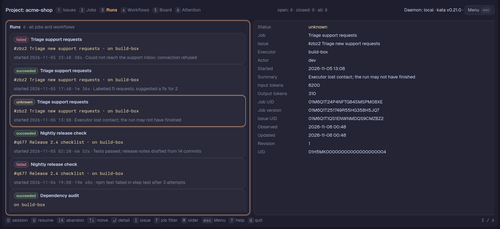

# Runs

`3` in a Project opens the Runs Page. It lists the Project's **Runs**, newest first as kata lists them (by when each was first observed).

A Run is kata's record of one execution of a Cron job or workflow, written by whoever ran it: an adapter, a worker here or another machine's. The Pane shows what kata holds, whoever the executor was.



Each card has:

- a status badge: `running`, `succeeded`, `failed`, `cancelled` or `unknown`;
- the job's or workflow's name;
- the Issue the run is for (`#short title`);
- the executor (its label, else the actor);
- when it started;
- how long it took (so far, while it runs);
- the first line of its summary;
- the reason code, `reason: <code>`, when the summary leads with kata's `reason: <code>` line (or is a hold an earlier tern-kata wrote as `<code>: <detail>`); the summary shown is then the line after it.

## Keys

| Key | Action |
|---|---|
| Enter or Tab | Open the detail; Enter reads the run from kata again |
| Esc or Tab | Back to the list (on the list, Esc first ends a search) |
| `i` | Open the run's Issue on the Issues Page, from the list or the detail (a run with no Issue leaves a Notice) |
| `f` | Narrow the list to the selected run's job, or show every run again |
| `m` | Read the next older 100 runs |
| `/` | Search the loaded runs: type to keep the runs whose status, name, Issue, executor, start, duration, reason, hold or summary holds the text (case-insensitive); Enter keeps the search and returns to the list, Esc ends it and brings every run back. An empty result says so under the search |
| `ctrl+r` | Read the newest page again |
| `o` | Open the omp session of a finished or held run of this machine in a new Tern tab |
| `u` | Resume the selected held run through the worker |
| `A` | Abandon a held run, or cancel a run still running on this machine |
| `n` | Switch to the [since-you-last-looked mode](#since-you-last-looked), or back to the list of every run |
| `s` | In that mode, mark the runs that ended so far as seen (offered only once `seen.toml` was read without error) |

`r` on the [Jobs Page](jobs.md) opens the Runs Page filtered to the selected job.

## Since you last looked

`n` switches the Page to a mode that answers "what ran while I was away". `n` again brings back the list of every run, which stays the default. The mode is remembered for each Project, across Pane restarts.

In the mode the list has two halves around a **Now** line:

- Above it, the runs that ended since you last looked on this machine, newest first and highlighted: succeeded, failed, cancelled, `unknown` and held runs alike. A run still running has not ended and is not listed. A run that ended without an end time counts from when kata last updated it. A Project never marked seen lists every ended run it has read, and says "Nothing new yet." when there is none. While the runs are still being read it says "Loading runs…".
- Below it, the Project's next runs. A native job shows its next time, soonest first, worked out as on the [Jobs Page](jobs.md). An adapter job is listed with no time ("started by the worker"), because only the worker knows when it starts it. A paused, archived or manual job is left out. While the jobs are being read it says "Loading next runs…".

With nothing new the top half is one line, "Nothing new since 08:00." (the time of the last mark, with the date when it was another day).

`s` marks the runs read so far as seen: the highlighted runs leave the list and the mark moves to the end of the newest ended run among them, not to the clock, so a run that ended before the key but was not read yet, or whose executor's clock is behind, still shows as new. With no ended run read the mark stays. The mark is per machine, as kata has nowhere to keep it, so two machines disagree. It is `seen.toml` in tern-kata's config folder, beside `filters.toml`: one table per Project UID.

```toml
["01JABC..."]
seen = 2026-11-07T08:00:00Z
timeline = true
```

`seen` is the last mark and `timeline = true` is the remembered mode. The file is written atomically. A file that cannot be read is left alone: the Page says why in either view, `s` is not offered and nothing is saved until it is fixed.

### Folding

Up to eight new results are listed one by one. With more than eight, one job's ended runs fold into a single row: the job's name, how many runs, their counts by status and when the newest ended. A failed run is never folded: it stays listed by itself, and so does a job's only run. A folded row cannot be selected; `n` brings back the list of every run, where each run can be opened.

`f` narrows the mode to the selected run's job, like the list, and the next runs to that job. `/` searches the new runs (before they fold) and the next runs by job name. `m` still reads older runs.

## Detail

Enter (or Tab) opens the **detail**: status, job and workflow, Issue, executor, actor and teammate, start, end, duration, the reason code, the summary's whole message after its reason line, input and output token counts, and the references kata holds (occurrence, job and workflow uids and the version of each the run used, Issue uid, run uid and revision). At 140 columns and wider the detail sits beside the list, narrower only the focused column shows.

## Reading and filtering

- On the Runs Page `f` narrows the list to the selected run's job, or shows every run again. The filter stays, like the selection and the older runs already read, while another Page is shown and until the Project changes. A run of a workflow alone has no job to narrow to.
- kata lists at most 100 runs a page, filters them only by job (a run that names a workflow alone matches no job, and there is no filter by status or workflow) and names none of them by job or workflow. The Pane reads the newest 100, `m` reads the next older 100 and adds them, and it looks up each job's, workflow's and Issue's name itself. `ctrl+r` and daemon events read the newest page again.
- The [Workflows Page](workflows.md) shows each workflow's latest run on its row and its latest runs in its inspector. It reads the Project's newest 100 runs and then older pages (up to 1000 runs) until every workflow has its latest run and the selected one the five its inspector lists: a workflow whose runs are all older than that shows none.

## Runs of this machine

A run whose executor label is this machine's worker's is also read from the worker's local state, over its control socket. A run of another executor shows only what kata holds.

- A **held** run (the worker could not prove what its agent did) shows the badge `held` and its reason on its card. The detail says why it is held, what the worker knew, whether `u` would be accepted and, when not, why. See [held runs](worker-reference.md#recovery-and-held-runs).
- The detail also lists the run's **steps** (kind, attempt, state, exit status), the **tail of the agent's output** (its last assistant messages, at most 4 KiB), the end of its stderr while it runs or is held, and the omp session id.
- While a run is running the page asks the worker every 2 seconds and reads the newest runs again, so the output grows and the status turns `succeeded` or `failed` without a key.

### Open the session, resume, abandon

- `o` opens the omp session of a finished or held run of this machine in a new Tern tab: `tern new tab --cwd <the run's checkout> -- omp --resume <session id> --session-dir <the run's session folder>`. The tab opens in Tern's session daemon and is not focused; the Notice says it opened. It is refused for a run still running, a run with no session, and a run of another machine. Needs `tern` and `omp` on the Pane's `PATH`.
- `u` resumes the selected **held** run through the worker and `A` abandons it, or cancels a run still running on this machine (the worker stops its agent's process group and records the run cancelled), like `tern-kata worker resume` and `abandon`. The worker's refusal (its Project's lease is held elsewhere, no free slot, the agent's process group is still present) is shown as the Notice. Both are refused for a run that is not held and for a run of another executor.

The Runs Page needs a Project like the Board Page and ends when you switch to a Collection that is not a Project.
