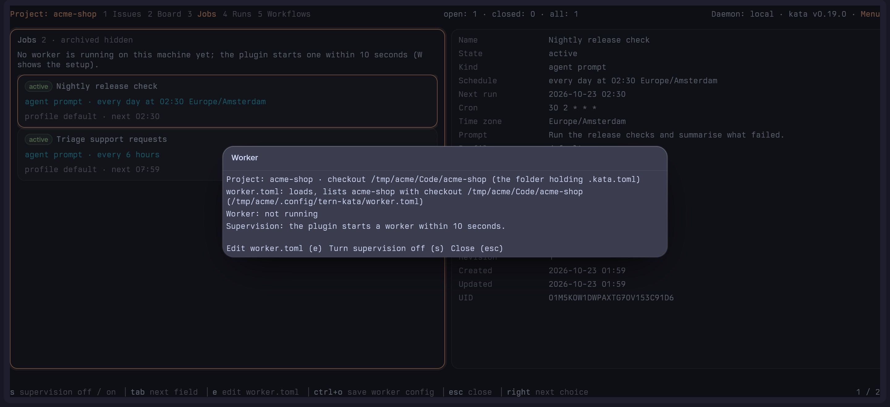

# The worker

kata stores jobs that run an agent prompt on a schedule, and the evidence of each run, but runs none of them. `tern-kata worker` is the adapter that does, on your machine, with no Tern tab or window open.

What it does:

- runs prompt jobs, and the steps of workflow jobs, through [omp](https://github.com/can1357/oh-my-pi) headless in the job's checkout with the job's agent profile (command steps through your shell);
- creates each run's Issue, or comments on the job's existing one;
- records every run in kata as running, then succeeded or failed with a summary and token counts.

What it never does:

- run native jobs (a recurring child kata's daemon delivers);
- send a prompt twice: a run whose outcome is uncertain after a crash is held.

It needs kata v0.19.0 or newer and `omp` on `PATH`. On Windows, workflow command steps also need `sh`, which [Git for Windows](https://gitforwindows.org/) provides.

## Trust

> **Trust.** Anyone who can write jobs in a Project you list in `worker.toml` can run prompts and commands on this machine, as your user, with your files and credentials, and the agent runs unattended (`--approval-mode yolo`) in the checkout the job names. There are no command allowlists and no sandbox. List only Projects whose writers you trust, and keep secrets out of the checkouts a job can name.

## Set it up

Setting up means one file, `worker.toml`, in tern-kata's config folder (`~/.config/tern-kata/worker.toml` on Linux, honouring `$XDG_CONFIG_HOME`, beside `lanes.toml`; `%AppData%\tern-kata\worker.toml` on Windows). The Worker card in the Pane and the `tern-kata worker` commands write it the same way, with the same checks, so use whichever is at hand:

| | From the Pane | From a shell |
|---|---|---|
| First Project | **Set up** | `tern-kata worker init` |
| Another Project | **Serve this Project** | `tern-kata worker add` |
| Change anything else | **Edit** (`e`) | `tern-kata worker edit` |
| Pick up a change | the restart choice | `tern-kata worker stop` |
| Supervision on or off | `s` | `worker.manual` |

Both need a folder bound to a kata Project, the Binding the Pane uses: a `.kata.toml` in the folder or a parent up to the git root (`kata init` creates one). The **checkout** the worker maps for the Project is the folder holding that `.kata.toml`, also when you start from a subdirectory. Neither calls the kata daemon. What they write, and the checks, are in the [reference](worker-reference.md#writing-workertoml).

### From the Pane: the Worker card

`W` on the Jobs Page (from the list or the inspector) opens the Worker card for the Project the Pane's folder is bound to.



It reads this machine once, asks the worker for its status and shows:

- whether `worker.toml` exists, whether the worker's loader accepts it (or why not), and whether it lists the Project, with the checkout it maps;
- whether a worker runs, with its process id, executor and runs in flight;
- whether the plugin supervises it, or `worker.manual` turned that off.

What the card offers depends on the file:

- **No `worker.toml`: Set up.** Executor, actor, command, model and thinking, prefilled as `worker init` would.
- **A file that loads but does not list the Project: Serve this Project.** It does what `worker add` does.
- **Any file: Edit** (`e`). The file opens in `$EDITOR` as a `.toml` file; the text you save is checked and written like the commands do. A refusal names the problem on the card and keeps your text, so `e` again reopens it rather than the file; an unchanged or empty result changes nothing. Edit can repair a file that does not load, which Set up and Serve never overwrite.

Set up and Serve show the checkout and the trust note, and save only when the trust choice is Yes (it starts at No; space, left and right or a click change it). A value the loader refuses is named, with focus on that field, and your input stays. A folder bound to no Project gets a message and no fields. Esc closes the card.

After a save or an edit with a worker running, the card asks how to restart it, since it reads `worker.toml` only at start. **When idle** (`i` or enter, the default) and **now** (`n`) are the two [stop modes](#restarting-and-stopping); the card names the runs in flight. Esc leaves the worker running. Its notice then says whether the plugin starts a fresh worker. With no worker running, the card says the plugin starts one within 10 seconds, or, under `worker.manual`, that you start it.

`s` on the card turns [supervision](#supervision) off or on (when the card draws no fields; otherwise `s` is typed). The Jobs Page banner says per state what is missing (no file, a file that does not load, a Project not listed, no worker running, `worker.manual`) and points at `W`.

### From a shell

Run these in a directory bound to the Project.

```sh
tern-kata worker init                    # writes worker.toml for this Project
tern-kata worker init --executor laptop --actor dangerboi --command omp --model anthropic/claude-sonnet-5-5 --thinking medium
tern-kata worker add                     # in each further Project's directory
tern-kata worker edit                    # change the file by hand
tern-kata worker doctor                  # check the result
```

- **`init`** writes a new file for this Project: its checkout, a `default` profile, capacity 1. The five optional flags set the values the Set up card prefills; one you leave out keeps its default, and a value the loader refuses is refused naming it, with nothing written. It refuses when the file exists (use `add`) or the directory is not bound. It ends by printing the path, a line of the trust note, and that the plugin's host half starts the worker within 10 seconds (else run `tern-kata worker`).
- **`add`** adds this Project to an existing file, with its checkout, and leaves every other line and comment byte for byte as it was. It refuses when there is no file (use `init`), the directory is not bound, or the Project is already listed.
- **`edit`** opens the file in `$VISUAL` (else `$EDITOR`) on a temporary copy. A result that does not load reopens the editor on your text with the problem as `#!` comment lines at the top, until it loads; an unchanged or empty result cancels. It refuses with no file and points at `init`.

After any of them, a running worker reads the new file only after `tern-kata worker stop`; `edit` and `add` say so, and whether a worker runs.

## A two-Project `worker.toml`

After `worker init` in the `acme-shop` checkout and `worker add` in the `acme-infra` checkout, the file reads (comments abridged):

```toml
# Anyone who can write jobs in a listed Project can run prompts and commands
# on this machine as you.
executor = "laptop"
# actor = "dangerboi"

[[projects]]
name      = "acme-shop"
capacity  = 1
checkouts = ["acme-shop"]

[checkouts]
acme-shop = "/home/me/Code/acme-shop"
acme-infra = "/home/me/Code/acme-infra"

[profiles.default]
command = "omp"

[[projects]]
name      = "acme-infra"
capacity  = 1
checkouts = ["acme-infra"]
```

Each `[[projects]]` block lists its own checkout only, so a job in `acme-shop` cannot name the `acme-infra` directory. Every key is described in the [worker reference](worker-reference.md#workertoml).

## Restarting and stopping

`tern-kata worker stop` asks the running worker to stop. It is how a change to `worker.toml` takes effect: the plugin then starts a fresh worker that reads the file. The Pane sends the same request from the restart choice.

- **By default** (when idle) the worker admits nothing new, lets its runs in flight finish and report to kata, and exits with status 0. `tern-kata worker status` says it is stopping and how many runs it waits for.
- **`--now`** ends it at once. The runs it interrupts are held `interrupted` and resumable, as after a terminate signal. A `--now` during a drain upgrades the drain.

The command prints the mode, the runs in flight and whether a fresh worker follows: it does when the plugin supervises this worker; a worker you started by hand, or one under `worker.manual`, stays stopped. The [reference](worker-reference.md#stopping-the-worker) has the refusals and what is kept.

## Supervision

The plugin's host half starts `tern-kata worker` when `worker.toml` exists and keeps it running, inside Tern's session daemon, so no window is needed. You do not start the worker yourself; `tern-kata worker` in a terminal is for a worker you want to watch.

- **Restarts.** It starts the worker again whenever it exits, after 1 second, then 2, 4 and so on up to a minute between tries. A worker that stayed up for a minute starts the count over.
- **When it starts.** When Tern's daemon starts, which a window does on demand and Tern's "Start at login" setting does at login. Nothing starts the daemon at boot or after a quit by itself: with Tern not running, no worker runs.
- **Finding the program.** The host half finds `tern-kata` on the daemon's `PATH` or in the folder the install scripts use (`~/.local/bin`, `%LOCALAPPDATA%\Programs\tern-kata`, `$TERN_KATA_INSTALL_DIR`). It gives the worker the daemon's `PATH` plus those folders, Tern's bundled omp, `~/go/bin` and Homebrew's, so `omp` resolves even when Tern was started from a launcher with a short `PATH`.
- **Logs.** Its log lines (`tern-kata: worker started`, `the worker exited with status ...`) are in Tern's daemon log. `tern-kata worker status` says whether Tern supervises the worker or you started it by hand.

A worker the daemon left running when it stopped keeps running (Tern does not stop its children), so after a daemon restart the host half's new attempts are refused by `worker.lock` until it ends, and then the next attempt starts a worker.

### Turning supervision off

Create an empty `worker.manual` next to `worker.toml`, or press `s` on the Worker card, which does it for you. The host half then starts no worker and looks again every 10 seconds. Deleting `worker.toml` has the same effect. Use it to run the worker from a service of your own (a systemd user unit, a launchd agent).

The marker cannot stop a worker that already runs: create it first, or the host half starts a new one, then run `tern-kata worker stop`. The card writes the marker before the stop request and asks how the running worker stops (when idle or now). Removing the marker, or `s` again, turns supervision on, and the plugin starts the worker within 10 seconds. The card and the Jobs Page banner show the state.

`tern plugin remove tern-kata`, or disabling the plugin in Tern's settings, removes the host half altogether, together with the window half.

## Commands

```sh
tern-kata worker doctor      # checks the file, checkouts, commands, secrets, kata and each Project's lease; says how to fix them
tern-kata worker status      # what it serves, runs and refuses; held runs with their reasons
tern-kata worker             # runs in the foreground; ctrl+c stops it (a supervised worker needs no start)
tern-kata worker stop [--now]
tern-kata run <job-uid>      # run an adapter prompt job now
tern-kata worker resume <run-uid>    # continue a held run in its omp session
tern-kata worker abandon <run-uid>   # give up a held run (kata records it cancelled), stop a running one, or settle one whose local state is lost
```

`tern-kata worker --takeover` moves a Project's lease on purpose (see [state and leases](worker-reference.md#state-and-leases)). `tern-kata --help` lists every command.

See also [Jobs](jobs.md) for making jobs, [Runs](runs.md) for watching them, and the [worker reference](worker-reference.md) for held runs, recovery and the complete `worker.toml` key list.
