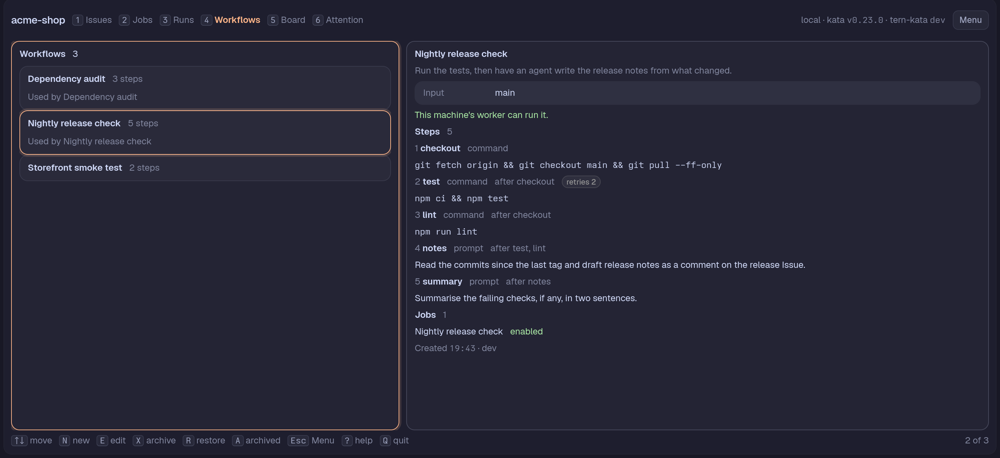

# Workflows

`4` in a Project opens the Workflows Page. It shows the Project's kata **Workflows**, one card each with its name and step count. The heading counts them (`Workflows 2`) and, while archived ones are hidden, says how many (`2 archived hidden`); `a` shows them. With none, the Page reads "No workflows" / "A workflow is a list of steps a job runs." with a **New workflow** button; when every workflow is archived it reads "No workflows" / "All of them are archived." with a **Show archived** button.

The Project is found as the [Board Page](pages-and-board.md#board-page) finds it, and the Page ends when you leave the Project Collection. Esc closes the steps first, then ends a search, then goes to the Menu.



Each card names the jobs that run the workflow (`Used by Hourly report +1`) and shows its latest run (`succeeded · 2026-11-17 10:00`); the inspector lists its latest runs (see [Runs](runs.md#reading-and-filtering)).

## Keys

| Key | Action |
|---|---|
| Enter | Open the inspector for the selected workflow |
| `n` | New workflow (opens the Workflow card) |
| `e` | Edit the selected workflow |
| `ctrl+e` | In the card, edit the JSON in `$VISUAL`, else `$EDITOR`, else `vi` |
| `ctrl+o` | In the card, save |
| `x` | Archive the selected workflow |
| `r` | Restore an archived workflow |
| `a` | Show or hide archived workflows |
| `/` | Search the workflows: type to keep the workflows whose name, step count, using jobs or latest run holds the text (case-insensitive); Enter keeps the search and returns to the list, Esc ends it and brings every workflow back. An empty result says so under the search |

## Inspector

**Enter** opens the inspector for the selected workflow: each step in order with its number and key, its kind in words (`command` or `prompt`), its command or prompt, the steps it waits for (`after review`) and its retries (`retries 2`), the jobs that run it, its latest runs, and `Created by <author>`. A card also names those jobs. Above the steps a line says whether this machine's worker can run the workflow, or lists what it would refuse. The inspector sits beside the list at 140 columns and wider, in place of it in a narrower Pane.

## Workflow card

`n` and `e` open the **Workflow card** on a new workflow or the selected one, as the JSON kata takes:

```json
{"name": "...", "definition": {"version": 1, "steps": [{"key": "review", "kind": "prompt", "prompt": "..."}, {"key": "test", "kind": "command", "command": "make test", "after": ["review"], "retries": 1}]}}
```

Edit it in the card or press `ctrl+e` for your editor; `ctrl+o` saves. The card's buttons are **Save**, **Open in editor** and **Cancel**; leaving a changed text asks "Discard this Draft?" with **Discard Draft** and **Keep editing**.

Saving checks the text first, and nothing is sent while it fails. The check requires:

- valid JSON and a name;
- version 1;
- at least one step;
- unique step keys of letters, digits, `-`, `_` and `.`;
- `after` naming earlier steps only (so steps are listed in the order they run);
- retries from 0 to 100;
- exactly one of `command` or `prompt`, matching the step's kind.

The card names the problem and keeps your text.

A save is a Guarded write on the version you started from. If the workflow changed meanwhile, nothing is written: the card says "Changed since you opened it. Nothing was written; your Draft is kept." and shows your text (**Yours**) beside the workflow as it stands now (**Current**). **Keep mine** (`o`) saves yours over it and **Discard mine** (`d`) drops your text. When the workflow was archived meanwhile, only Discard mine is offered, since a save would bring it back.

## Archive and restore

`x` archives the selected workflow and `r` restores an archived one, both guarded the same way. kata refuses to archive a workflow a live Cron job uses, and the Pane shows its message: "Cannot archive "W": workflow W is used by live job J; update or delete that job first."

To run a workflow on a schedule, make a job whose kind is Workflow on the [Jobs Page](jobs.md). How [the worker](worker-reference.md#workflow-runs) runs the steps is in the worker reference.
